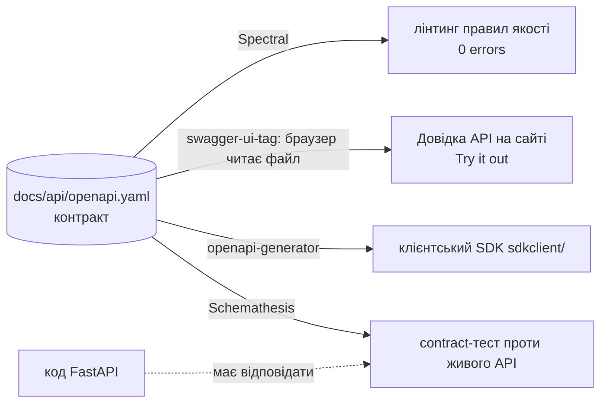

# Рівень 3 · API Docs — як інтегруватися

## Єдине джерело істини (Single Source of Truth)

Формати запитів і відповідей описані **лише в одному файлі** — `docs/api/openapi.yaml` (OpenAPI 3.0.3,
версія контракту в `info.version`, SemVer). З нього без копіювання отримуються всі інші артефакти:

Сторінка [[openapi-reference|довідки]] не містить жодного поля чи прикладу — на ній лише тег
`<swagger-ui src="openapi.yaml">`, а Swagger UI в браузері завантажує сам файл контракту, опублікований поруч.
Тому версія і формати в довідці **фізично не можуть** розійтися з контрактом: іншого джерела немає.
Розходження контракту з **кодом** ловить contract-тест ([[contract-testing]]).

## API-first проти code-first

| | Code-first | **API-first (обрано)** |
|---|---|---|
| Що первинне | код; OpenAPI генерується з анотацій FastAPI (`/openapi.json`) | контракт `openapi.yaml`; код реалізує контракт |
| Коли пишеться контракт | після коду, «як вийшло» | до або разом зі зміною коду, проходить рев'ю як окремий артефакт |
| Узгоджена схема помилок, приклади | лише якщо їх явно задекларовано в коді | обов'язкові, перевіряє Spectral |
| Ризик | контракт змінюється непомітно разом з рефакторингом | дрейф коду від контракту → ловить Schemathesis |

У цьому проєкті FastAPI-схема (`/docs`) лишається допоміжним code-first артефактом для розробника;
зовнішнім контрактом є `openapi.yaml`.

## Що описано в контракті 1.x

| Маршрут | Операція |
|---|---|
| `GET /stations` | `listStations` |
| `GET /stations/{station_id}/availability` | `getStationAvailability` (додано в краш-тесті ЛР№10) |
| `POST /rentals/start` | `startRental` |
| `POST /rentals/{rental_id}/end` | `endRental` |
| `GET /vehicles/{vehicle_id}/state` | `getVehicleState` |

Повний інвентар усіх маршрутів системи (включно з auth, GDPR, admin) — в [[sdd#5-api-контракти|SDD §5]].

## Версіонування та breaking changes

- **PATCH** — уточнення описів і прикладів без зміни схем.
- **MINOR** — additive: новий маршрут, нове необов'язкове поле відповіді, новий код помилки.
- **MAJOR** — breaking: видалення чи перейменування поля, зміна типу, обов'язкове нове поле запиту.
  Breaking-зміна вимагає міграційного гайду в цьому розділі та запису в `CHANGELOG.md`.
  Приклад: [міграційний гайд 1.x → 2.0](migration-guide-v2.md).

Пов'язано: [[openapi-reference]] · [[contract-testing]] · [[sdk]] · [[python-reference]] · [[sdd]] · #api
