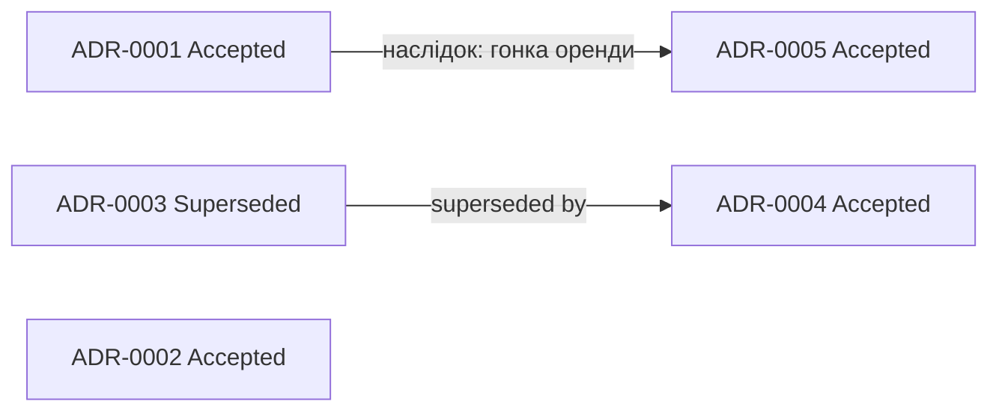

# Кущ архітектурних рішень (ADR)

## Канон ведення

1. **Наскрізна нумерація** `ADR-0001`, `ADR-0002`, …; файл `adr-NNNN-<рішення>.md`. Номери не перевикористовуються.
2. **Життєвий цикл статусу:** `Proposed` → `Accepted` → (`Deprecated` | `Superseded by ADR-NNNN`).
3. **Незмінюваність:** контекст, альтернативи і рішення запису після `Accepted` не редагуються. Нове рішення —
   новий запис; у старому змінюється лише рядок статусу (`Superseded by …`) і поле `adr_status` у front matter.
   При міграції з ЛР№10 у записах 0001–0002 змінено лише відносні шляхи посилань і додано front matter.

## Реєстр

| № | Рішення | Статус | Дата | Зв'язок |
|---|---|---|---|---|
| [0001](adr-0001-postgresql-redis-rabbitmq-storage.md) | PostgreSQL — джерело істини, Redis — гарячий стан, RabbitMQ — телеметрія | Accepted | 2026-09-04 | → 0005 (кандидат з наслідків) |
| [0002](adr-0002-gitops-argo-canary-delivery.md) | GitOps (Argo CD) + canary Argo Rollouts з авто-відкатом | Accepted | 2026-10-26 | — |
| [0003](adr-0003-plain-markdown-doc-passport.md) | Паспорт документації — Markdown у `docs/` + `doc_audit.py` | **Superseded by 0004** | 2026-11-14 | → 0004 |
| [0004](adr-0004-documentation-as-code-mkdocs.md) | Documentation as Code: MkDocs Material, API-first OpenAPI, strict CI, Pages | Accepted | 2026-11-20 | замінює 0003 |
| [0005](adr-0005-row-lock-on-rental-start.md) | `SELECT … FOR UPDATE` при старті оренди | Accepted (Proposed → Accepted за рішенням CCB) | 2026-11-20 | RFC-001 (ЛР№12) |



## Шаблон

```markdown
---
owner: "@login"
status: draft            # стан документа
adr_status: Proposed     # стан рішення
decision_date: YYYY-MM-DD
review_date: YYYY-MM-DD
tags: [architecture, adr]
---
# ADR-NNNN: <рішення>
- **Статус:** Proposed | Accepted | Deprecated | Superseded by ADR-NNNN
## Контекст
## Розглянуті альтернативи
## Рішення
## Наслідки
```

Пов'язано: [[sdd]] · [[isd]] · [[CONTRIBUTING]] · #architecture
