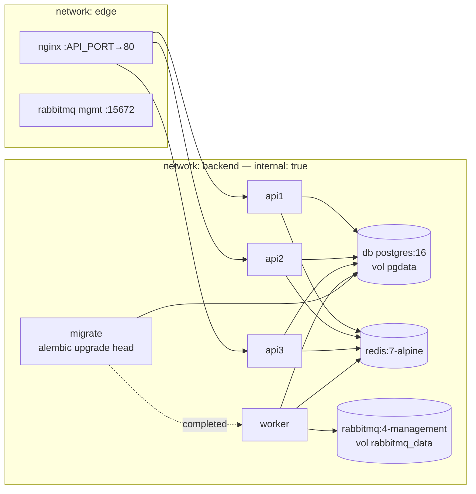
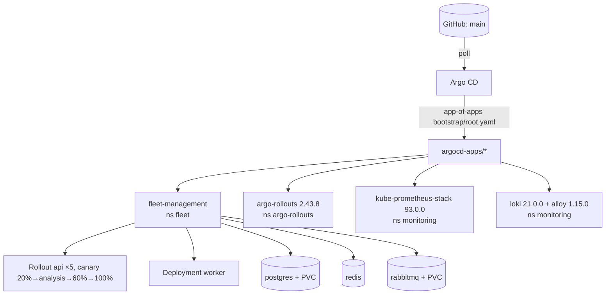
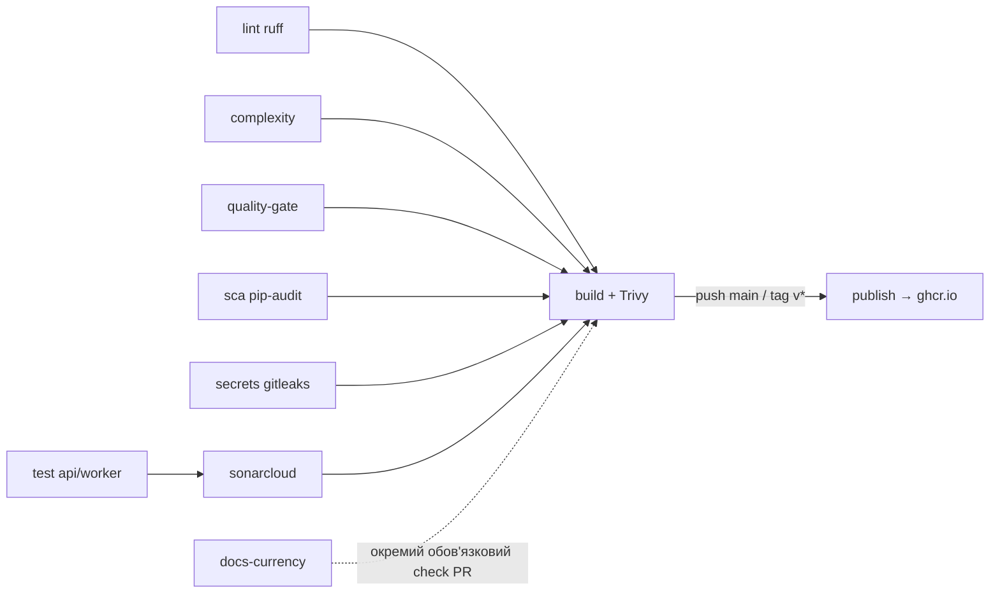
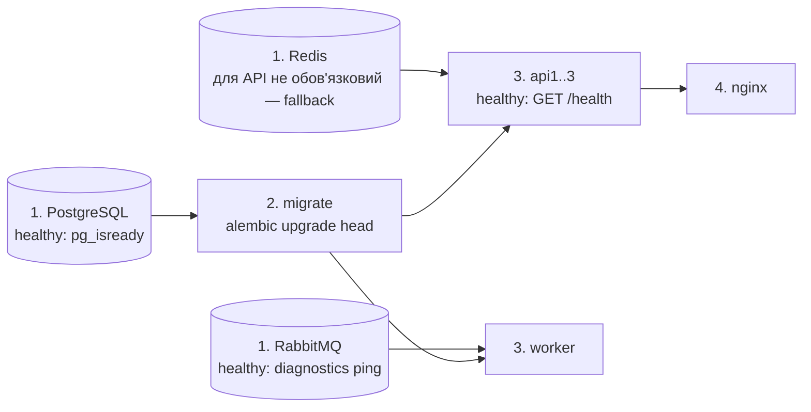

# Infrastructure Specification Document — Fleet Management

**Що це за документ:** *де і на чому* працює система — середовища, топологія розгортання, змінні
оточення, сховища, CI/CD, моніторинг, резервне копіювання. Внутрішня будова компонентів — у
[[sdd|SDD]]; обґрунтування рішень — в [кущі ADR](adr/index.md).

**Зв'язки:** [[sdd]] · [[adr-0001-postgresql-redis-rabbitmq-storage|ADR-0001]] · [[adr-0002-gitops-argo-canary-delivery|ADR-0002]] ·
[[adr-0004-documentation-as-code-mkdocs|ADR-0004]] · [[local-setup]] · [[handover]] · #architecture #ops

## 1. Середовища

| Середовище | Де | Як запускається | Конфігурація | Дані |
|---|---|---|---|---|
| **dev** | ноутбук розробника, Docker Desktop | `docker compose -f docker-compose.yml -f docker-compose.dev.yml up --build` (hot reload `api1`) | `.env` (з `.env.example`) | том `pgdata` проєкту `COMPOSE_PROJECT_NAME` |
| **test** | GitHub Actions (`ubuntu-latest`) і локально | job `test` (service-контейнери `postgres:16`, `redis:7-alpine`); локально — тимчасові контейнери на `55432`/`56379` | `APP_ENV=sandbox`, `TEST_DATABASE_URL`, `TEST_REDIS_URL` | БД `fleet_management_test`, Redis db 15; знищуються після тестів |
| **sandbox** (staging) | один Docker-хост | `docker compose -p fleet_sandbox --env-file .env.sandbox up -d --build` | `.env.sandbox` | БД `fleet_sandbox`, API `:8000` |
| **production** | той самий або окремий хост | `docker compose -p fleet_production --env-file .env.production up -d --build` | `.env.production` | БД `fleet_production`, API `:8080`; `/docs` вимкнено, `DEBUG=false` примусово |
| **k8s (minikube, GitOps)** | minikube, namespace `fleet` | Argo CD синхронізує `charts/fleet-management` + `values-minikube.yaml` з `main` | ConfigMap `<release>-config` (з `values.yaml`), Secret `fleet-secret` (`existingSecret`, створюється вручну) | PVC Postgres і RabbitMQ |

Захисти середовищ у коді (`config.py`): застосунок не стартує, якщо ім'я БД не відповідає `APP_ENV`, а в
production — якщо `DEBUG=true` чи `JWT_SECRET_KEY` слабкий.

### 1.1 Змінні оточення (без секретів)

| Змінна | Сервіси | Значення за замовчуванням / приклад | Секрет? |
|---|---|---|---|
| `APP_ENV` | api, migrate, worker | `sandbox` \| `production` | ні |
| `DEBUG` | api | `false` | ні |
| `APP_NAME`, `APP_VERSION` | api | `Fleet Management`, версія образу (build-arg) | ні |
| `DATABASE_URL` | api, migrate, worker | `postgresql+asyncpg://<user>:<pass>@db:5432/<db>` (складається compose/Helm) | **так** (пароль) |
| `POSTGRES_USER`, `POSTGRES_DB` | db | `fleet_sandbox_user`, `fleet_sandbox` | ні |
| `POSTGRES_PASSWORD` | db | — | **так** |
| `REDIS_URL` | api, worker | `redis://redis:6379/0`; у sandbox — `redis://toxiproxy:26379/0` (`COMPOSE_PROFILES=fault`) | ні |
| `RABBITMQ_URL` | worker | `amqp://<user>:<pass>@rabbitmq:5672/` | **так** |
| `RABBITMQ_DEFAULT_USER` / `_PASS` | rabbitmq | — | **так** (`_PASS`) |
| `TELEMETRY_QUEUE` | worker | `telemetry` | ні |
| `JWT_SECRET_KEY` | api, migrate | — (≥ 32 символи) | **так** |
| `ACCESS_TOKEN_EXPIRE_MINUTES` | api | `30` | ні |
| `RESILIENCE_ENABLED`, `REDIS_ATTEMPT_TIMEOUT_MS`, `REDIS_RETRY_MAX_ATTEMPTS` | api | `true`, `200`, `3` | ні |
| `LIST_CACHE_ENABLED`, `LIST_CACHE_TTL_SECONDS` | api | `true`, `30` | ні |
| `PASSWORD_HASH_WORKERS` | api | `1` (0 = хеш на event loop) | ні |
| `FAIL_RATE` | api | `0` (частка штучних 500 — лише демо поганого релізу) | ні |
| `COMPOSE_PROJECT_NAME`, `API_PORT`, `RABBITMQ_MGMT_PORT`, `NGINX_CONF` | compose | `fleet_management`, `8000`, `15672`, `./nginx/round_robin.conf` | ні |

Секрети живуть лише в `.env.*` (в `.gitignore`), у GitHub Secrets (`SONAR_TOKEN`) та в Secret
`fleet-secret` кластера; у Git вони не потрапляють (перевіряє gitleaks, §5).

<a id="isd-compose"></a>

## 2. Топологія розгортання

### 2.1 Контейнерна (Docker Compose, `docker-compose.yml`)



- Мережа `backend` — `internal: true`: БД, Redis, репліки API і worker недоступні з хоста; назовні
  опубліковано лише nginx (`${API_PORT:-8000}`) і UI RabbitMQ.
- Ліміти ресурсів реплік API: 2 CPU / 512 MiB (`deploy.resources.limits`).
- Профілі: `fault` (toxiproxy між API і Redis, `scripts/fault.py`), `loadtest` (k6).

<a id="isd-startup-order"></a>
**Порядок підняття сервісів (`depends_on` + healthcheck):**

1. `db` (healthy: `pg_isready`), `redis` (healthy: `redis-cli ping`), `rabbitmq` (healthy: `rabbitmq-diagnostics ping`) — паралельно;
2. `migrate` — після `db healthy`; виконує `alembic upgrade head` і завершується (`service_completed_successfully`);
3. `api1`, `api2`, `api3` — після `migrate` completed + `db` і `redis` healthy; healthy = `GET /health`;
4. `worker` — одразу після `migrate` completed + `rabbitmq` і `redis` healthy (**не чекає API**: потрібна лише схема БД);
5. `nginx` — після healthy `api1`, `api2`, `api3`.

Наслідок для експлуатації: worker починає споживати чергу `telemetry` паралельно зі стартом реплік API, тому
збій API більше не блокує запис телеметрії; при діагностиці «worker не стартує» перевіряйте `docker compose logs migrate`.

<a id="isd-k8s"></a>

### 2.2 Kubernetes (minikube) через GitOps



- `bootstrap/root.yaml` — кореневий Application (app-of-apps) на каталог `argocd-apps/`.
- `argocd-apps/fleet-management.yaml`: `automated: {prune: true, selfHeal: true}`, retry 5×
  (backoff 10 с ×2, до 3 хв), `CreateNamespace=true`.
- Образи: `ghcr.io/yakymivdanylo/fleet-management-api:<X.Y.Z>`, `…-worker:<X.Y.Z>`; реліз = зміна
  `image.tag` у `values-minikube.yaml` через PR.
- Secret `fleet-secret` (ключі `POSTGRES_PASSWORD`, `RABBITMQ_DEFAULT_USER`, `RABBITMQ_DEFAULT_PASS`,
  `JWT_SECRET_KEY`) створюється один раз вручну: `kubectl create secret generic fleet-secret -n fleet --from-literal=...`.
- Альтернатива без Argo CD — `helm install fleet charts/fleet-management -f values-dev.yaml|values-prod.yaml`
  ([README чарта](https://github.com/YakymivDanylo/Fleet-management/blob/main/charts/fleet-management/README.md)). Каталог `k8s/` — **deprecated** (див. [[k8s-raw-manifests]]).

### 2.3 Реліз і відкат

| Середовище | Реліз | Відкат |
|---|---|---|
| Compose | `git pull && docker compose -p <env> --env-file .env.<env> up -d --build` | `git checkout <попередній тег> && … up -d --build`; схема — `alembic downgrade -1` (лише якщо міграція оборотна) |
| k8s (Argo CD) | `git tag vX.Y.Z && git push --tags` → CI публікує образ → PR зі зміною `image.tag` | **автоматичний**: AnalysisRun < 95 % успішних відповідей → abort canary; ручний — `git revert` коміту з тегом (Argo CD поверне попередній стан) |
| Helm | `helm upgrade fleet charts/fleet-management --set image.tag=X.Y.Z` | `helm rollback fleet <revision>` |

<a id="isd-images"></a>

## 3. Образи

| Образ | Dockerfile | База | Особливості |
|---|---|---|---|
| `fleet-management-api` | `Dockerfile` (multi-stage) | `python:3.13-slim` | venv у `/opt/venv`, без pip у runtime, користувач `appuser`, `APP_VERSION` build-arg, CMD: `alembic upgrade head && uvicorn` (у compose CMD перевизначено — міграції робить `migrate`) |
| `fleet-management-worker` | `Dockerfile.worker` | `python:3.13-slim` | команда `telemetry-worker` |
| `Dockerfile.metrics` | — | — | лише для CI-гейту coverage + mutation (mutmut, lizard) |

<a id="isd-storage"></a>

## 4. Сховища даних

| Сховище | Версія | Персистентність | Що зберігає | Критичність |
|---|---|---|---|---|
| PostgreSQL | 16 | том `pgdata` / PVC | джерело істини: довідники, оренди, телеметрія, GDPR-журнали | **висока** |
| RabbitMQ | 4-management | том `rabbitmq_data` / PVC | черга `telemetry` (повідомлення в дорозі) | середня |
| Redis | 7-alpine | без тому (in-memory) | похідний гарячий стан і кеш (відновлюється) | низька |

<a id="isd-cicd"></a>

## 5. CI/CD (`.github/workflows/ci.yml`, `hotspots.yml`)

Тригери `ci.yml`: `pull_request` у `main`; `push` у `main`; `push` тегів `v*`. Зміни лише в `docs/**`,
`charts/**`, `argocd-apps/**`, `bootstrap/**` не перезбирають образи (`paths-ignore`).



| Job | Quality Gate (блокує злиття) |
|---|---|
| `test` (matrix api, worker) | усі pytest-тести (unit + integration на Postgres/Redis service-контейнерах), coverage XML |
| `lint` | `ruff check`, `ruff format --check` |
| `complexity` | усі файли аналізовані; CC ≤ 10 на блок (xenon B); Cognitive ≤ 15 (complexipy) |
| `quality-gate` | Line Coverage ≥ 90 % **AND** Mutation Score ≥ 75 % (пінований контейнер `Dockerfile.metrics`) |
| `sca` | `pip-audit` прямих і транзитивних залежностей |
| `secrets` | gitleaks по всій історії |
| `docs-currency` | `scripts/doc_audit.py --strict`: усі API-маршрути описані в SDD, немає битих посилань, документи паспорта існують, не застаріли й не відстали від коду > 20 комітів ([[CONTRIBUTING#definition-of-done-docs-or-dont-merge\|DoD]]) |
| `sonarcloud` | SonarCloud Quality Gate (`sonar-project.properties`) |
| `build` | збірка образів + Trivy (CRITICAL/HIGH, fixable → fail) |
| `publish` | лише `push`: `main` → тег `<sha>` + `latest`; `vX.Y.Z` → тег `X.Y.Z` |

**Конвеєр документації** `.github/workflows/docs.yml` (ЛР№11, кожен push/PR, що змінює `docs/**`, `mkdocs.yml`,
`README.md`): `lint` (markdownlint-cli2) і `api-contract` (Spectral) → `build` (`mkdocs build --strict`, Exit Code 1
на будь-яке попередження) → `deploy` (GitHub Pages, лише `main` або гілка з репозиторної змінної `DOCS_PREVIEW_BRANCH`);
паралельно `review-audit` — перелік прострочених `review_date`. Обґрунтування — [[adr-0004-documentation-as-code-mkdocs|ADR-0004]].

`hotspots.yml` (кожен push/PR): матриця складність × churn за 90 днів → артефакт. Локально ті самі
перевірки — pre-commit (ruff, ruff-format, gitleaks, BOM/LF, check-ast, complexity-gate).

<a id="isd-monitoring"></a>

## 6. Моніторинг і алерти

| Що | Як | Ціль |
|---|---|---|
| Liveness / readiness | `/livez`, `/health` (k8s-проби; compose healthcheck) | перезапуск/виведення з ротації непрацюючої репліки |
| Метрики | `/metrics` → ServiceMonitor (15 с) → Prometheus (`kube-prometheus-stack`) | `http_requests_total`, `http_request_duration_seconds` |
| Дашборд | ConfigMap з Grafana-дашбордом (`charts/.../dashboards/fleet-management.json`) | RPS, частка 5xx, p95 за репліками |
| Логи | JSON-логи з correlation id і санітайзером PII → Alloy → Loki | пошук за `request_id`/`correlation_id` |
| Алерти | [[alert-catalog\|каталог алертів]] ALR-01…: PrometheusRule (5xx > 5 % за 1 хв), БД, свіжість копій, restore drill — кожен з runbook | реакція за [[maintenance-plan#матриця-ескалації\|матрицею ескалації]] |
| Canary-аналіз | AnalysisTemplate `fleet-management-success-rate`: успішних ≥ 95 %, 4 виміри по 30 с, `failureLimit: 1` | автоматичний відкат поганого релізу |
| Compose | `docker compose ps` (health), `python scripts/docker_stats.py` | — |

<a id="isd-backup"></a>

## 7. Резервне копіювання (backup policy)

Політика ЛР№12. Операційні кроки — у [[RB-001|runbook RB-001]]; тут — *що*, *як часто* і *чому*.

### 7.1 Обсяг даних

| Дані | Сховище | Обсяг зараз (sandbox, 2026-11-20) | Модель production | Бекап |
|---|---|---|---|---|
| Довідники, оренди, користувачі, GDPR-журнали | PostgreSQL | < 1 МБ | десятки МБ | **так** — джерело істини |
| Історія телеметрії `telemetry_readings` | PostgreSQL | 11 тис. рядків, 1,6 МБ на диску; дамп ~12 Б/рядок | 200 авто × 1 показ/10 с = 1,73 млн рядків/добу ≈ 260 МБ/добу на диску, ≈ 21 МБ/добу в дампі; 90 днів ≈ 1,9 ГБ дампу | **так** |
| Черга `telemetry` | RabbitMQ | секунди потоку | — | лише definitions (черги, користувачі) |
| `vehicle:{id}:state`, кеш списків | Redis | КБ | — | **ні** — похідні дані, відновлюються worker'ом і fallback на PostgreSQL ([[adr-0001-postgresql-redis-rabbitmq-storage\|ADR-0001]]) |
| Конфігурація, маніфести, контракт | Git | — | — | Git = копія (GitHub + клони) |

Вимір: `pg_database_size` = 9,98 МБ, дамп `pg_dump -Fc` = 131 КіБ (`docs/lab12/evidence/restore_drill_01.txt`).

### 7.2 Розклад, типи копій, retention, шифрування

| Тип | Як | Коли | Зберігання (retention) | Стан |
|---|---|---|---|---|
| **Повна логічна** | `python scripts/db_backup.py backup` (`pg_dump -Fc` + SHA-256) | щодня 02:00 UTC + **перед кожним релізом з міграцією** (Release Checklist) | 7 щоденних + 4 тижневі (`db_backup.py prune`) | реалізовано |
| **Інкрементна** (PITR) | безперервне архівування WAL (`archive_mode=on`, `archive_timeout=300`) поверх щотижневого `pg_basebackup` | безперервно / щонеділі 03:00 UTC | WAL — 7 днів, base backup — 4 тижні | **заплановано** ([[maintenance-plan]], пріоритет P2): знижує RPO з 24 год до 5 хв |
| Definitions RabbitMQ | `rabbitmqctl export_definitions` | при зміні черг | у Git поруч з чартом | вручну |

**Шифрування.** У спокої на хості — шифрований том; копія, що покидає хост, шифрується асиметрично
`age -r <public key команди>` (приватний ключ — у сховищі секретів, не на хості бекапів); у транзиті — TLS
об'єктного сховища. Цілісність — `.sha256` поруч з кожною копією; `restore` і `drill` відмовляються працювати з
пошкодженою копією.

**Правило 3-2-1:**

| | Копія | Носій | Де |
|---|---|---|---|
| 1 | робоча БД (том `pgdata` / PVC) | диск хоста БД | майданчик |
| 2 | `backups/fleet_*.dump` | окремий диск хоста бекапів (інший тип носія) | майданчик |
| 3 | зашифрована копія `*.dump.age` | об'єктне сховище (S3-сумісне, версіонування + object lock 30 днів) | **поза майданчиком**, інший регіон |

<a id="isd-restore-drill"></a>

### 7.3 Restore drill — тестове відновлення

Копія, з якої ніколи не відновлювались, копією не вважається. Тому щомісяця (1-й робочий день, 10:00 UTC) і після
кожної зміни схеми бекапу: `python scripts/db_backup.py drill` — свіжа копія відновлюється в одноразовий контейнер
`postgres:16-alpine`, кожна таблиця порівнюється з джерелом (append-only таблиці — в межах лічильників до/після дампу),
перевіряється head Alembic, фіксується час `pg_restore` (складова RTO). Критерій — `restore drill: PASS`; FAIL =
інцидент SEV-2 (у нас немає робочої копії).

| Дата (UTC) | Копія | Таблиць | Час `pg_restore` | Результат | Хто |
|---|---|---|---|---|---|
| 2026-11-14 | ручний `pg_dump`/`pg_restore` (ЛР№10) | — | — | PASS (дані відновлено) | @YakymivDanylo |
| 2026-11-20 11:50 | `fleet_20261120T115013Z.dump`, 131 КіБ | 13 | 0,4 с | **PASS** (`docs/lab12/evidence/restore_drill_01.txt`) | @YakymivDanylo |

<a id="isd-operations"></a>

## 8. Експлуатаційний пакет: розгортання, оновлення, відновлення після відмови

### 8.1 Розгортання версії (compose)

```powershell
git fetch --tags; git checkout vX.Y.Z
docker compose -p fleet_production --env-file .env.production up -d --build
docker compose -p fleet_production --env-file .env.production ps              # усі healthy
curl -s http://localhost:8080/health                                          # {"status":"ok","db":"connected"}
curl -s http://localhost:8080/version                                         # = X.Y.Z
```

Health-перевірка вбудована: репліки API стають `healthy` лише після успішного `GET /health` (`SELECT 1` у БД),
nginx стартує лише після трьох healthy реплік ([порядок старту](#isd-startup-order)).

### 8.2 Оновлення з міграціями

1. Прочитати запис релізу в `CHANGELOG.md` (чи є міграція схеми, чи вона зворотна).
2. **Резервна копія перед міграцією**: `python scripts/db_backup.py backup` (пункт Release Checklist).
3. `docker compose … up -d --build` — одноразовий сервіс `migrate` виконує `alembic upgrade head` **до** старту реплік
   API і worker; якщо міграція падає, нова версія застосунку не стартує.
4. Перевірити `select version_num from alembic_version` = head нової версії.
5. Відкат: зворотна міграція — `docker compose … run --rm migrate alembic downgrade -1` і попередній тег; незворотна —
   [[RB-001]] з копії кроку 2.

### 8.3 Відновлення після відмови — порядок підняття

Сервіси піднімаються **за залежностями знизу вгору**; кожен наступний крок — лише після healthy попереднього:



```powershell
docker compose -p fleet_production --env-file .env.production up -d db redis rabbitmq
docker compose -p fleet_production --env-file .env.production up -d migrate        # дочекатися Exit 0
docker compose -p fleet_production --env-file .env.production up -d api1 api2 api3 worker
docker compose -p fleet_production --env-file .env.production up -d nginx
```

Якщо БД не піднімається (пошкоджений том) — [[RB-001]], розділ «Повне відновлення».

<a id="isd-rto-rpo"></a>

### 8.4 Цільові RTO і RPO — розрахунок

**RTO** (за який час система має повернутися в стрій) = виявлення + діагностика + відновлення + верифікація:

| Складова | Обґрунтування | Хв |
|---|---|---|
| Виявлення | алерт `ALR-02` спрацьовує через 2 хв недоступності + доставка on-call | 5 |
| Діагностика й рішення | логи `db`, спроба перезапуску, вибір копії (RB-001) | 10 |
| Відновлення | `pg_restore` 131 КіБ = 0,4 с (drill 2026-11-20); модель 1,9 ГБ при ~20–50 МБ/с з перебудовою індексів ≈ 2–5 хв + підняття застосунку за §8.3 ≈ 2 хв | 7 |
| Верифікація | таблиця «Верифікація» RB-001 | 5 |
| Запас | | 3 |
| **RTO** | | **30 хв** |

**RPO** (скільки даних дозволено втратити) визначається частотою копій: щоденна повна копія → у найгіршому випадку
втрачається все з моменту останньої копії, тобто **RPO = 24 год**; перед релізами з міграцією — **0** (копія робиться
безпосередньо перед зміною). Для каршерінгу 24 год оренд — забагато (оренди довелося б відновлювати вручну), тому ціль
після впровадження WAL-архівування (§7.2) — **RPO ≤ 5 хв** (`archive_timeout=300`).

| Сховище | RPO | RTO |
|---|---|---|
| PostgreSQL | 24 год (ціль 5 хв) | 30 хв |
| RabbitMQ | повідомлення в дорозі ≤ 1 хв (at-least-once від сенсорів) | 10 хв |
| Redis | n/a (похідні дані) | 0 — fallback на PostgreSQL одразу |
| Git / GitOps | 0 | 15 хв (re-sync Argo CD) |

Узгодженість з SLO: RTO 30 хв вкладається в місячний бюджет помилок доступності (216 хв, [[slo-policy]]), але один
такий інцидент з'їдає ~14 % бюджету.
