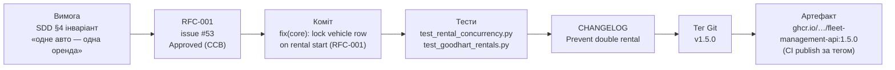

# Release Checklist (go / no-go)

Реліз іде в production лише коли **всі** пункти «go». Будь-який «no-go» = реліз переноситься; рішення фіксується в
issue RFC. Чек-лист — продовження Definition of Done ([[CONTRIBUTING#definition-of-done-docs-or-dont-merge|DoD]]).

| # | Критерій | Як перевірити | Go, якщо |
|---|---|---|---|
| 1 | Тести зелені | CI `Build & Test` (api, worker), `quality-gate`, локально `pytest tests` | 0 failed; coverage ≥ 90 % AND mutation ≥ 75 % |
| 2 | Контракт і документація | конвеєр `Docs` (markdownlint, Spectral, strict build); Schemathesis | 0 errors / 0 failures |
| 3 | Міграції перевірені на staging | `docker compose -p fleet_sandbox … up -d --build` → `migrate` Exit 0 → `alembic downgrade -1 && upgrade head` | обидва напрямки проходять, або міграцій немає |
| 4 | Резервна копія перед релізом | `python scripts/db_backup.py backup && python scripts/db_backup.py check` | `backup freshness: PASS` |
| 5 | CHANGELOG і документація оновлені | запис у `CHANGELOG.md`, SDD/ISD/ADR/`openapi.yaml` за Impact Analysis | рев'ю власника (CODEOWNERS) |
| 6 | Моніторинг і алерти | [[alert-catalog]]: ALR-01..04 активні; дашборд Grafana відкрито | алерти «зелені» до релізу |
| 7 | Runbook відкату під руками | план відкату з RFC + [[RB-001]] | виконавець знає команду відкату і критерій |
| 8 | Бюджет помилок | [[slo-policy]] | change freeze **не діє** або зміна — термінова, схвалена CCB |
| 9 | Комунікація | повідомлення в `#fleet-incidents` і статус-сторінці за 24 год до вікна; хто on-call під час вікна | надіслано, on-call підтвердив |
| 10 | Рішення CCB | issue RFC з міткою `rfc:approved`, умови виконано | усі умови протоколу ✅ |

## Застосування до RFC-001 (реліз API 1.0.1)

| # | Стан | Доказ |
|---|---|---|
| 1 | ✅ go | `pytest tests` — усі тести зелені, включно з `test_rental_concurrency.py` (`docs/lab12/evidence/rfc001_tests_after.txt`) |
| 2 | ✅ go | Spectral 0 errors (контракт 1.0.1); Schemathesis — 0 failures (`docs/lab12/evidence/rfc001_contract.txt`) |
| 3 | ✅ go | міграцій немає (Impact Analysis, рівень 5) |
| 4 | ✅ go | `db_backup.py backup` + `check` → PASS (`docs/lab12/evidence/restore_drill_01.txt`) |
| 5 | ✅ go | CHANGELOG «Prevent double rental of the same car»; SDD §4, ADR-0005 Accepted, `openapi.yaml` 1.0.1 |
| 6 | ✅ go | ALR-01 у чарті; ALR-03/04 — скрипти |
| 7 | ✅ go | RFC-001 §4: `git revert` + редеплой, міграцій немає |
| 8 | ✅ go | бюджет не витрачено (CCB) |
| 9 | ✅ go | оголошення вікна 2026-11-21 22:00–23:00 UTC в issue #53 |
| 10 | ✅ go | [[CCB-2026-11-20]]: погоджено з умовами, умови 1–5 виконано |

## Ланцюг простежуваності релізу

Конкретні ідентифікатори (хеш коміту, тег, digest образу) — у [звіті ЛР№12](../lab12/REPORT.md#ланцюг-простежуваності).

Пов'язано: [[RFC-001]] · [[CCB-2026-11-20]] · [[RB-001]] · #ops
