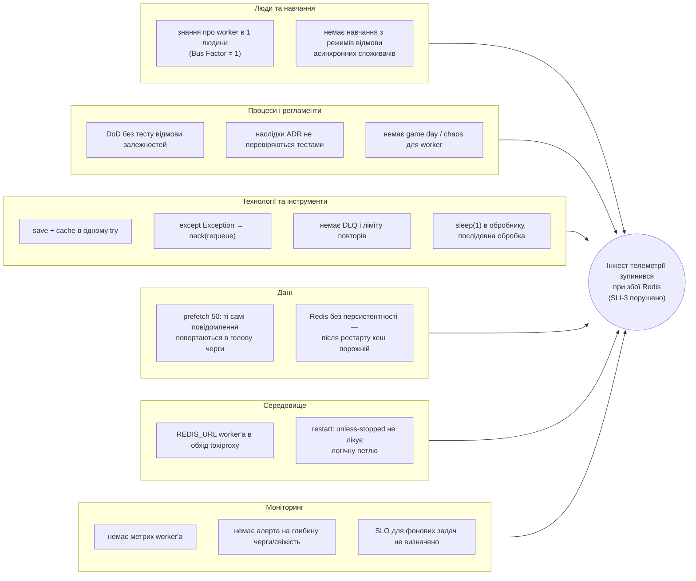

# PM-001 · Blameless Post-Mortem: Redis зупинив інжест телеметрії

**Принцип.** Аналізуємо системи і процеси, а не людей: автор коду, рев'юер і черговий діяли в межах того, що
дозволяли процес та інструменти. «Покарання за чесний звіт гарантує, що наступний звіт буде брехливим.»
Факти — [[INC-001]]; знання про компонент — [[telemetry-worker]].

## Що сталося (коротко)

Redis — похідний кеш стану авто ([[adr-0001-postgresql-redis-rabbitmq-storage|ADR-0001]]) — став недоступним.
Замість деградації до «пишемо в PostgreSQL без кешу» `telemetry-worker` перестав записувати телеметрію взагалі: черга
виросла до 520 повідомлень, свіжість даних у джерелі істини — до 104 с, SLI-3 порушено. Даних не втрачено.

## Що спрацювало добре

- API деградував правильно: fallback на PostgreSQL, `degraded=true`, 0 помилок 5xx (SLI-1 не зачеплено).
- Ідемпотентний INSERT (`ON CONFLICT DO NOTHING`) зробив повтори безпечними: 0 дублікатів, 0 втрат.
- Після усунення тригера черга спорожнилась за 11 с.

## «5 Чому» — від симптому до процесної причини

| # | Питання | Відповідь | Доказ |
|---|---|---|---|
| 1 | Чому телеметрія в PostgreSQL застаріла (SLI-3, lag 104 с)? | worker перестав додавати нові показники: після 12:12:23 кількість рядків не змінювалась, хоча черга росла | проба: `rows` = 17190 з 12:12:23 до 12:13:12; `ready` 230 → 470 |
| 2 | Чому worker перестав їх додавати? | кожне повідомлення завершувалось `nack(requeue=True)` після паузи 1 с, тож ті самі 50 повідомлень prefetch ходили по колу, а нові не діставались до обробки | 49 × `Failed to process telemetry, requeueing` за 3 хв (`incident_actions.log`); `worker.py`, `handle_message`: `except Exception` → `asyncio.sleep(NACK_DELAY_SECONDS)` → `nack(requeue=True)` |
| 3 | Чому обробка «падала», хоча запис у БД вдавався? | збереження в PostgreSQL і оновлення кешу Redis стоять в **одному** `try`; помилка кешу (`ConnectionError redis:6379`) трактується як провал обробки всього повідомлення | `worker.py` (коміт `b18d110`): `save_reading(…)` і `update_vehicle_state(…)` під одним `try`; лог `redis.exceptions.ConnectionError: Error -3 connecting to redis:6379` |
| 4 | Чому збій некритичної залежності вважався фатальним? | обробка помилок має одну категорію «інфраструктурна помилка → повтор» без розрізнення критичності залежностей, і саме цю поведінку **закріпив тест** як правильну | `tests/integration/test_telemetry_worker.py::test_infrastructure_failure_requeues_message` — недоступний **Redis** → очікується `('nack', True)` |
| 5 | Чому дизайн і тест суперечать ADR-0001 («Redis — похідні дані, втрата не критична») і це не помітили 2 місяці? | **процес не перетворює наслідки ADR на перевірки**: Definition of Done і рев'ю не вимагають тесту відмови кожної залежності для кожного асинхронного споживача з урахуванням її критичності; fault-injection ЛР№2 покривав лише API, бо `REDIS_URL` worker'а в compose йде в обхід toxiproxy; алерта і SLO на інжест не існувало | DoD у `CONTRIBUTING.md` до ЛР№12 — без пункту про режими відмови; `docker-compose.yml`: worker `REDIS_URL: redis://redis:6379/0` (не через toxiproxy); каталог алертів до ЛР№12 — лише `FleetHighErrorRate` |

**Коренева причина (процес):** у життєвому циклі змін немає кроку «матриця відмов залежностей → тест», що зв'язує
критичність залежності з ADR з очікуваною поведінкою кожного споживача; тому неправильна поведінка була закодована,
протестована як правильна і пройшла рев'ю. **Супутня причина виявлення:** для фонового конвеєра не було SLI/SLO і
алерта — збій бачить лише людина.

## Діаграма Ісікави

| Категорія | Гіпотеза | Підтверджено? | Доказ |
|---|---|---|---|
| Технології | спільний `try` для БД і кешу | ✅ | код `worker.py`, регресійний тест падає |
| Технології | requeue на голову черги блокує нові повідомлення | ✅ | `rows` не росте після рестарту worker'а (12:12:23–12:13:12) |
| Процеси | тест закріплював дефект | ✅ | `test_infrastructure_failure_requeues_message` |
| Середовище | fault-injection не покривав worker | ✅ | `docker-compose.yml` (REDIS_URL worker'а) |
| Моніторинг | виявлення лише вручну | ✅ | каталог алертів до ЛР№12; `incident_actions.log` «manual, no alert exists» |
| Дані | порожній кеш після рестарту Redis подовжує деградацію | ❌ відкинуто | після старту Redis `source=cache` вже через 11 с — кеш наповнюється наступним показником |
| Люди | «розробник не подумав про Redis» | ❌ **не причина** — висновок про процес (рядок 5), не про людину | — |

Дії — [[CAPA-001]].

Пов'язано: [[INC-001]] · [[telemetry-worker]] · [[maintenance-plan]] · #ops
