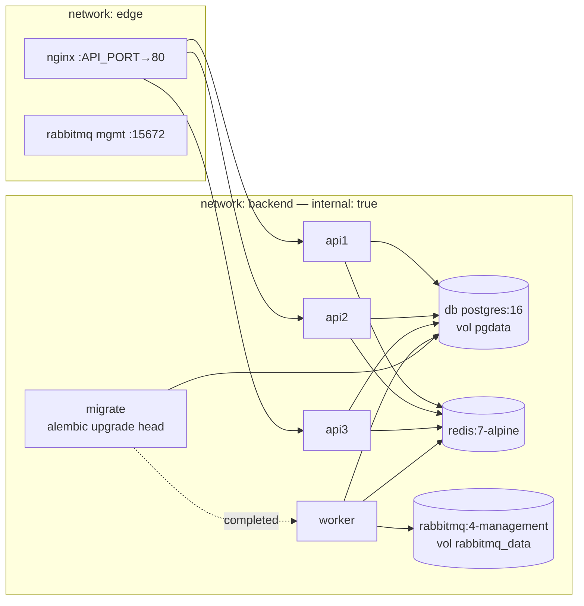
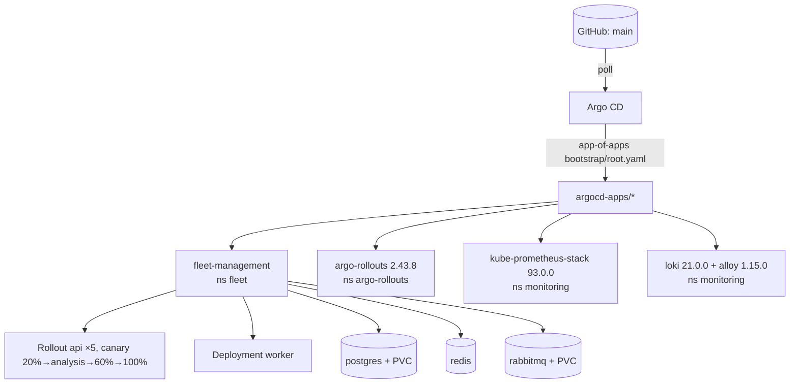
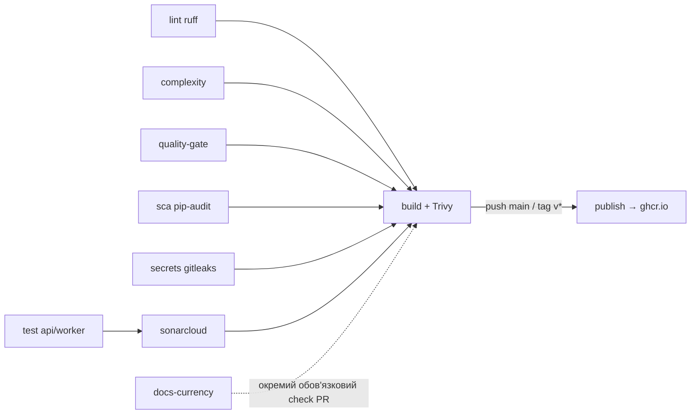

# Infrastructure Specification Document — Fleet Management

**Що це за документ:** *де і на чому* працює система — середовища, топологія розгортання, змінні
оточення, сховища, CI/CD, моніторинг, резервне копіювання. Внутрішня будова компонентів — у
[SDD](sdd.md); обґрунтування рішень — в [ADR](architecture/adr/).

## 1. Середовища

| Середовище | Де | Як запускається | Конфігурація | Дані |
|---|---|---|---|---|
| **dev** | ноутбук розробника, Docker Desktop | `docker compose -f docker-compose.yml -f docker-compose.dev.yml up --build` (hot reload `api1`) | `.env` (з `.env.example`) | том `pgdata` проєкту `COMPOSE_PROJECT_NAME` |
| **test** | GitHub Actions (`ubuntu-latest`) і локально | job `test` (service-контейнери `postgres:16`, `redis:7-alpine`); локально — тимчасові контейнери на `55432`/`56379` | `APP_ENV=sandbox`, `TEST_DATABASE_URL`, `TEST_REDIS_URL` | БД `fleet_management_test`, Redis db 15; знищуються після тестів |
| **sandbox** (staging) | один Docker-хост | `docker compose -p fleet_sandbox --env-file .env.sandbox up -d --build` | `.env.sandbox` | БД `fleet_sandbox`, API `:8000` |
| **production** | той самий або окремий хост | `docker compose -p fleet_production --env-file .env.production up -d --build` | `.env.production` | БД `fleet_production`, API `:8080`; `/docs` вимкнено, `DEBUG=false` примусово |
| **k8s (minikube, GitOps)** | minikube, namespace `fleet` | Argo CD синхронізує `charts/fleet-management` + `values-minikube.yaml` з `main` | ConfigMap `<release>-config` (з `values.yaml`), Secret `fleet-secret` (`existingSecret`, створюється вручну) | PVC Postgres і RabbitMQ |

Захисти середовищ у коді (`config.py`): застосунок не стартує, якщо ім'я БД не відповідає `APP_ENV`, а в
production — якщо `DEBUG=true` чи `JWT_SECRET_KEY` слабкий.

### 1.1 Змінні оточення (без секретів)

| Змінна | Сервіси | Значення за замовчуванням / приклад | Секрет? |
|---|---|---|---|
| `APP_ENV` | api, migrate, worker | `sandbox` \| `production` | ні |
| `DEBUG` | api | `false` | ні |
| `APP_NAME`, `APP_VERSION` | api | `Fleet Management`, версія образу (build-arg) | ні |
| `DATABASE_URL` | api, migrate, worker | `postgresql+asyncpg://<user>:<pass>@db:5432/<db>` (складається compose/Helm) | **так** (пароль) |
| `POSTGRES_USER`, `POSTGRES_DB` | db | `fleet_sandbox_user`, `fleet_sandbox` | ні |
| `POSTGRES_PASSWORD` | db | — | **так** |
| `REDIS_URL` | api, worker | `redis://redis:6379/0`; у sandbox — `redis://toxiproxy:26379/0` (`COMPOSE_PROFILES=fault`) | ні |
| `RABBITMQ_URL` | worker | `amqp://<user>:<pass>@rabbitmq:5672/` | **так** |
| `RABBITMQ_DEFAULT_USER` / `_PASS` | rabbitmq | — | **так** (`_PASS`) |
| `TELEMETRY_QUEUE` | worker | `telemetry` | ні |
| `JWT_SECRET_KEY` | api, migrate | — (≥ 32 символи) | **так** |
| `ACCESS_TOKEN_EXPIRE_MINUTES` | api | `30` | ні |
| `RESILIENCE_ENABLED`, `REDIS_ATTEMPT_TIMEOUT_MS`, `REDIS_RETRY_MAX_ATTEMPTS` | api | `true`, `200`, `3` | ні |
| `LIST_CACHE_ENABLED`, `LIST_CACHE_TTL_SECONDS` | api | `true`, `30` | ні |
| `PASSWORD_HASH_WORKERS` | api | `1` (0 = хеш на event loop) | ні |
| `FAIL_RATE` | api | `0` (частка штучних 500 — лише демо поганого релізу) | ні |
| `COMPOSE_PROJECT_NAME`, `API_PORT`, `RABBITMQ_MGMT_PORT`, `NGINX_CONF` | compose | `fleet_management`, `8000`, `15672`, `./nginx/round_robin.conf` | ні |

Секрети живуть лише в `.env.*` (в `.gitignore`), у GitHub Secrets (`SONAR_TOKEN`) та в Secret
`fleet-secret` кластера; у Git вони не потрапляють (перевіряє gitleaks, §5).

<a id="isd-compose"></a>
## 2. Топологія розгортання

### 2.1 Контейнерна (Docker Compose, `docker-compose.yml`)



- Мережа `backend` — `internal: true`: БД, Redis, репліки API і worker недоступні з хоста; назовні
  опубліковано лише nginx (`${API_PORT:-8000}`) і UI RabbitMQ.
- Ліміти ресурсів реплік API: 2 CPU / 512 MiB (`deploy.resources.limits`).
- Профілі: `fault` (toxiproxy між API і Redis, `scripts/fault.py`), `loadtest` (k6).

<a id="isd-startup-order"></a>
**Порядок підняття сервісів (`depends_on` + healthcheck):**

1. `db` (healthy: `pg_isready`), `redis` (healthy: `redis-cli ping`), `rabbitmq` (healthy: `rabbitmq-diagnostics ping`) — паралельно;
2. `migrate` — після `db healthy`; виконує `alembic upgrade head` і завершується (`service_completed_successfully`);
3. `api1`, `api2`, `api3` — після `migrate` completed + `db` і `redis` healthy; healthy = `GET /health`;
4. `worker` — одразу після `migrate` completed + `rabbitmq` і `redis` healthy (**не чекає API**: потрібна лише схема БД);
5. `nginx` — після healthy `api1`, `api2`, `api3`.

Наслідок для експлуатації: worker починає споживати чергу `telemetry` паралельно зі стартом реплік API, тому
збій API більше не блокує запис телеметрії; при діагностиці «worker не стартує» перевіряйте `docker compose logs migrate`.

<a id="isd-k8s"></a>
### 2.2 Kubernetes (minikube) через GitOps



- `bootstrap/root.yaml` — кореневий Application (app-of-apps) на каталог `argocd-apps/`.
- `argocd-apps/fleet-management.yaml`: `automated: {prune: true, selfHeal: true}`, retry 5×
  (backoff 10 с ×2, до 3 хв), `CreateNamespace=true`.
- Образи: `ghcr.io/yakymivdanylo/fleet-management-api:<X.Y.Z>`, `…-worker:<X.Y.Z>`; реліз = зміна
  `image.tag` у `values-minikube.yaml` через PR.
- Secret `fleet-secret` (ключі `POSTGRES_PASSWORD`, `RABBITMQ_DEFAULT_USER`, `RABBITMQ_DEFAULT_PASS`,
  `JWT_SECRET_KEY`) створюється один раз вручну: `kubectl create secret generic fleet-secret -n fleet --from-literal=...`.
- Альтернатива без Argo CD — `helm install fleet charts/fleet-management -f values-dev.yaml|values-prod.yaml`
  ([README чарта](../charts/fleet-management/README.md)). Каталог `k8s/` — **deprecated** (див. `k8s/README.md`).

### 2.3 Реліз і відкат

| Середовище | Реліз | Відкат |
|---|---|---|
| Compose | `git pull && docker compose -p <env> --env-file .env.<env> up -d --build` | `git checkout <попередній тег> && … up -d --build`; схема — `alembic downgrade -1` (лише якщо міграція оборотна) |
| k8s (Argo CD) | `git tag vX.Y.Z && git push --tags` → CI публікує образ → PR зі зміною `image.tag` | **автоматичний**: AnalysisRun < 95 % успішних відповідей → abort canary; ручний — `git revert` коміту з тегом (Argo CD поверне попередній стан) |
| Helm | `helm upgrade fleet charts/fleet-management --set image.tag=X.Y.Z` | `helm rollback fleet <revision>` |

<a id="isd-images"></a>
## 3. Образи

| Образ | Dockerfile | База | Особливості |
|---|---|---|---|
| `fleet-management-api` | `Dockerfile` (multi-stage) | `python:3.13-slim` | venv у `/opt/venv`, без pip у runtime, користувач `appuser`, `APP_VERSION` build-arg, CMD: `alembic upgrade head && uvicorn` (у compose CMD перевизначено — міграції робить `migrate`) |
| `fleet-management-worker` | `Dockerfile.worker` | `python:3.13-slim` | команда `telemetry-worker` |
| `Dockerfile.metrics` | — | — | лише для CI-гейту coverage + mutation (mutmut, lizard) |

<a id="isd-storage"></a>
## 4. Сховища даних

| Сховище | Версія | Персистентність | Що зберігає | Критичність |
|---|---|---|---|---|
| PostgreSQL | 16 | том `pgdata` / PVC | джерело істини: довідники, оренди, телеметрія, GDPR-журнали | **висока** |
| RabbitMQ | 4-management | том `rabbitmq_data` / PVC | черга `telemetry` (повідомлення в дорозі) | середня |
| Redis | 7-alpine | без тому (in-memory) | похідний гарячий стан і кеш (відновлюється) | низька |

<a id="isd-cicd"></a>
## 5. CI/CD (`.github/workflows/ci.yml`, `hotspots.yml`)

Тригери `ci.yml`: `pull_request` у `main`; `push` у `main`; `push` тегів `v*`. Зміни лише в `docs/**`,
`charts/**`, `argocd-apps/**`, `bootstrap/**` не перезбирають образи (`paths-ignore`).



| Job | Quality Gate (блокує злиття) |
|---|---|
| `test` (matrix api, worker) | усі pytest-тести (unit + integration на Postgres/Redis service-контейнерах), coverage XML |
| `lint` | `ruff check`, `ruff format --check` |
| `complexity` | усі файли аналізовані; CC ≤ 10 на блок (xenon B); Cognitive ≤ 15 (complexipy) |
| `quality-gate` | Line Coverage ≥ 90 % **AND** Mutation Score ≥ 75 % (пінований контейнер `Dockerfile.metrics`) |
| `sca` | `pip-audit` прямих і транзитивних залежностей |
| `secrets` | gitleaks по всій історії |
| `docs-currency` | `scripts/doc_audit.py --strict`: усі API-маршрути описані в SDD, немає битих посилань, документи паспорта існують, не застаріли й не відстали від коду > 20 комітів ([регламент](maintenance.md)) |
| `sonarcloud` | SonarCloud Quality Gate (`sonar-project.properties`) |
| `build` | збірка образів + Trivy (CRITICAL/HIGH, fixable → fail) |
| `publish` | лише `push`: `main` → тег `<sha>` + `latest`; `vX.Y.Z` → тег `X.Y.Z` |

`hotspots.yml` (кожен push/PR): матриця складність × churn за 90 днів → артефакт. Локально ті самі
перевірки — pre-commit (ruff, ruff-format, gitleaks, BOM/LF, check-ast, complexity-gate).

<a id="isd-monitoring"></a>
## 6. Моніторинг і алерти

| Що | Як | Ціль |
|---|---|---|
| Liveness / readiness | `/livez`, `/health` (k8s-проби; compose healthcheck) | перезапуск/виведення з ротації непрацюючої репліки |
| Метрики | `/metrics` → ServiceMonitor (15 с) → Prometheus (`kube-prometheus-stack`) | `http_requests_total`, `http_request_duration_seconds` |
| Дашборд | ConfigMap з Grafana-дашбордом (`charts/.../dashboards/fleet-management.json`) | RPS, частка 5xx, p95 за репліками |
| Логи | JSON-логи з correlation id і санітайзером PII → Alloy → Loki | пошук за `request_id`/`correlation_id` |
| Алерт | PrometheusRule: частка 5xx > 5 % протягом 1 хв | реакція чергового < 15 хв |
| Canary-аналіз | AnalysisTemplate `fleet-management-success-rate`: успішних ≥ 95 %, 4 виміри по 30 с, `failureLimit: 1` | автоматичний відкат поганого релізу |
| Compose | `docker compose ps` (health), `python scripts/docker_stats.py` | — |

<a id="isd-backup"></a>
## 7. Резервне копіювання і відновлення

| Дані | Метод | Частота | Зберігання | **RPO** | **RTO** |
|---|---|---|---|---|---|
| PostgreSQL (prod) | `pg_dump -Fc` (логічний бекап) | щодня 02:00 + перед кожним релізом зі зміною схеми | 7 щоденних + 4 тижневі, поза хостом | **24 год** (до 0 перед релізом) | **30 хв** |
| RabbitMQ | експорт definitions (`rabbitmqctl export_definitions`); повідомлення не бекапляться | при зміні черг | у репозиторії/поруч з бекапом БД | втрата повідомлень у дорозі ≤ 1 хв телеметрії (некритично) | 10 хв |
| Redis | не бекапиться — дані похідні | — | — | n/a | 0 хв (fallback на PostgreSQL одразу; кеш наповнюється worker'ом) |
| Конфігурація / маніфести | Git (GitOps) | кожен коміт | GitHub | 0 | 15 хв (re-sync Argo CD) |

**Процедура бекапу (compose):**

```bash
docker compose -p fleet_production --env-file .env.production exec -T db \
  sh -c 'pg_dump -U "$POSTGRES_USER" -d "$POSTGRES_DB" -Fc' > backups/fleet_production_$(date +%F).dump
```

**Відновлення:**

```bash
docker compose -p fleet_production --env-file .env.production stop api1 api2 api3 worker
docker compose -p fleet_production --env-file .env.production exec -T db \
  sh -c 'pg_restore -U "$POSTGRES_USER" -d "$POSTGRES_DB" --clean --if-exists' < backups/fleet_production_YYYY-MM-DD.dump
docker compose -p fleet_production --env-file .env.production up -d
```

У k8s та сама команда виконується через `kubectl exec deploy/<release>-postgres -n fleet -- pg_dump …`.
Перевірка бекапу — щомісячне тестове відновлення в `sandbox`. Процедуру `pg_dump -Fc` → `DROP` → `pg_restore --clean`
перевірено 2026-11-14 на тимчасовому контейнері `postgres:16` (дані відновлено повністю). Каталог `backups/` —
поза Git.
