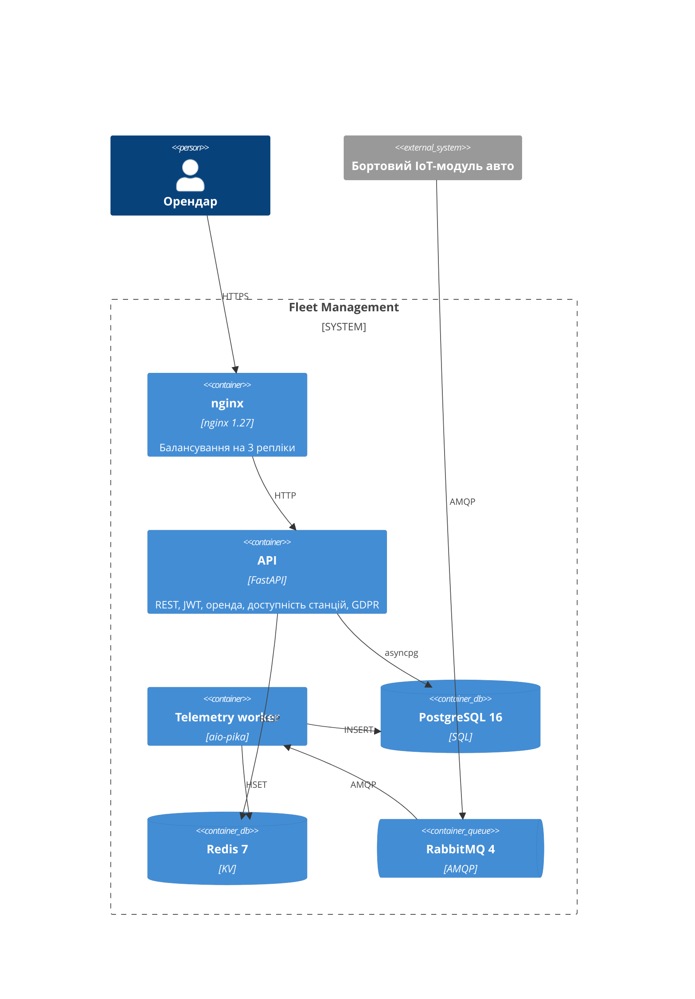

# Лабораторна робота №10 — Аудит документації, архітектурний паспорт (SDD, ISD, ADR), супровід і Handover

Гілка: `feat/lab9-lab10-quality`. Об'єкт: власний проєкт Fleet Management (FastAPI + PostgreSQL + Redis +
RabbitMQ, історія Git ЛР№1–9, 207 комітів з 2026-09-04). Інструменти: Git CLI, `scripts/doc_audit.py`
(автоматизований аудит актуальності), Mermaid. Сирі логи — `docs/lab10/evidence/`.

| Коміт | Стан |
|---|---|
| `d371d68` docs(audit): add documentation decay audit with git currency metrics | інструмент аудиту + baseline-метрики |
| `2a29ff6` **docs(architecture): deliver design and infrastructure passport** | паспорт: SDD, ISD, 2 ADR, регламент, README |
| `a6d404d` **docs(audit): simulate documentation decay, FAIL** | контрольована зміна коду без документації |
| `859860e` **docs(maintenance): restore documentation currency, PASS** | відновлення README/SDD/ISD/регламенту |
| `08487cd` docs(maintenance): add handover package with bus factor declaration | handover-пакет |

---

## Завдання 1. Інвентаризаційний аудит документації

### 1.1 Інвентаризаційний реєстр (стан `main` до аудиту, коміт `a871049`)

| # | Назва документа | Розташування | Тип | Категорія | Цільова аудиторія | Не покриває потреби | Власник |
|---|---|---|---|---|---|---|---|
| 1 | README.md | корінь | продукт (+ вкраплення процесу) | технічна + архітектурна + експлуатаційна | усі | новачок: немає «швидкого старту» і шляху онбордингу; DevOps: немає GitOps/моніторингу/бекапу; QA: немає переліку контрактів | Danylo Yakymiv |
| 2 | Розділи README «SonarQube Завд.1–4», «Cyclomatic vs Cognitive» | README.md, рядки 130–329 | **процес** (звіт ЛР, факт у часі) | технічна | викладач / QA | нікого з поточних — описує код вересня 2026 | Danylo Yakymiv |
| 3 | charts/fleet-management/README.md | `charts/` | продукт | експлуатаційна | DevOps | розробник, бізнес | Danylo Yakymiv |
| 4 | templates/NOTES.txt | `charts/.../templates/` | продукт | експлуатаційна | DevOps | — | Danylo Yakymiv |
| 5 | k8s/*.yaml (+ розділ README «Kubernetes») | `k8s/` | продукт | експлуатаційна | DevOps | не відображає Helm/Argo/canary | Danylo Yakymiv |
| 6 | .env.example, .env.sandbox.example, .env.production.example | корінь | продукт | експлуатаційна | DevOps, розробник | секретні/несекретні змінні не розмежовані | Danylo Yakymiv |
| 7 | Коментарі в docker-compose*.yml, Dockerfile*, nginx/*.conf, values*.yaml | корінь, `charts/`, `nginx/` | продукт | експлуатаційна | DevOps | цілісної топології і порядку старту немає | Danylo Yakymiv |
| 8 | .github/workflows/ci.yml, hotspots.yml (коментарі + стадії) | `.github/` | продукт (living config) | експлуатаційна | DevOps, QA | немає опису гейтів людською мовою | Danylo Yakymiv |
| 9 | config/docker-compose.yml (локальний SonarQube) | `config/` | продукт | експлуатаційна | QA | — | Danylo Yakymiv |
| 10 | Docstrings і коментарі коду | `src/`, `scripts/`, `tests/` | продукт | технічна | розробник | архітектура модулів «з висоти» відсутня | Danylo Yakymiv |
| 11 | OpenAPI `/docs`, `/redoc`, `/openapi.json` (автогенерація) | runtime | продукт | технічна | розробник, QA | вимкнено в production; не описує телеметрію/Redis | автоген (FastAPI) |
| 12 | alembic/README («Generic single-database configuration…») | `alembic/` | продукт (шаблон) | технічна | — | — (шаблонний текст генератора) | ніхто |
| 13 | CHANGELOG.md | корінь | процес | — | бізнес | 1 запис на 207 комітів | Danylo Yakymiv |
| 14 | Повідомлення комітів (207) | Git | процес | технічна | розробник | — | автор коміту |
| 15 | Описи PR #1–#48 | GitHub | процес | технічна | рев'юер | — | автор PR |
| 16 | Звіти ЛР (`docs/labN/REPORT.md`, `DEMO.md`) | лише на feature-гілках; з `main` видалено (коміт `632ffe5`) | процес | різні | викладач | — | Danylo Yakymiv |
| 17 | sonar-project.properties | корінь | продукт | технічна | QA | — | Danylo Yakymiv |
| 18 | FINANCIAL_LEDGER.md (ЛР№9, згенерований) | корінь | процес | — | бізнес | — | генератор |
| 19 | Описи задач трекера | — | процес | — | — | **трекер у проєкті не використовується** | — |

### 1.2 Класифікація за двома осями

| | Технічна (що робить) | Архітектурна (як влаштована) | Експлуатаційна (як запускати/супроводжувати) |
|---|---|---|---|
| **Продукт** (живе разом із системою) | docstrings (10), OpenAPI (11), alembic/README (12), sonar-project (17) | README «Архітектура» (1) | README «Запуск» (1), chart README (3), NOTES (4), k8s (5), .env* (6), коментарі конфігів (7), CI (8), config SonarQube (9) |
| **Процес** (історичний запис) | звіт SonarQube у README (2), коміти (14), PR (15) | — | звіти ЛР (16), CHANGELOG (13), FINANCIAL_LEDGER (18) |

Покриття аудиторій до аудиту: **розробник** — частково (README + код, без SDD); **QA** — лише OpenAPI і тести;
**DevOps** — фрагментарно (README + коментарі, GitOps/моніторинг/бекап не описані взагалі); **бізнес** —
перший абзац README і CHANGELOG з одним записом.

### 1.3 Лог метрик актуальності (Git CLI)

Сирі команди і вивід — `evidence/git_cli_metrics.txt`, автоматичний аудит — `evidence/audit_baseline.txt`
(`python scripts/doc_audit.py --today 2026-11-14`).

```text
$ git log -1 --format=%cs -- README.md                       → 2026-10-26   (19 днів)
$ git log -1 --format=%cs -- charts/fleet-management/README.md → 2026-10-26   (19 днів)
$ git log -1 --format=%cs -- CHANGELOG.md                    → 2026-11-07   (7 днів)
$ git log -1 --format=%cs -- .env.example                    → 2026-10-17   (28 днів)
$ git log -1 --format=%cs -- alembic/README                  → 2026-09-15   (60 днів)
$ git log -1 --format=%cs -- k8s/40-api-deployment.yaml      → 2026-10-06   (39 днів)
$ git log -1 --format=%cs -- sonar-project.properties        → 2026-10-05   (40 днів)
$ git log --oneline -- src/fleet_management | wc -l          → 47
$ git log --oneline -- src/fleet_management/services | wc -l → 21
$ git log --oneline -- charts | wc -l                        → 19
$ git log --oneline -- k8s | wc -l                           → 3
$ git log --oneline -- README.md | wc -l                     → 16
$ git log --oneline 97069ce..HEAD -- src | wc -l             → 12   (коміти коду після останнього оновлення README)
```

| Документ | Last Updated Age | Code-Doc Change Ratio (коміти коду всього / після оновлення документа) | Биті посилання | Свідчення використання (вхідні посилання / згадки в комітах за 30 д) | Сигнал |
|---|---|---|---|---|---|
| README.md | 19 д | 80 / **29** (src + compose + charts + Dockerfile) | **6** | 1 / 0 | **drift > 20** + битi посилання |
| charts/…/README.md | 19 д | 19 / 18 | **1** | 1 / 0 | биті посилання |
| CHANGELOG.md | 7 д | 66 / 2 | 0 | **0 / 0** | немає споживача |
| .env.example | 28 д | 21 / 5 | 0 (але коментар → видалений `docs/lab3-web-env-cicd.md`) | 2 / 0 | — |
| alembic/README | 60 д | 6 / 5 | 0 | **0 / 0** | немає споживача |
| k8s/ | 39 д | 3 коміти, Helm-чарт — 19 | — | 1 (README) | заміщено чартом |
| SDD / ISD / ADR | — | — | — | — | **документи відсутні** |

Пороги 90/180 днів не перевищено жодним документом (проєкту 71 день), тому головні сигнали — структурний дрейф
і биті посилання, а не вік. Свідчення використання: питання колег/чат відсутні (одноосібний проєкт), тому
доказом споживання вважаються вхідні посилання з інших файлів і згадки в повідомленнях комітів.

### 1.4 Діагноз антипатернів

**Documentation Decay (документ описує неіснуючу систему):**

1. README стверджує: «створення оренди виконується з блокуванням рядка (`SELECT … FOR UPDATE`)» — у
   `services/rental_service.py:start_rental` блокування **немає** (`db.get(Vehicle)` + перевірка статусу). Найнебезпечніший
   випадок: документ створює ілюзію захисту від race condition.
2. README: 6 посилань на видалені звіти (`docs/lab3-web-env-cicd.md`, `docs/lab4-helm/REPORT.md`,
   `docs/lab4-privacy-gdpr.md`, `docs/lab5-docker/REPORT.md`, `docs/lab6-nginx/REPORT.md`, `docs/lab4-loadtest/REPORT.md`).
3. README-діаграма: клієнт — «Мобільний застосунок», хоча реальний клієнт — SPA `/app`; немає Argo CD, Rollouts,
   Prometheus/Loki (ЛР№5–7) — 29 комітів коду без оновлення.
4. `charts/…/README.md` → `docs/lab4-helm/REPORT.md` (видалено); `values-minikube.yaml` → `docs/lab5-gitops/DEMO.md`
   (видалено); `.env.example` → `docs/lab3-web-env-cicd.md` (видалено).
5. Розділ README «Kubernetes» + `k8s/` — описують розгортання, яке замінено Helm-чартом і GitOps.

**Dead Documentation (документ існує, але не має споживача):**

1. `alembic/README` — шаблонний рядок генератора Alembic, 0 вхідних посилань, 0 згадок; нічого не пояснює.
2. Розділи README «SonarQube Завд.1–4» — документ процесу (звіт вересня), вбудований у живий документ продукту:
   метрики (`ncloc 332`, «тестів ще немає») давно не відповідають системі, читач-новачок їх не потребує.
3. `CHANGELOG.md` — 0 вхідних посилань і 1 запис на 207 комітів (одночасно Decay: не відображає історію).

### 1.5 Матриця вердиктів (вхід для Завдання 2)

| Артефакт | Вердикт | Дія (виконано в `2a29ff6`) |
|---|---|---|
| README.md | **оновити** | переписано: призначення, аудиторії, швидкий старт, шлях онбордингу, карта документації; виправлено твердження про `FOR UPDATE`; биті посилання прибрано |
| README «SonarQube Завд.1–4» | **deprecated** | перенесено в `docs/history/sonarqube-quality-gate-lab.md` з банером DEPRECATED |
| README «Kubernetes» + `k8s/` | **deprecated** | `k8s/README.md` з банером, посиланням на ADR-0002 і ISD §2.2 |
| charts/…/README.md | **оновити** | битe посилання → ISD |
| values-minikube.yaml, .env.example (коментарі) | **оновити** | посилання → ISD §2.2 / §1 |
| alembic/README | **видалити** | видалено |
| CHANGELOG.md | **оновити** | ведеться далі (новий запис 2026-11-14); посилання з README |
| SDD / ISD / ADR | **створити** | Завдання 2 |
| docstrings, OpenAPI, CI, compose, .env.*.example | залишити | описані/зведені в SDD та ISD |
| коміти, PR, звіти ЛР | залишити (процес) | історичні записи не редагуються |

---

## Завдання 2. Архітектурний паспорт системи

Файли (коміт `2a29ff6`, оновлено в `859860e`):

- [`docs/sdd.md`](../sdd.md) — призначення, **C4 Container diagram (Mermaid `C4Container`)** + flowchart-дубль,
  7 компонентів (відповідальність, модулі, з ким взаємодіє, посилання на ISD), ER-модель (`erDiagram`, 12 таблиць),
  35 REST-маршрутів, службові ендпоінти, контракт телеметрії, внутрішні контракти API↔Redis/worker/Prometheus.
- [`docs/isd.md`](../isd.md) — середовища dev / test / sandbox / production / k8s, таблиця змінних оточення
  (з позначкою «секрет», без значень), топологія compose (мережі `edge`/`backend internal`) і k8s (app-of-apps),
  **порядок підняття сервісів**, реліз/відкат, образи, сховища, CI/CD (10 jobs, тригери, Quality Gates),
  моніторинг і алерти, **бекап з RTO/RPO** (PostgreSQL RPO 24 год / RTO 30 хв; Redis — похідні дані; Git — RPO 0).
  Процедуру `pg_dump`/`pg_restore` перевірено на тимчасовому `postgres:16`.
- [`docs/architecture/adr/0001`](../architecture/adr/0001-postgresql-redis-rabbitmq-storage.md) — PostgreSQL + Redis +
  RabbitMQ (альтернативи: лише PostgreSQL, MongoDB, Kafka) і [`0002`](../architecture/adr/0002-gitops-argo-canary-delivery.md) —
  GitOps Argo CD + canary з аналізом (альтернативи: ручний kubectl/helm, CI push-деплой, blue-green).
  Обидва — з контекстом, таблицею альтернатив, рішенням і наслідками (✅/⚠️); індекс і шаблон — `adr/README.md`.

Фрагмент C4 (повністю — у SDD §2):



### 2.1 Матриця покриття аудиторій

| Аудиторія | Ключові питання | Документ-відповідь | Статус до | Статус після |
|---|---|---|---|---|
| Новачок | Як запустити проєкт локально? | README «Швидкий старт (5 хвилин)», handover §2 | прогалина | ✅ покрито |
| | З чого почати читати? | README «Шлях онбордингу» | прогалина | ✅ |
| Розробник | З якими компонентами взаємодіє мій модуль? | SDD §3 (кожен компонент → «Взаємодіє з») | прогалина | ✅ |
| | Яка модель даних та інваріанти? | SDD §4 | прогалина | ✅ |
| | Чому обрано такий стек? | ADR-0001, ADR-0002 | прогалина | ✅ |
| QA | Де описані контракти поведінки для перевірок? | SDD §5 (35 маршрутів, коди помилок, контракт телеметрії), OpenAPI | частково | ✅ |
| | Які гейти якості блокують злиття? | ISD §5 | прогалина | ✅ |
| DevOps | Як розгорнути і відкотити реліз? | ISD §2.3 | частково (лише Helm) | ✅ |
| | Порядок старту сервісів, змінні оточення? | ISD §1.1, §2.1 | прогалина | ✅ |
| | Моніторинг, бекап, RTO/RPO? | ISD §6, §7 | прогалина | ✅ |
| Бізнес | Що система робить і для кого? | README перший розділ, «Предметна область» | частково | ✅ |
| | Що змінилось останнім часом? | CHANGELOG.md | прогалина (1 запис) | ✅ |

Закриті прогалини на практиці: README доопрацьовано (призначення, таблиця аудиторій, швидкий старт, онбординг,
карта документації). Повторний аудит після коміту паспорта — усі 9 документів **PASS** (`evidence/audit_passport.txt`).

---

## Завдання 3. Супровід документації, краш-тест, Handover

### 3.1 Регламент підтримки ([`docs/maintenance.md`](../maintenance.md))

| Документ | Власник | Цикл перегляду | Дата останнього перегляду |
|---|---|---|---|
| README.md | Danylo Yakymiv | 90 днів (експлуатаційна) | 2026-11-14 |
| docs/sdd.md | Danylo Yakymiv | 180 днів (архітектурна) | 2026-11-14 |
| docs/isd.md | Danylo Yakymiv | 90 днів (експлуатаційна) | 2026-11-14 |
| ADR-0001, ADR-0002 | Danylo Yakymiv | 180 днів (архітектурна, лише статус) | 2026-11-14 |
| charts/…/README.md, .env*.example | Danylo Yakymiv | 90 днів | 2026-11-14 |
| docs/maintenance.md, docs/handover.md | Danylo Yakymiv | 90 днів | 2026-11-14 |

Правило **«зміна коду = зміна документації»** закріплено трьома механізмами: таблиця «що змінилось → що оновити»,
PR-шаблон із чекбоксом документації і CI-job `docs-currency` (`scripts/doc_audit.py --strict`), що блокує PR,
якщо API-маршрут не описаний у SDD, є биті посилання, документ відсутній/застарів або відстав > 20 комітів.

### 3.2 Краш-тест «Documentation Decay» — FAIL (`a6d404d`)

Git-diff контрольованої зміни (повністю — `evidence/fail_commit.diff`):

```diff
# src/fleet_management/api/stations.py — новий API-ендпоінт
+@router.get("/{station_id}/availability", response_model=StationAvailability)
+async def get_station_availability(station_id: int, db: AsyncSession = Depends(get_db)):
+    return await station_service.get_availability(db, station_id)
# src/fleet_management/schemas.py — новий контракт відповіді
+class StationAvailability(BaseModel):
+    station_id: int
+    capacity: int
+    parked_vehicles: int
+    free_slots: int
+    available_vehicles: int
# src/fleet_management/services/station_service.py
+async def count_available_vehicles(db, station_id) -> int: ...
+async def get_availability(db, station_id) -> StationAvailability: ...
# docker-compose.yml — змінено порядок підняття сервісів
   worker:
     depends_on:
-      api1:
-        condition: service_healthy
+      migrate:
+        condition: service_completed_successfully
```

Зміна працює (2 нові integration-тести, увесь набір — 1453 passed), але жоден документ не оновлено.

**Доказ дрейфу для кожної аудиторії** (`evidence/drift_proof_fail.txt`):

| Аудиторія | Документ | Що каже документ | Що в системі | Доказ |
|---|---|---|---|---|
| Новачок, бізнес | README | «веде станції, авто… показує стан парку» — про доступність станцій ні слова | є функція доступності станції (вільні місця/авто) | `grep -n availability README.md` → *(no matches)* |
| Розробник, QA | SDD §5 | 34 маршрути, `StationAvailability` відсутній (structure/contract drift) | 35 маршрутів | `doc_audit --strict` → `undocumented route -> GET /stations/{station_id}/availability`, **exit 1** |
| DevOps | ISD §2.1 | «`worker` — після `api1` healthy» | worker стартує після `migrate` completed, не чекає API | `docs/isd.md:89` vs `docker-compose.yml` (worker `depends_on: migrate`) |

**Повторний аудит метрик актуальності:**

| Метрика | Паспорт `2a29ff6` | FAIL `a6d404d` | PASS `859860e` |
|---|---|---|---|
| Маршрути API, описані в SDD | 34 / 34 | **34 / 35** | 35 / 35 |
| Коміти коду після оновлення SDD / ISD / README | 0 / 0 / 0 | **1 / 1 / 1** | 0 / 0 / 0 |
| Коміти документації після зміни коду (`git log 2a29ff6..HEAD -- docs README.md`) | — | **0** | 1 |
| Порядок старту в ISD = compose | так | **ні** (worker) | так |
| Last Updated Age README / SDD / ISD | 0 / 0 / 0 д | 0 / 0 / 0 д | 0 / 0 / 0 д |
| `doc_audit.py --strict` | PASS, exit 0 | **FAIL, exit 1** | PASS, exit 0 |

Вік документа в цьому експерименті не змінився (усе в один день) — і це головний висновок краш-тесту: **метрика віку
не помічає дрейфу**, документ «свіжий», але вже бреше. Деградацію ловлять лише структурні метрики (Code-Doc
Change Ratio і звірка контрактів), тому саме вони винесені в CI.

### 3.3 Відновлення — PASS (`859860e`)

Оновлені фрагменти (diff — `evidence/pass_commit.diff`):

- **README:** «…показує актуальний стан парку та **доступність кожної станції** (вільні місця для повернення і вільні
  авто — `GET /stations/{station_id}/availability`)»; сутність Station — «доступність обчислюється на льоту».
- **SDD:** C4-контейнер API — «доступність станцій»; компонент `station_service` — `get_availability() → StationAvailability`;
  §5.1 — новий рядок `GET /stations/{station_id}/availability` з форматом відповіді і 404.
- **ISD:** §2.1 порядок старту — «4. `worker` — одразу після `migrate` completed + `rabbitmq` і `redis` healthy
  (не чекає API)», «5. `nginx` — після healthy `api1..api3`», наслідок для діагностики; на схемі — ребро `migrate → worker`.
- **maintenance.md:** дати повторного перегляду README/SDD/ISD; **CHANGELOG:** запис 2026-11-14.

Повторний аудит (`evidence/audit_pass.txt`): усі документи PASS, `--strict` exit 0; матриця аудиторій знову без прогалин.

### 3.4 Handover-пакет ([`docs/handover.md`](../handover.md))

- Реєстр 9 документів паспорта з власниками, циклами і статусом актуальності (PASS / deprecated).
- Онбординг у 5 кроків: README+SDD → середовище → `docker compose up` + `/health` + `create-admin` → тести → перша зміна з PR-шаблоном.
- **Декларація Bus Factor** (`git log --format=%aN -- <компонент> | sort | uniq -c`, `evidence/bus_factor_shortlog.txt`):
  усі 12 компонентів мають одного автора → **Bus Factor = 1**; ризик 🔴 для `rental_service`, GDPR і GitOps
  (темні зони: відсутність `FOR UPDATE`, політика згод, ручний `fleet-secret` і пороги аналізу).
  План: co-owner на кожен документ і обов'язкове рев'ю «червоних» компонентів, ADR-0003/0004 для темних зон, runbook
  ручних кроків, виконаний не автором, ротація чергування, квартальна метрика `git shortlog`.
- **Вердикт:** документаційно система готова до передачі (паспорт повний, `doc_audit` PASS, онбординг і відновлення
  перевірені), але **не перебуває в стані «Always Ready to Handover»**, доки Bus Factor = 1.

### Відтворення

```bash
python scripts/doc_audit.py --today 2026-11-14 --strict      # поточний стан: PASS
git checkout a6d404d && python scripts/doc_audit.py --strict  # FAIL, exit 1
pytest tests/unit/test_doc_audit.py -q                        # правила аудиту
```
