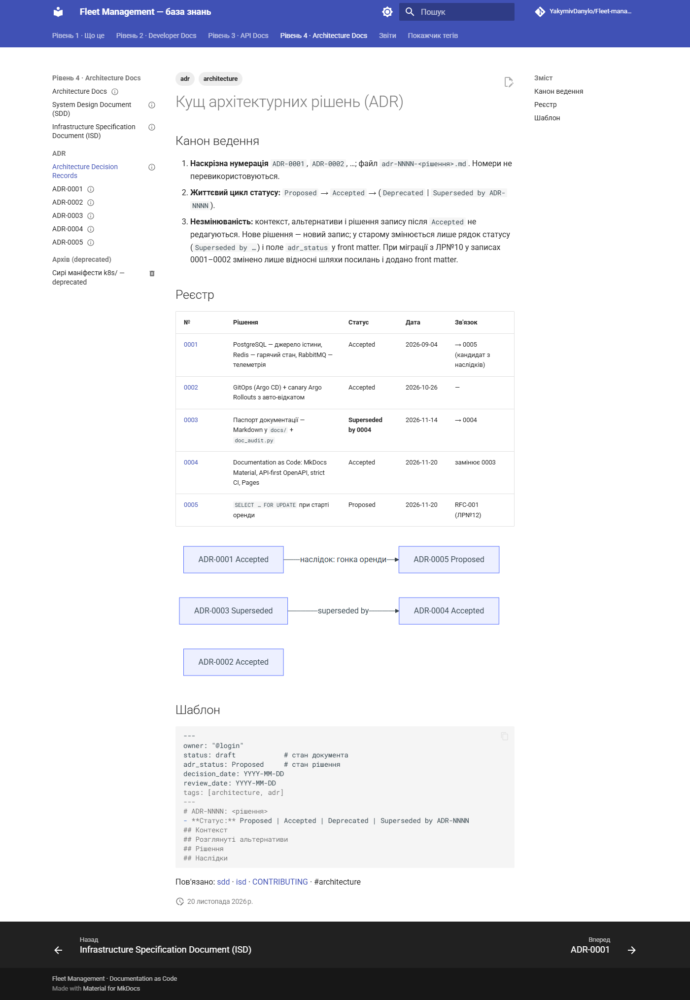
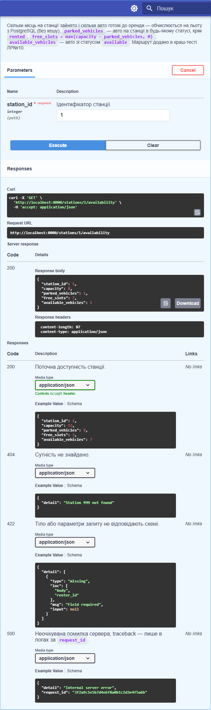
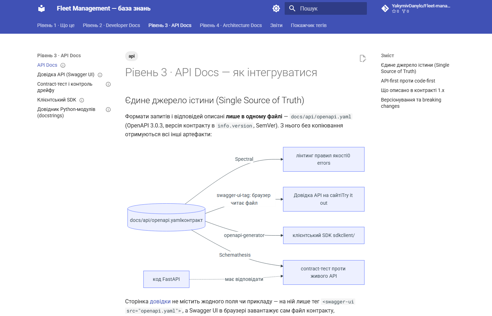
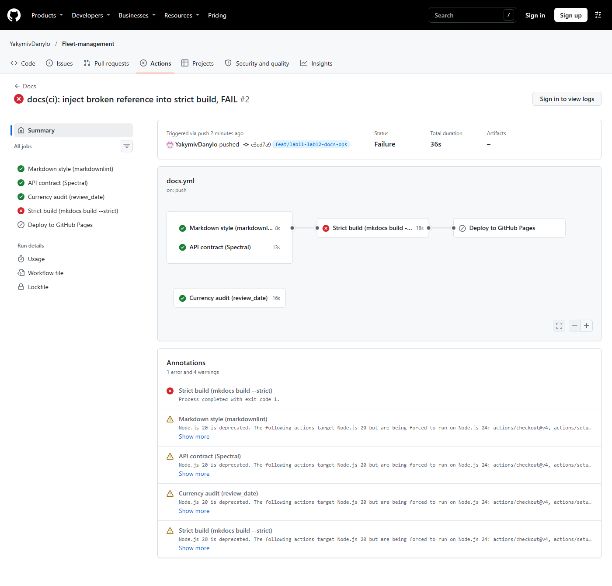
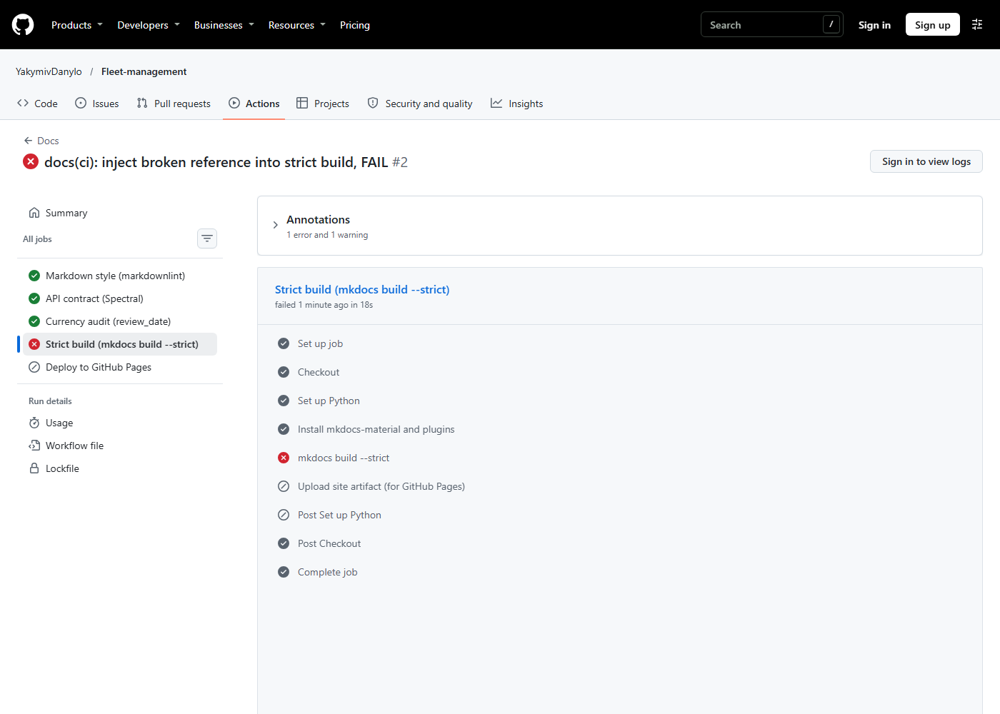
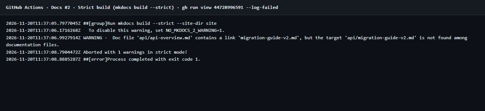
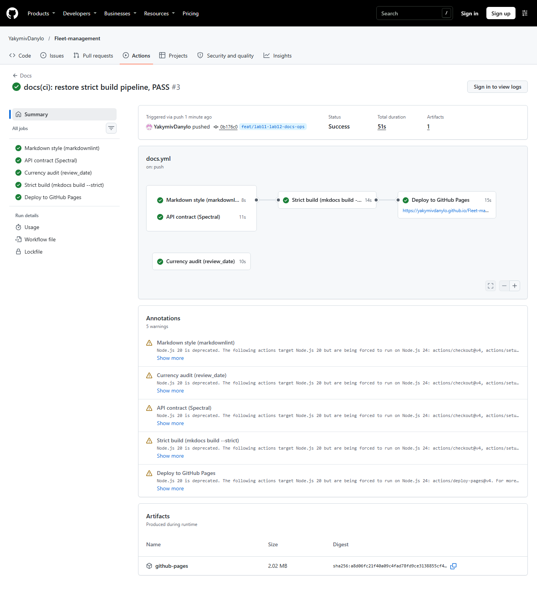
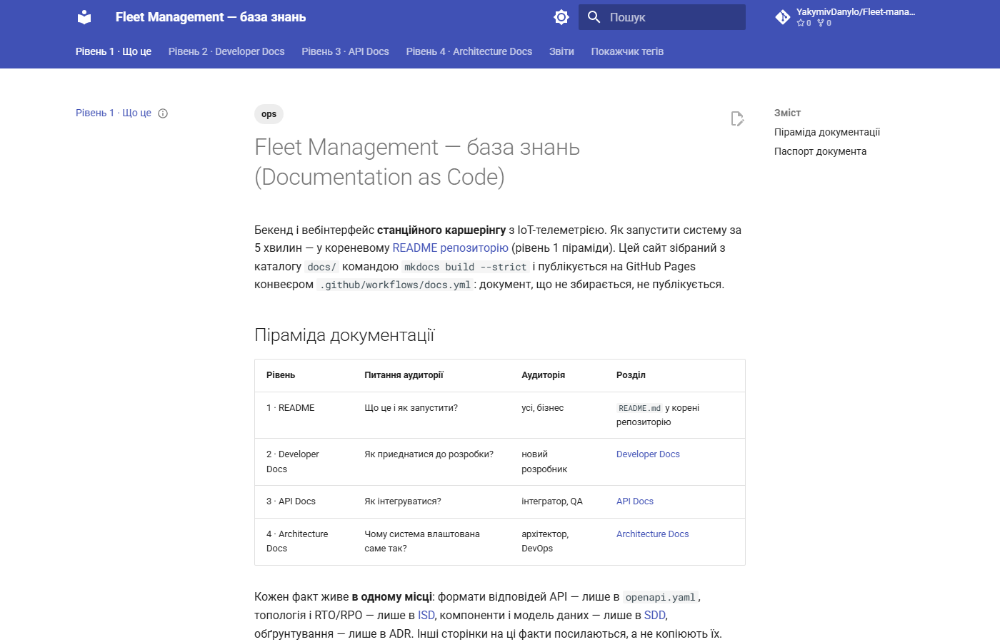
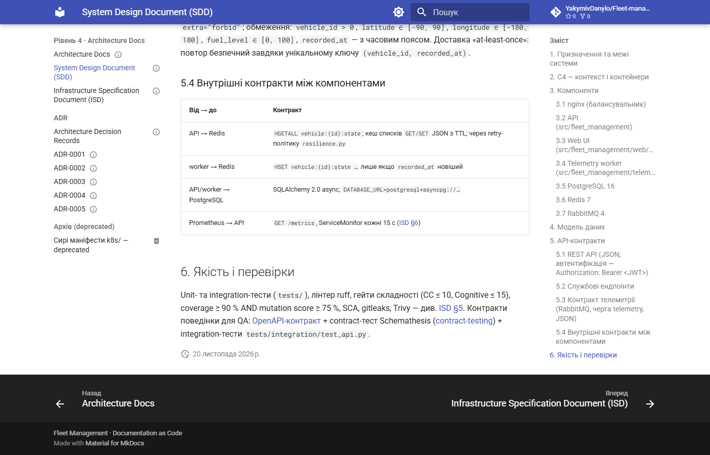

# Лабораторна робота №11 — Documentation as Code: база знань, API-first, CI/CD документації

Об'єкт: власний проєкт Fleet Management (станційний каршерінг, FastAPI + PostgreSQL + Redis + RabbitMQ) з паспортом
SDD/ISD/ADR з ЛР№10. Гілка `feat/lab11-lab12-docs-ops`.

**Публічний сайт документації:** <https://yakymivdanylo.github.io/Fleet-management/>

| Коміт | Що зафіксовано | Конвеєр `Docs` |
|---|---|---|
| `1c6599a` fix(api): align rental responses and id validation with the OpenAPI contract | виправлення коду, знайдені contract-тестом (Завд. 2) | — |
| `5a849d9` docs(kb): migrate documentation into a four-level MkDocs knowledge base… | піраміда, MkDocs, ADR, front matter, CODEOWNERS, OpenAPI, Spectral, DoD | — |
| `58643c8` ci(docs): add docs pipeline with markdownlint, Spectral, strict build and Pages deploy | workflow | [✅ #1](https://github.com/YakymivDanylo/Fleet-management/actions/runs/44728801168) + деплой |
| `e3ed7a9` **docs(ci): inject broken reference into strict build, FAIL** | краш-тест | [❌ #2](https://github.com/YakymivDanylo/Fleet-management/actions/runs/44728996591), деплой пропущено |
| `0b176c0` **docs(ci): restore strict build pipeline, PASS** | відновлення | [✅ #3](https://github.com/YakymivDanylo/Fleet-management/actions/runs/44729315174) + деплой |

Сирі логи — у каталозі `docs/lab11/evidence/`, скріншоти — `docs/lab11/screenshots/`.

---

## Завдання 1. DaC-скелет і корпоративна база знань

### 1.1 Чотирирівнева піраміда (схема репозиторію)

```text
README.md                          # Рівень 1 — що це і як запустити за 5 хв; таблиця DoD-перевірок; посилання на рівні 2–4
mkdocs.yml                         # конфігурація бази знань: nav = піраміда, мова uk, плагіни, strict-валідація
docs_hooks/wikilinks.py            # [[wikilinks]] Obsidian -> посилання сайту; неіснуюча ціль = помилка strict
.github/CODEOWNERS                 # обов'язкові рев'юери docs/, контракту, ADR
.obsidian/                         # налаштування Obsidian Vault (виключення службових каталогів, кольори тегів)
docs/
├── index.md                       # головна сайту: карта піраміди, правило SSOT, паспорт документа
├── developer/                     # Рівень 2 — як приєднатися до розробки?
│   ├── developer-index.md
│   ├── CONTRIBUTING.md            #   процес PR + Definition of Done «docs-or-don't-merge»
│   ├── local-setup.md             #   локальне середовище, тести, збірка бази знань
│   ├── code-standards.md          #   стандарти коду ЛР№1 (ruff, складність, коміти)
│   ├── handover.md                #   пакет передачі знань (з ЛР№10)
│   └── documentation-regime.md    #   регламент ЛР№10 — status: deprecated -> CONTRIBUTING
├── api/                           # Рівень 3 — як інтегруватися?
│   ├── api-overview.md            #   SSOT, API-first vs code-first, SemVer
│   ├── openapi.yaml               #   ЄДИНЕ джерело істини контракту (OpenAPI 3.0.3)
│   ├── openapi-reference.md       #   Swagger UI, рендериться з openapi.yaml
│   ├── contract-testing.md        #   Schemathesis: контракт проти живого API
│   ├── sdk.md                     #   OpenAPI Generator -> fleet_client
│   └── python-reference.md        #   варіативний пункт: довідник з docstrings (mkdocstrings)
├── architecture/                  # Рівень 4 — чому система влаштована саме так?
│   ├── architecture-index.md
│   ├── sdd.md  isd.md             #   паспорт проєктування та інфраструктури (міграція з ЛР№10)
│   ├── k8s-raw-manifests.md       #   status: deprecated -> ISD §2.2
│   └── adr/                       #   кущ ADR-0001…0005 (Accepted / Superseded / Proposed)
├── tags.md                        # покажчик тегів #architecture #api #ops #adr
└── lab11/                         # цей звіт, evidence/, screenshots/
```

Дублювання фактів прибрано: формати відповідей API видалено з SDD (там лишився лише інвентар маршрутів), розділи
README «Середовища», «Тести», «Інструменти» переїхали до ISD і `local-setup.md`, у README — лише посилання.

### 1.2 Лістинг `mkdocs.yml`

```yaml
--8<-- "mkdocs.yml"
```

`mkdocs serve` / `mkdocs build` показує дефекти як попередження ще до CI — сторінка поза `nav` і неіснуюча
wikilink-ціль (`evidence/mkdocs_preview_warnings.txt`):

```text
--8<-- "docs/lab11/evidence/mkdocs_preview_warnings.txt"
```

### 1.3 Front matter-паспорти (приклади)

=== "SDD (архітектурна, 180 днів)"

    ```yaml
    --8<-- "docs/architecture/sdd.md:1:8"
    ```

=== "CONTRIBUTING (процес, 90 днів)"

    ```yaml
    --8<-- "docs/developer/CONTRIBUTING.md:1:8"
    ```

=== "ADR-0005 (in-review)"

    ```yaml
    --8<-- "docs/architecture/adr/adr-0005-row-lock-on-rental-start.md:1:10"
    ```

=== "Регламент ЛР№10 (deprecated)"

    ```yaml
    --8<-- "docs/developer/documentation-regime.md:1:9"
    ```

`review_date` = дата перегляду з аудиту ЛР№10 (2026-11-14 / 2026-11-20) + цикл: 90 днів для експлуатаційних і
процесних сторінок, 180 — для архітектурних. Перевіряє `scripts/docs_review_audit.py` (Завд. 3.4).

### 1.4 CODEOWNERS

```text
--8<-- ".github/CODEOWNERS"
```

Щоб правило «без рев'ю власника не зливається» стало фізичним, у налаштуваннях гілки `main` вмикається
*Require a pull request before merging → Require review from Code Owners*.

### 1.5 Кущ ADR

| ADR | Рішення | Статус | Канон |
|---|---|---|---|
| 0001 | PostgreSQL + Redis + RabbitMQ | Accepted | мігровано з ЛР№10 без зміни змісту |
| 0002 | GitOps Argo CD + canary | Accepted | мігровано з ЛР№10 без зміни змісту |
| 0003 | Паспорт як Markdown + `doc_audit.py` | **Superseded by 0004** | рішення ЛР№10 оформлено записом і закрито новим |
| 0004 | Documentation as Code: MkDocs, API-first, strict CI, Pages | Accepted | нове рішення = новий номер |
| 0005 | `SELECT … FOR UPDATE` при старті оренди | Proposed | вхід для RFC-001 (ЛР№12) |



### 1.6 Граф знань (Obsidian)

Посилання між документами — wikilinks (`[[sdd]]`, `[[isd#isd-backup|ISD §7]]`), теги — у front matter і рядках
«Зв'язки» (`#architecture`, `#api`, `#ops`, `#adr`). Сховище: Obsidian → *Open folder as vault* → корінь репозиторію;
`.obsidian/app.json` виключає код і службові каталоги, `.obsidian/graph.json` фарбує вузли за тегами.

Зв'язність перевірено тим самим правилом, що малює Obsidian (wikilinks + Markdown-посилання), скриптом
`scripts/kb_graph.py --strict` (він же стоїть у CI-стадії `review-audit`): **24 сторінки, 101 зв'язок, 1 компонента —
островів немає**; єдина сторінка без вхідних посилань — головна `index.md` (корінь навігації).

```text
--8<-- "docs/lab11/evidence/kb_graph.txt"
```

--8<-- "docs/lab11/evidence/kb_graph.mmd"

> Скріншот графа з самого Obsidian (вікно *Graph view*) додається вручну як `screenshots/obsidian_graph.png`.

---

## Завдання 2. Контрактне документування API (API-first)

### 2.1 Лістинг `docs/api/openapi.yaml`

П'ять реальних маршрутів коду (`src/fleet_management/api/stations.py`, `rentals.py`, `vehicles.py`), включно з
`GET /stations/{station_id}/availability` з краш-тесту ЛР№10; SemVer `1.0.0`; схеми з `required`/`enum`/`example`;
коди 200/201/400/404/409/422/500/503 через спільні `components.responses` зі схемою `Error`.

??? note "Повний лістинг openapi.yaml"

    ```yaml
    --8<-- "docs/api/openapi.yaml"
    ```

### 2.2 Swagger UI і «Try it out»

Довідка на сайті рендериться з файлу контракту. Виклик «Try it out» `GET /stations/1/availability` до запущеного
sandbox-API (`CORS_ALLOW_ORIGINS=http://127.0.0.1:8001`) повернув **200** з живими даними:



### 2.3 Клієнтський SDK (OpenAPI Generator 7.27.0)

```text
--8<-- "docs/lab11/evidence/sdk_generation.txt"
```

### 2.4 Лінтинг Spectral

Правила `.spectral.yaml`: `spectral:oas` + підвищені до error `operation-description`, `operation-operationId`,
`operation-tags`, `info-contact`, валідність прикладів, і власні: непорожній опис операції (≥ 30 символів), `example`
у кожній схемі, усі 4xx/5xx — лише через спільні відповіді, спільні відповіді — лише зі схемою `Error`, обов'язковий
500, SemVer у `info.version`.

Перший прогін чернетки знайшов 6 помилок (некоректний YAML у flow-описах, поле `info.summary`, якого немає в
OpenAPI 3.0.3) — `evidence/spectral_01_draft.txt`; після виправлення:

```text
--8<-- "docs/lab11/evidence/spectral_02_rules_negative_and_final.txt"
```

Негативний тест доводить, що власні правила спрацьовують; на реальному контракті — **0 errors, 0 warnings**.

### 2.5 SSOT і контроль контрактного дрейфу

**SSOT.** Сторінка довідки містить лише `<swagger-ui src="openapi.yaml"/>` — жодного поля контракту; Swagger UI в
браузері завантажує файл, який MkDocs копіює в сайт без змін. SHA-256 джерела, зібраного сайту і опублікованої
сторінки однакові — довідка фізично не може показати іншу версію чи формат:

```text
--8<-- "docs/lab11/evidence/ssot_proof.txt"
```

**Дрейф.** Contract-тест Schemathesis 4.33.4 проти живого API (`st run docs/api/openapi.yaml --url http://localhost:8000 --checks all`)
знайшов **п'ять реальних розбіжностей**; кожну виправлено і перевірено повторним прогоном:

| Ітерація | Знайдено | Рішення | Лог |
|---|---|---|---|
| 1 | наївні мітки часу без зони (ST108) — дефект **коду**; `detail` у 422 — масив, а не рядок (ST108) — дефект **контракту** | `RentalRead` віддає UTC з `Z`; `Error.detail` = рядок \| `ValidationIssue[]` | `evidence/contract_01_drift_found.txt` |
| 2 | 400 на некоректний JSON не задокументовано (ST103) — дефект **контракту** | додано `400 BadRequest` | `evidence/contract_02_after_code_fix.txt` |
| 3 | id = 2^31 → **500** з traceback (ST101, OverflowError asyncpg) — дефект **коду** | межі `1..2^31−1` → 422 | `evidence/contract_03_fuzzing_found_500.txt` |
| 4 | неіснуючий `renter_id` → **500** (порушення FK) — дефект **коду** | перевірка орендаря → 404 | `evidence/contract_04_unknown_renter_500.txt` |
| 5 | **0 failures**, 1124 кейси, фази Examples / Coverage / Fuzzing / Stateful ✅ | — | `evidence/contract_05_final_pass.txt` |

Відоме прийняте відхилення: `TRACE`/`OPTIONS` (методи поза контрактом) — nginx відповідає 405 без `Allow`, а Starlette
перелічує в `Allow` методи лише одного маршруту; це поведінка проксі/фреймворку, не контракту, тому перевірки
`unsupported_method`, `allow_header_conformance` виключено з фінального прогону з цим обґрунтуванням.



### 2.6 Варіативний пункт — довідник з docstrings

Для API-проєкту на Python: сторінка [[python-reference]] містить лише директиви `::: fleet_management.services.station_service`
тощо; `mkdocstrings` (аналог Sphinx autodoc) рендерить сигнатури і Google-style docstrings з `src/` під час кожної
збірки — окремий розділ бази знань на рівні 3.

---

## Завдання 3. CI/CD-конвеєр документації і краш-тест

### 3.1 Лістинг `.github/workflows/docs.yml`

```yaml
--8<-- ".github/workflows/docs.yml"
```

Стадії: checkout (повна історія для дат) → Python → `pip install -r requirements-docs.txt` (mkdocs-material + плагіни)
→ markdownlint (job `lint`) і Spectral (`api-contract`) → `mkdocs build --strict` (`build`) → GitHub Pages (`deploy`);
паралельно `review-audit` (прострочені `review_date` + зв'язність графа), щодня о 06:00 UTC за `cron`.

### 3.2 Протокол краш-тесту — FAIL

Дефект: **мертве посилання** — у `docs/api/api-overview.md` додано посилання на неіснуючий
`migration-guide-v2.md`. Коміт `e3ed7a9` **docs(ci): inject broken reference into strict build, FAIL**,
[прогін #2](https://github.com/YakymivDanylo/Fleet-management/actions/runs/44728996591): lint, Spectral і аудит —
зелені, `Strict build` — червоний, **деплой пропущено** (сайт лишився на попередній робочій версії).

```text
--8<-- "docs/lab11/evidence/ci_fail_strict_build.log"
```







### 3.3 Протокол відновлення — PASS

Посилання прибрано (breaking-змін 1.x не було — гайду не існує). Коміт `0b176c0`
**docs(ci): restore strict build pipeline, PASS**, [прогін #3](https://github.com/YakymivDanylo/Fleet-management/actions/runs/44729315174):
усі 5 jobs зелені, деплой на Pages успішний.

```text
--8<-- "docs/lab11/evidence/ci_pass_run.log"
```





Автоматична дата редагування (`git-revision-date-localized`, з історії Git) внизу кожної сторінки:



### 3.4 Регламент безперервного супроводу

**Чек-лист docs-or-don't-merge** опубліковано в [[CONTRIBUTING#definition-of-done-docs-or-dont-merge|CONTRIBUTING → Definition of Done]]
і продубльовано чекбоксами в шаблоні PR; таблиця документаційних перевірок DoD (Spectral / markdownlint / strict build /
`review_date`) — у README.

**Аудит актуальності** (`scripts/docs_review_audit.py`, стадія `review-audit` + щоденний cron) порівнює сьогоднішню
дату з `review_date` кожного паспорта: прострочені живі сторінки й биті паспорти валять стадію, прострочені
`deprecated` лише показуються. Реальний прогін (2026-11-20) і прогін «на дату наступного кварталу» (2027-02-20):

```text
--8<-- "docs/lab11/evidence/review_audit.txt"
```

**Деприкація замість видалення:** `developer/documentation-regime.md` (регламент ЛР№10, замінений DoD) і
`architecture/k8s-raw-manifests.md` (сирі маніфести, замінені Helm + Argo CD) мають `status: deprecated`,
`superseded_by` і банер-переспрямування; лишаються в навігації в розділах «Архів».

**Версії документації:** знімок бази знань цієї ЛР зафіксовано тегом `docs-v1.0`; відновлення —
`git checkout docs-v1.0 && mkdocs build --strict`.

---

## Відповіді для захисту

- **Single Source of Truth** — кожен факт має рівно одне місце зберігання, решта артефактів *генерується* з нього або
  *посилається* на нього. Тут: контракт API — лише `openapi.yaml` (з нього довідка, SDK і contract-тест); топологія —
  лише ISD; рішення — лише ADR.
- **API-first vs code-first** — у code-first контракт є побічним продуктом коду (FastAPI `/openapi.json`), у API-first
  контракт пишеться і рев'юється першим, а код зобов'язаний йому відповідати; відповідність перевіряє машина
  (Schemathesis), що й знайшло 5 розбіжностей у цій ЛР.
