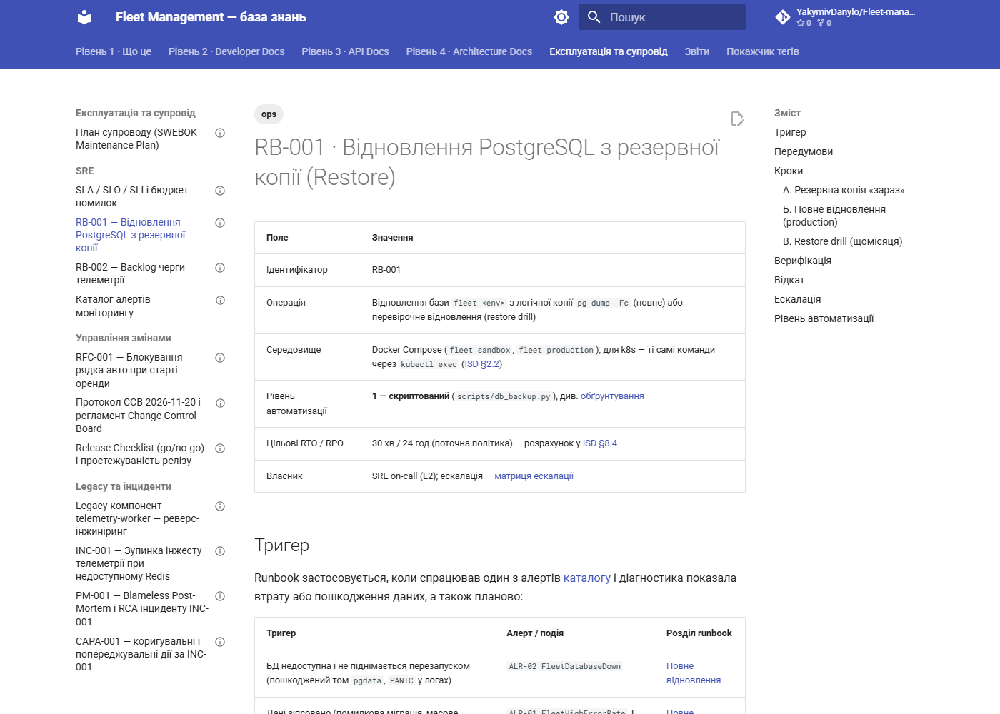
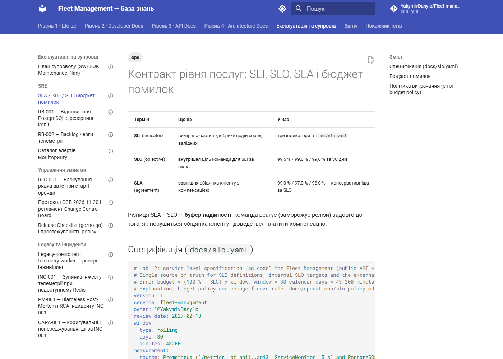
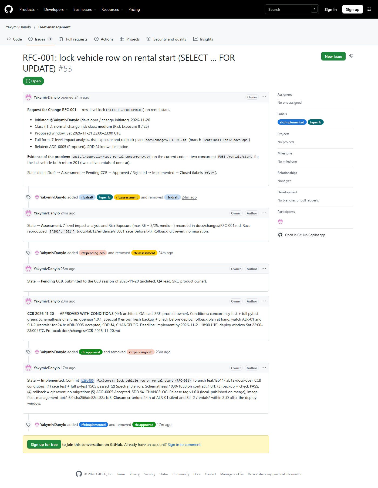
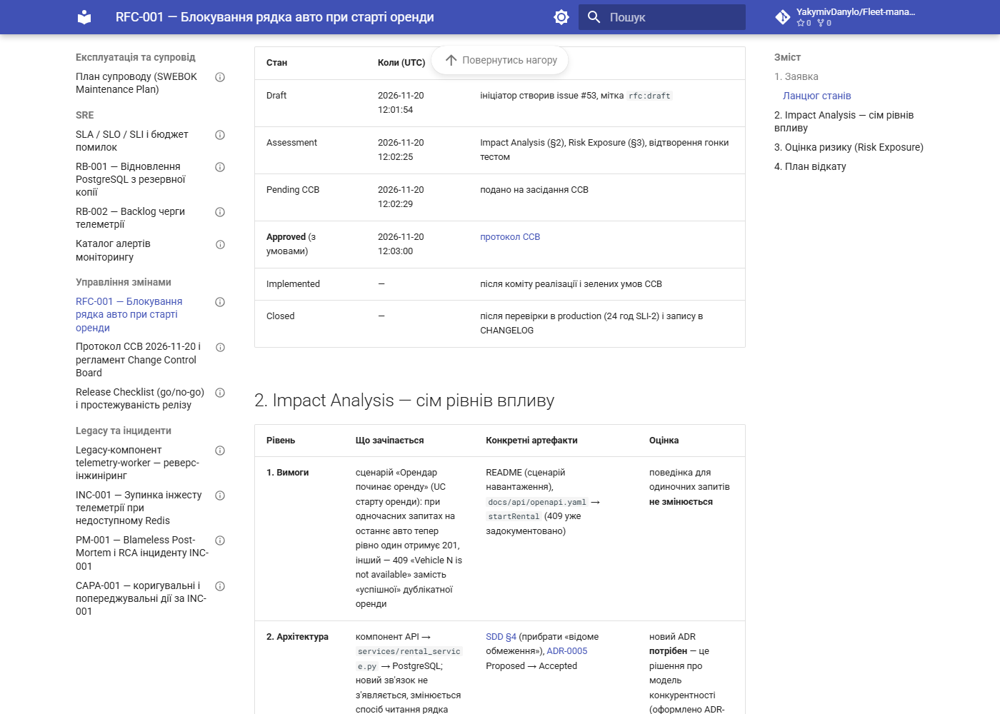
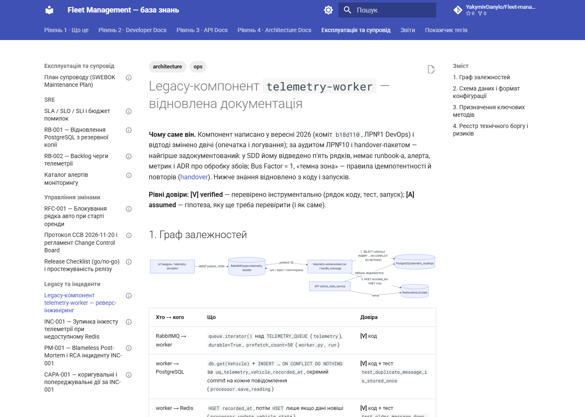
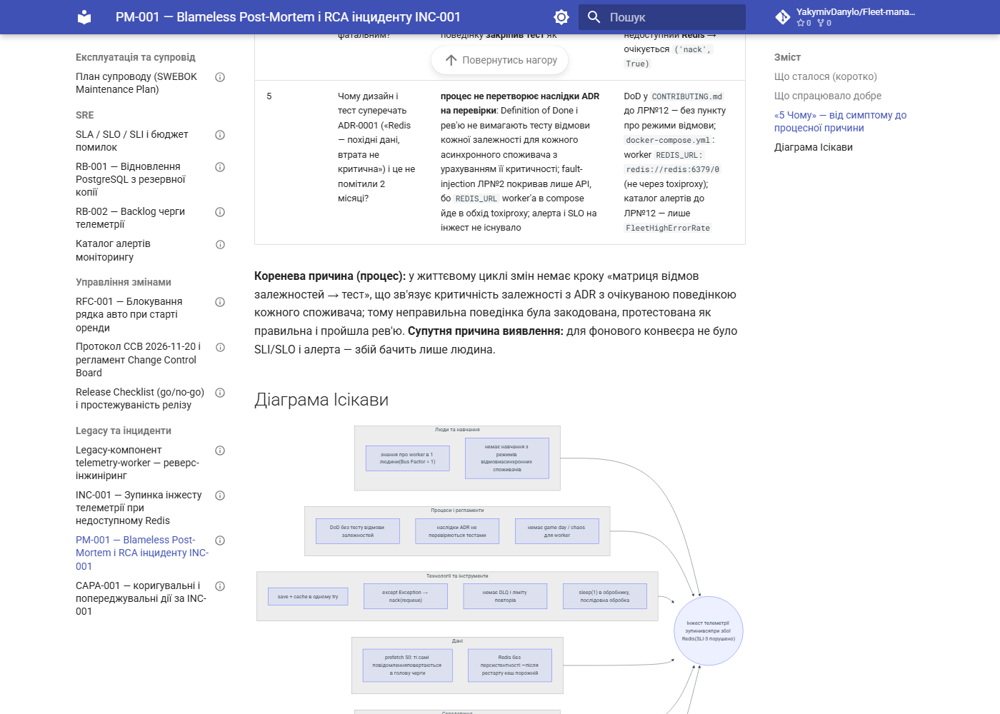
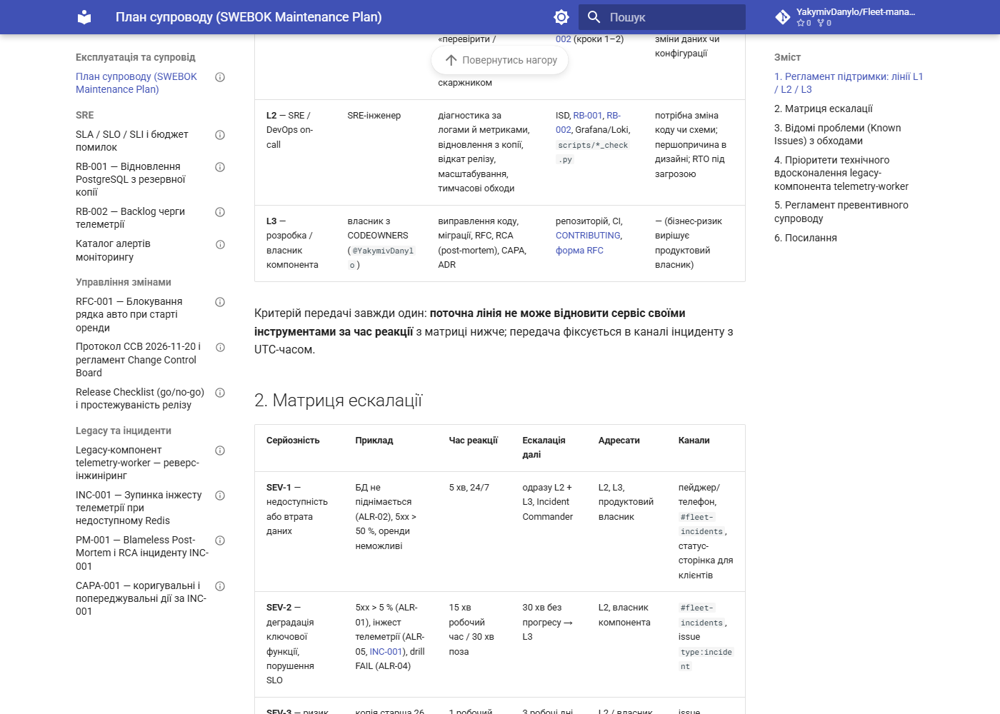

# Лабораторна робота №12 — runbooks, Change Management, інженерія інцидентів

Об'єкт: Fleet Management (база знань ЛР№10–11). Гілка `feat/lab11-lab12-docs-ops`, сайт —
<https://yakymivdanylo.github.io/Fleet-management/>. Сирі логи — `docs/lab12/evidence/`, скріншоти — `docs/lab12/screenshots/`.

| Коміт | Що зафіксовано |
|---|---|
| `ae681d7` docs(ops): add runbook, alert catalog, backup policy, SLO spec and change management records | Завд. 1 + RFC/CCB/Release Checklist |
| `b26c453` fix(core): lock vehicle row on rental start (RFC-001) | реалізація RFC-001 з DoD-документацією |
| `cbc31cb` **ops(incident): capture legacy module outage, FAIL** | legacy-документація, Incident Report, проба, падаючий регресійний тест |
| `78eedf3` **docs(maintenance): deliver capa actions and swebok plan, PASS** | CA-1 у коді, CA-2 (алерт + RB-002), Post-Mortem, CAPA, Maintenance Plan |

Конвеєр `Docs` зелений на кожному з цих комітів (strict-збірка, markdownlint, Spectral, аудит `review_date`).

---

## Завдання 1. Експлуатаційний пакет SRE

### 1.1 Runbook RB-001 і каталог алертів

- **[[RB-001]]** — «Відновлення PostgreSQL з резервної копії»: ідентифікатор і front matter, тригери (прив'язані до
  ALR-02/03/04 і ALR-01), передумови, кроки А/Б/В з точними командами, верифікація (таблиця з очікуваними
  результатами), відкат (копія поточного стану перед `--clean`), ескалація з таймаутами.
- **Рівень автоматизації 1 (скриптований)** — `scripts/db_backup.py backup|restore|drill|prune|check`. Рівні 2–3
  відкинуто свідомо: відновлення руйнівне й переводить систему на стан RPO, хибне автоспрацювання знищить більше даних,
  ніж сам збій; безпечний drill — кандидат на рівень 2 (щомісячний cron).
- **[[alert-catalog]]** — 5 алертів «Назва | Умова | Серйозність | Роль | Runbook»; кожен тригер RB-001 = алерт каталогу.



```text
--8<-- "docs/lab12/evidence/restore_drill_01.txt"
```

### 1.2 Фрагмент ISD: розгортання, оновлення, відновлення, RTO/RPO, backup policy, restore drill

Нові розділи [[isd#isd-backup|ISD §7]] і [[isd#isd-operations|ISD §8]]:

| Розділ | Зміст |
|---|---|
| §7.1 Обсяг даних | виміряно: БД 9,98 МБ, дамп 131 КіБ (~12 Б/рядок телеметрії); модель production 1,9 ГБ дампу за 90 днів |
| §7.2 Розклад і типи | повна `pg_dump -Fc` щодня + перед релізом з міграцією; інкрементна (WAL/PITR) — запланована; retention 7 щоденних + 4 тижневі; шифрування `age` + SHA-256; **3-2-1**: робоча БД, диск хоста бекапів, off-site об'єктне сховище з object lock |
| §7.3 Restore drill | щомісяця; журнал: 2026-11-20 — **PASS**, 13 таблиць, `pg_restore` 0,4 с |
| §8.1–8.3 | розгортання з health-перевіркою; оновлення з міграціями (CHANGELOG → копія → `migrate` → перевірка head → відкат); порядок підняття: БД → migrate → API/worker → nginx |
| §8.4 RTO/RPO | **RTO 30 хв** = 5 виявлення + 10 діагностика + 7 відновлення + 5 верифікація + 3 запас; **RPO 24 год** (щоденна копія; 0 перед релізами), ціль 5 хв після WAL-архівування |

### 1.3 `docs/slo.yaml`

```yaml
--8<-- "docs/slo.yaml"
```

Буфер надійності SLA − SLO: SLI-1 99,0 / 99,5 %, SLI-2 97 / 99 %, SLI-3 98 / 99 % — команда заморожує релізи задовго
до порушення обіцянки клієнту. Поріг латентності 250 мс — межа кошика гістограми (`le="0.25"`), тож SLI рахується точно.

### 1.4 Error Budget і політика

Error Budget = (100 % − SLO) × 43 200 хв: **SLI-1 — 216 хв/міс**, **SLI-2 — 432 хв/міс**, **SLI-3 — 432 хв/міс**.
Політика ([[slo-policy]]): > 50 % — звичайний темп; 25–50 % — лише з планом відкату; < 25 % — пріоритет стабільності;
**0 % — change freeze** (лише термінові зміни через CCB), той самий пункт — у регламенті CCB.



---

## Завдання 2. Управління змінами

### 2.1 RFC і трекер

[[RFC-001]] — блокування рядка авто (`SELECT … FOR UPDATE`) при старті оренди: ініціатор/дата, опис, мета,
обґрунтування (бізнес + архітектура), клас ITIL **нормальна**, ризик **середній**, вікно 2026-11-21 22:00–23:00 UTC.
Трекер — [GitHub issue #53](https://github.com/YakymivDanylo/Fleet-management/issues/53) з мітками
`rfc:draft → rfc:assessment → rfc:pending-ccb → rfc:approved → rfc:implemented` (часові мітки — з timeline issue).
Стан **Closed** — після 24 год спостереження в production (критерій закриття в issue).



Проблему доведено до CCB тестом: на коді до зміни два одночасні старти → `['201', '201']`.

```text
--8<-- "docs/lab12/evidence/rfc001_race_before.txt"
```

### 2.2 Impact Analysis і Risk Exposure

Сім рівнів (вимоги, архітектура, код, API, дані, тести, документація/експлуатація) з конкретними артефактами — у
[[RFC-001#2-impact-analysis--сім-рівнів-впливу|RFC-001 §2]]. API — **additive** (контракт 1.0.0 → 1.0.1); дані —
без міграції; радіус коду — 1 функція. **Risk Exposure** = імовірність × наслідки: 2 × 4 = **8/25** (латентність під
конкуренцією), 1 × 4 = 4 (deadlock), 1 × 5 = 5 (регресія) → клас «середній». План відкату — `git revert`, ~10 хв.



### 2.3 Протокол CCB

[[CCB-2026-11-20]]: склад архітектор / QA lead / SRE / product owner (кворум 4/4, ролі виконує студент — зафіксовано як
ризик Bus Factor), аргументи кожної ролі, рішення **«погоджено з умовами»** (5 умов), термін; регламент — щочетверга,
подання за 2 робочі дні, Emergency CAB, change freeze при вичерпанні бюджету.

### 2.4 Release Checklist і ланцюг простежуваності

[[release-checklist]] — 10 критеріїв go/no-go, застосовано до RFC-001 (усі ✅):

```text
--8<-- "docs/lab12/evidence/rfc001_tests_after.txt"
```

```text
--8<-- "docs/lab12/evidence/rfc001_contract.txt"
```

#### Ланцюг простежуваності

| Ланка | Ідентифікатор |
|---|---|
| Вимога | інваріант SDD §4 «авто в статусі `rented` має рівно одну активну оренду»; сценарій навантаження README |
| RFC | RFC-001, [issue #53](https://github.com/YakymivDanylo/Fleet-management/issues/53), ADR-0005 Accepted |
| Коміт | `b26c453` fix(core): lock vehicle row on rental start (RFC-001) — у гілці; у `main` — squash-merge `6b2638c` ([PR #57](https://github.com/YakymivDanylo/Fleet-management/pull/57)) |
| Тести | `tests/integration/test_rental_concurrency.py` (FAIL → PASS), `tests/unit/test_goodhart_rentals.py`; 1505 passed |
| CHANGELOG | «Prevent double rental of the same car — 12:07 UTC» |
| Тег Git | `v1.6.0` → `6b2638c` (коміт `main`; push тегу запускає `publish` з тегом образу `1.6.0`) |
| Артефакт | CI [run 44739935356](https://github.com/YakymivDanylo/Fleet-management/actions/runs/44739935356) на `main`: `ghcr.io/yakymivdanylo/fleet-management-api:6b2638c…` (= `latest`), `sha256:e485247fd036379fd0e2ef7f7546ffdc2a0e78b7d08b05650bd4e31b2b9550d0`; тег образу `1.6.0` — після push `v1.6.0` |

---

## Завдання 3. Інцидент на legacy-модулі

### 3.1 Документація legacy-компонента

[[telemetry-worker]] — граф залежностей (Mermaid), схема даних (повідомлення, таблиця, hash Redis), конфігурація,
призначення методів; кожне твердження позначено **[V] verified** (рядок коду / тест / запуск) або **[A] assumed**
(з тим, як перевірити). Ключова гіпотеза «втрата Redis не втрачає даних» була **[A]** і саме її перевірив інцидент.
Реєстр боргу TD-1…TD-7 за типами architecture / code / test / documentation з наслідками і пріоритетами.



### 3.2 Incident Report (FAIL)

[[INC-001]]: збій — зупинка Redis о 12:11:18 UTC; виявлення вручну о 12:12:09 (алерта не існувало); **SEV-2**;
хронологія за пробою кожні ~15 с; обхід №1 (рестарт worker'а) не допоміг, обхід №2 (повернення Redis) о 12:13:17;
стабілізація 12:13:28. Вплив: 0 × 5xx, 10 авто з застиглим станом до 104 с, ~600 показників затримано, 0 втрачено;
SLI-3 порушено 2 хвилинні вікна (0,46 % бюджету). SLA не порушено лише завдяки швидкому усуненню; без алерта нічний
збій тривалістю 8 год перевищив би бюджет SLO (480 > 432 хв).

```text
--8<-- "docs/lab12/evidence/incident_probe_fail.log"
```

```text
--8<-- "docs/lab12/evidence/incident_actions.log"
```

Стан FAIL зафіксовано комітом `cbc31cb`; регресійний тест на коді того моменту падає:

```text
--8<-- "docs/lab12/evidence/inc001_test_fail.txt"
```

### 3.3 Post-Mortem і RCA

[[PM-001]] — blameless: «5 Чому» від симптому (застаріла телеметрія) до **процесної** першопричини — процес не
перетворює критичність залежностей з ADR на тести відмови для кожного споживача, тому дефект закодували, закріпили
тестом `test_infrastructure_failure_requeues_message` і пропустили рев'ю; кожен крок — з доказом (рядок проби, лог,
рядок коду, тест, `docker-compose.yml`). Діаграма Ісікави — 6 категорій (люди, процеси, технології, дані,
середовище, моніторинг) з таблицею підтверджених і відкинутих гіпотез.



### 3.4 План CAPA (PASS)

[[CAPA-001]] (трекер: issues #54–#56, мітка `type:capa`):

| ID | Тип | Суть | Власник / дедлайн | Статус | Перевірка ефективності |
|---|---|---|---|---|---|
| CA-1 | коригувальна | кеш Redis best-effort, ack після запису в PostgreSQL; виправлено тест, що закріплював дефект | @YakymivDanylo / 2026-11-20 | ✅ | регресійні тести + **повтор того самого збою** |
| CA-2 | коригувальна | SLI-3, `telemetry_check.py`, ALR-05, RB-002 | SRE / 2026-11-27 | 🟡 | скрипт виявив інцидент (FAIL з причиною), MTTD ≤ 2 хв на game day |
| PA-1 | попереджувальна | матриця відмов у DoD, CI `worker-chaos`, DLQ + ліміт повторів | @YakymivDanylo / 2026-12-18 | ⏳ (DoD-пункт додано) | 3 chaos-сценарії зелені, DLQ після 5 спроб |

**Причину усунено фактично** (CA-1, коміт `78eedf3`). Повтор того самого збою на виправленому коді — черга 0,
свіжість ≤ 2 с, 0 × `requeueing`:

```text
--8<-- "docs/lab12/evidence/incident_probe_pass.log"
```

```text
--8<-- "docs/lab12/evidence/incident_actions_pass.log"
```

```text
--8<-- "docs/lab12/evidence/inc001_test_pass.txt"
```

### 3.5 SWEBOK Maintenance Plan

[[maintenance-plan]]: регламент L1/L2/L3 з критеріями передачі; матриця ескалації SEV-1…SEV-3 (час реакції, адресати,
канали); Known Issues KI-1…KI-6 з обходами; пріоритети вдосконалення `telemetry-worker` (P1–P3, зв'язок з TD-1…TD-7);
регламент превентивного супроводу; посилання на RB-001/RB-002 і `slo.yaml`.



---

## Відповіді для захисту

- **SLI / SLO / SLA:** SLI — що вимірюємо (частка добрих подій, напр. не-5xx запитів); SLO — внутрішня ціль для SLI
  за вікно (99,5 % за 30 днів); SLA — зовнішня обіцянка клієнту з компенсацією, нижча за SLO (99,0 %).
- **Коригувальна vs попереджувальна дія:** коригувальна усуває причину збою, що **вже стався** (CA-1 — кеш більше не
  блокує інжест); попереджувальна — причину **потенційного** збою, знайденого RCA (PA-1 — DLQ і chaos-тести для
  «отруйних» повідомлень і відмови PostgreSQL, яких ще не було).
