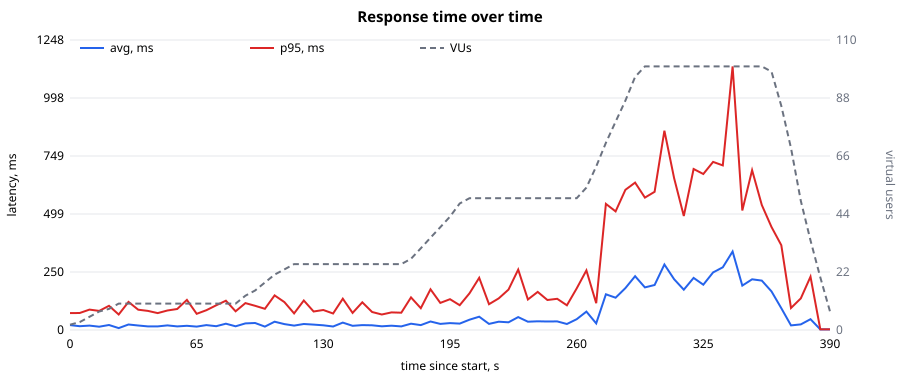
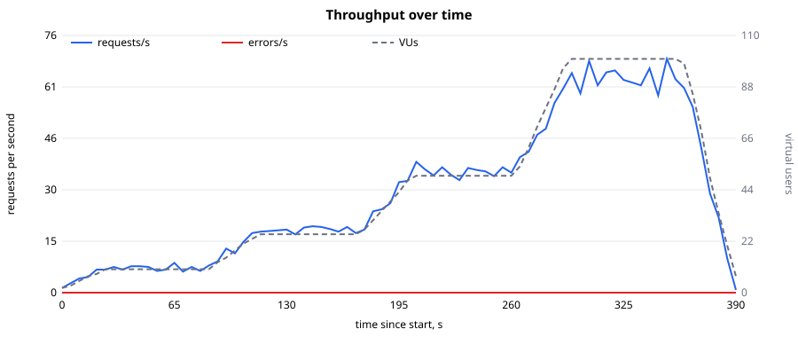
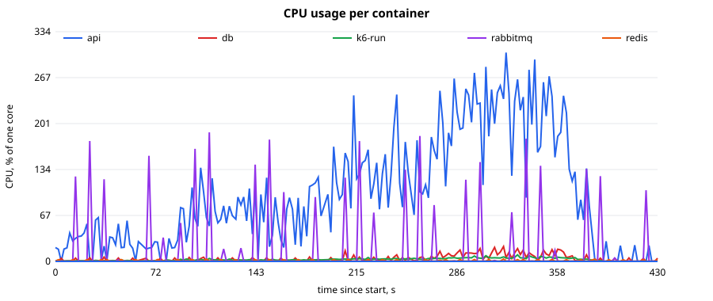
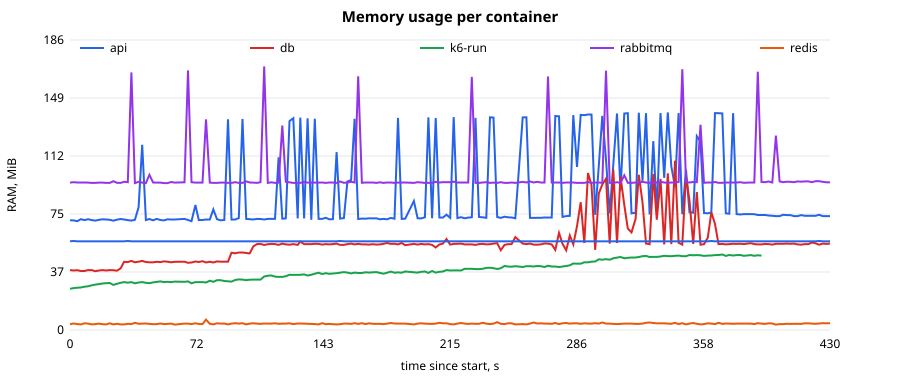

# Звіт: Лабораторна робота №4 — Первинне навантажувальне тестування

**Застосунок:** Fleet Management (каршерінг): FastAPI API + PostgreSQL + Redis + RabbitMQ
**Гілка:** `feat/lab4-lab5-loadtest-docker`
**Дата виконання:** 2026-10-17

Сирі результати лежать у [`loadtest/results/lab4/`](../../loadtest/results/lab4/): консольний вивід k6 ([`smoke.txt`](../../loadtest/results/lab4/smoke.txt), [`stepped.txt`](../../loadtest/results/lab4/stepped.txt)), таблиці ([`summary.md`](../../loadtest/results/lab4/summary.md)), семпли CPU/RAM ([`resources.csv`](../../loadtest/results/lab4/resources.csv)), інтерактивний дашборд k6 ([`k6-dashboard.html`](../../loadtest/results/lab4/k6-dashboard.html)) і SVG-графіки. Повний CSV k6 займає ~14 MB, тому в git не потрапляє: його можна відтворити командами з розділу 2.

## 1. Планування тестування

### Інструмент: k6

| Критерій | k6 | Locust | JMeter |
|---|---|---|---|
| Сценарій | JavaScript-код, у git, рев'ю як звичайний код | Python-код | XML (GUI-редактор) |
| Ресурси генератора | Go, тисячі VU на одному ядрі | Python, GIL, потрібні workers | JVM, важкий |
| Запуск у нашому стеку | вже є сервіс `k6` у `docker-compose.yml` (профіль `loadtest`, з ЛР2 з якості) | окремий образ | окремий образ |
| Пороги SLO | `thresholds` з ненульовим кодом виходу (зручно для CI) | вручну | плагіни |

Тест запускається контейнером у тій самій Docker-мережі, що й API (`http://api:8000`), тому вимірювання не залежать від мережі хоста.

### Цільові ендпоінти MVP

Сценарій відтворює сесію орендаря, який шукає авто:

| # | Ендпоінт | Що робить | Чому обрано |
|---|---|---|---|
| 1 | `POST /auth/login` | вхід, хешування Argon2id, запис в `user_activity` | єдиний «важкий» за CPU запит, з нього починається кожна сесія |
| 2 | `GET /auth/me` | профіль за JWT (читання `users`) | автентифікований запит |
| 3 | `GET /stations` | список станцій | перша сторінка застосунку |
| 4 | `GET /vehicles` | список авто (~50 записів) | найбільша відповідь |
| 5 | `GET /vehicles/{id}` | картка авто | читання за ключем |
| 6 | `GET /vehicles/{id}/state` | стан авто з Redis (fallback на Postgres) | гарячий шлях телеметрії |

Між кроками є пауза «на читання сторінки» `sleep(1…3 s)`, тому одна сесія триває ~8.7 с. Акаунти (100 шт.) реєструються в `setup()` ще до вимірювань, а авто з телеметрією створює `scripts/seed_loadtest.py`.

### Профіль навантаження

| Параметр | Контрольний запуск (`PROFILE=smoke`) | Основний тест (`PROFILE=stepped`) |
|---|---|---|
| Executor | `constant-vus` | `ramping-vus` |
| VUsers | 2 | ступені 10 → 25 → 50 → **100** |
| Ramp-Up | — | 30 с на кожен ступінь |
| Утримання | 30 с | 60 с на кожному ступені |
| Ramp-Down | — | 30 с до 0 |
| Тривалість | 30 с | **6 хв 30 с** |
| Пороги (SLO) | `p95 < 500 ms`, `error rate < 1%`, `p95(login) < 1000 ms` | ті самі |

Навантаження росте ступенями, щоб для кожного рівня VUs був окремий відрізок часу і було видно, з якого рівня починається деградація.

**Тестове середовище:** увесь стек ЛР5 (`docker compose up --build`), Docker Desktop 29.8.0 на Windows 11, 8 vCPU / 12 GiB. API — один процес uvicorn без лімітів CPU. Поруч працювали контейнери іншого проєкту, тож абсолютні цифри орієнтовні; висновки стосуються відносної динаміки.

## 2. Сценарій і запуск

Сценарій — [`loadtest/user_journey.js`](../../loadtest/user_journey.js). Кожен запит отримує тег `name`, тому метрики розбиваються по ендпоінтах. `check()` перевіряє статус 200, а для логіна сценарій ще й бере `access_token` для наступних запитів.

```powershell
docker compose up -d --build
python scripts/seed_loadtest.py --vehicles 50
# 1) контрольний запуск
docker compose run --rm --no-deps -e PROFILE=smoke k6 run --out csv=/scripts/results/lab4/k6-smoke.csv /scripts/user_journey.js
# 2) основний тест + паралельно збір CPU/RAM
python scripts/docker_stats.py --out loadtest/results/lab4/resources.csv --duration 440
docker compose run --rm --no-deps -e K6_WEB_DASHBOARD=true -e K6_WEB_DASHBOARD_EXPORT=/scripts/results/lab4/k6-dashboard.html k6 run --out csv=/scripts/results/lab4/k6.csv /scripts/user_journey.js
# 3) таблиці та графіки
python loadtest/report.py --k6 loadtest/results/lab4/k6.csv --resources loadtest/results/lab4/resources.csv --out loadtest/results/lab4
```

**Контрольний запуск** ([`smoke.txt`](../../loadtest/results/lab4/smoke.txt)): 2 VUs, 9 сесій, 54 запити, усі `check` пройшли, помилок 0%. GET-запити займають ~2–3 ms, `POST /auth/login` — ~80 ms. Пороги виконано: сценарій і середовище працюють, можна запускати основний тест.

## 3. Первинні метрики

[`scripts/docker_stats.py`](../../scripts/docker_stats.py) раз на ~2 с знімав `docker stats` по контейнерах проєкту. [`loadtest/report.py`](../../loadtest/report.py) (тільки стандартна бібліотека) агрегує CSV k6 у 5-секундні вікна та на плато ступенів. Запити з `setup()` у метрики не входять.

### Підсумкова таблиця (основний тест, 6 хв 30 с)

| Метрика | Значення |
|---|---|
| Усього запитів | 11 658 (1 943 сесії) |
| **RPS** середній / піковий (5-с вікно) | **29.8** / **69.0** (на 100 VUs) |
| **Latency** avg | **119.1 ms** |
| **Latency** min / max | **1.2 ms** / **2 114 ms** |
| **Latency p95** | **511 ms** (поріг 500 ms — ✗ не виконано) |
| Latency p99 | 825 ms |
| **Error Rate** | **0.00 %** (0 з 11 658; усі `check` пройшли) |
| **CPU api** (середнє / пік) | **101 %** / **324 %** одного ядра |
| **RAM api** (середнє / пік) | **88 MiB** / **140 MiB** |
| CPU / RAM db | 4 % / 56 MiB (пік 22 % / 109 MiB) |

### По ступенях навантаження (плато)

| VUs | RPS | Avg, ms | p95, ms | Max, ms | Errors | CPU api (avg) | CPU db (avg) |
|---|---|---|---|---|---|---|---|
| 10 | 7.2 | 17.9 | 85.7 | 150 | 0 % | 26 % | 1.5 % |
| 25 | 18.6 | 20.6 | 90.7 | 207 | 0 % | 64 % | 1.4 % |
| 50 | 36.0 | 39.7 | 160.4 | 633 | 0 % | 131 % | 3.3 % |
| **100** | **63.4** | **228.2** | **699.3** | **2 114** | 0 % | **221 %** | 11.3 % |

### По ендпоінтах

| Ендпоінт | Запитів | Avg, ms | Min, ms | Max, ms | p95, ms |
|---|---|---|---|---|---|
| `POST /auth/login` | 1 943 | **207.7** | 54.1 | 1 393.7 | **677.6** |
| `GET /auth/me` | 1 943 | 87.9 | 1.6 | 1 339.1 | 392.1 |
| `GET /stations` | 1 943 | 92.5 | 1.2 | 1 864.2 | 420.2 |
| `GET /vehicles` | 1 943 | 106.2 | 1.7 | 1 476.0 | 513.3 |
| `GET /vehicles/{id}` | 1 943 | 113.4 | 1.4 | 2 114.3 | 555.4 |
| `GET /vehicles/{id}/state` | 1 943 | 107.0 | 1.4 | 1 432.0 | 463.3 |

## 4. Графіки

**Динаміка часу відповіді** (avg і p95 за 5-с вікна; пунктир — кількість VUs, права вісь):



**Пропускна здатність** (запити/с і помилки/с; пунктир — VUs):



**CPU і RAM контейнерів:**





Інтерактивні графіки k6 (http_req_duration, RPS, VUs у часі) — у [`k6-dashboard.html`](../../loadtest/results/lab4/k6-dashboard.html); файл треба завантажити й відкрити в браузері.

## 5. Виявлені вузькі місця

1. **Різке зростання затримки між 50 і 100 VUs.** До 25 VUs p95 тримається ~90 ms. На 50 VUs p95 зростає до 160 ms, а на 100 VUs — до **699 ms** (×7.7 від 10 VUs), max — до 2.1 с. Пропускна здатність у той самий момент перестає рости лінійно: кількість VUs подвоїлася (50 → 100), а RPS виріс лише в 1.76 раза (36 → 63.4). Отже, точка насичення одного екземпляра API лежить у діапазоні **~50–100 одночасних користувачів (~40–60 RPS)**. Поріг `p95 < 500 ms` за весь тест не виконано (511 ms).

2. **Причина — CPU-важкий логін, що блокує event loop.** `POST /auth/login` перевіряє пароль Argon2id (~55–80 ms CPU на запит навіть без навантаження). `verify_password()` — синхронний виклик всередині `async`-обробника (`user_service.authenticate`), тому поки хеш рахується, однопроцесний uvicorn не обробляє інших запитів. Саме тому деградують **усі** ендпоінти, навіть ті, що читають з Redis: `GET /vehicles/{id}/state` без навантаження відповідає за ~2 ms, а на 100 VUs p95 становить ~460 ms. Висновок підтверджують ресурси: CPU api зростає приблизно пропорційно до VUs (26 % → 221 %), тоді як Postgres навіть на піку завантажений лише на 11 %, а Redis — <4 %. Вузьке місце — CPU процесу API, не база даних.

3. **Один процес API без горизонтального масштабування.** Uvicorn запущено з одним worker, тому один хеш Argon2 зупиняє обробку всіх запитів. Docker при цьому має 8 vCPU, і більшість із них простоює.

4. **Хибні тайм-аути Redis як наслідок блокування.** На ступені 100 VUs (12:25–12:26 UTC) у логах api ([`api-redis-timeouts.txt`](../../loadtest/results/lab4/api-redis-timeouts.txt)) з'явилися 8 записів `redis.hgetall failed on attempt N/3: TimeoutError()` і один `serving degraded state from Postgres`. Сам Redis при цьому був завантажений менше ніж на 4 % CPU. Тайм-аут на спробу (200 ms, з ЛР2 з якості) спрацьовує, бо event loop, зайнятий Argon2, не встигає вчасно обробити відповідь Redis. Отже, під навантаженням механізм resilience реагує на перевантаження самого API, а не на збій Redis.

5. **Помилок HTTP немає.** Error rate 0 %: при перевантаженні система уповільнюється, але запитів не втрачає. Пул з'єднань SQLAlchemy (5 + 10 overflow) на 100 VUs не вичерпався: у логах немає `QueuePool`-тайм-аутів.

**Що перевірити в наступних ітераціях** (у межах ЛР4 не реалізовано, бо це первинний тест):
- виносити `verify_password` / `hash_password` у потік (`await asyncio.to_thread(...)`) — event loop не блокуватиметься, GET-запити перестануть залежати від логінів;
- запускати кілька worker-процесів uvicorn (`--workers N`) або кілька реплік api за балансувальником (як у ЛР з Kubernetes/Helm);
- повторити тест зі ступенями 150/200 VUs, щоб знайти точку, де з'являються помилки (тайм-аути, вичерпання пулу з'єднань БД).
