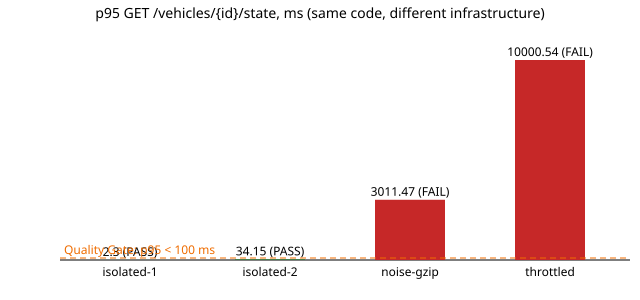

# ЛР №5. Enterprise-стратегія інженерного аудиту за GQM та інфраструктурна валідація метрик

**Проєкт:** Fleet Management (station-based carsharing, FastAPI + PostgreSQL + Redis + RabbitMQ)
**Гілка:** `feat/lab5-quality-gqm` · **Дата вимірювань:** 2026-10-17

Усі числа в звіті отримано реальними запусками; сирі протоколи лежать у [`outputs/`](outputs/).

| Артефакт | Призначення |
|---|---|
| `Dockerfile.metrics`, `requirements-metrics.txt` | закріплений (pinned) образ усіх вимірювальних інструментів |
| `pyproject.toml` → `[tool.mutmut]` | область мутаційного аналізу (scope Quality Gate) |
| `scripts/run_quality_gate.sh`, `scripts/quality_gate.py` | збалансований Quality Gate: Coverage AND Mutation Score |
| `scripts/goodhart_trap.py` | краш-тест закону Гудхарта (`plant` / `fix` / `clean`) |
| `scripts/metrics_probe.py`, `scripts/reliability_test.py` | експеримент 1: надійність аналізаторів |
| `scripts/stability_test.py` | експеримент 2: стабільність p95 під інфраструктурним шумом |
| `scripts/check_analyzable.py`, `.gitattributes`, `.pre-commit-config.yaml`, `docker-compose.yml`, CI | впроваджений інженерний захист |

---

## Завдання 1. GQM-матриця та паспортизація шкал Стівенса

### 1.1. Декларація стратегічної мети (шаблон Басілі)

| Компонент | Значення |
|---|---|
| **Об'єкт дослідження** | ядро оренди (Rental Core): API бронювання/повернення авто, доменна логіка тарифікації та допуску (`rental_service`), шар захисту персональних даних (`privacy`) і CI/CD-конвеєр, що їх доставляє |
| **Ціль** | **оцінити та покращити** |
| **Якісний фокус** | **супроводжуваність (maintainability) і надійність змін (reliability of change)** — здатність вносити зміни в тарифи/правила допуску без регресій і без нових вразливостей |
| **Роль / позиція** | з позиції **Lead Software Architect** |
| **Контекст середовища** | у межах ітераційного семестрового MVP (тижневі спринти-лабораторні осіннього семестру 2026, GitHub Actions як єдиний конвеєр якості |

> **G:** *Оцінити та покращити супроводжуваність і надійність змін ядра оренди Fleet Management з позиції Lead Software Architect*

### 1.2–1.4. Паспорт інженерних вимірювань (GQM Matrix)

| Контур | Інженерне запитання (Q) | Технічна метрика (M) | Інструмент / джерело | Шкала Стівенса | Валідна агрегація | Поточне значення (2026-10-17) |
|---|---|---|---|---|---|---|
| **Продукт** | **Q1.** Наскільки складна для розуміння й безпечної зміни логіка критичних модулів? | **M1.** Цикломатична складність функції (CC, кількість незалежних шляхів) | Radon / Lizard CLI (`radon cc src -s`) | **Відносна (ratio)** | будь-які: середнє, медіана, перцентилі, max, сума, відношення («удвічі складніша») | max = 10 (`sanitize_record`), середнє = 2.0 на 165 функцій, 0 функцій з CC > 10 |
| **Продукт** | **Q2.** Чи містять прямі й транзитивні залежності відомі вразливості і якої критичності? | **M2.** Максимальний рівень критичності відкритої CVE/GHSA: `NONE < LOW < MEDIUM < HIGH < CRITICAL` | pip-audit, Trivy (CI-джоби `sca`, `build`) | **Порядкова (ordinal)** | мода, медіана, перцентилі, **max** (найгірший випадок), частоти за рівнями; **без** середнього | `NONE` (у ЛР3 було `HIGH`: virtualenv 21.7.8 → закріплено 21.14.5) |
| **Процес** | **Q3.** Яку частку критичної доменної логіки виконує тестовий набір? | **M3.** Line Coverage, % рядків scope, виконаних тестами | pytest-cov (`coverage.json`), SonarCloud | **Відносна (ratio)** | зважене середнє за кількістю statements, медіана, перцентилі, різниці й відношення | 82.17 % (scope `rental_service.py` + `sanitizer.py`) |
| **Процес** | **Q4.** Наскільки стабільно проходить CI-конвеєр і як часто він «червоний»? | **M4.** Результат кожного CI-запуску: `{success, failure, cancelled}` | GitHub Actions API (`gh run list --json conclusion`) | **Номінальна (nominal)** | лише підрахунок частот, **мода**, частка категорії (failure rate), χ²; **без** порядку, медіани й середнього | 28 запусків (2026-09-20…10-17): 20 `success`, 8 `failure` → мода `success`, failure rate = 8/28 = **28.6 %** |
| **Команда** | **Q5.** Яку частку інженерних трудовитрат команда капіталізує в погашення технічного боргу (рефакторинг і виправлення)? | **M5.** Refactoring effort share = churn (додані + видалені рядки) у комітах `refactor:` + `fix:` / churn усіх комітів, % | Git CLI (`git log --numstat`), Conventional Commits | **Відносна (ratio)** | сума, середнє, медіана, відношення між спринтами | (316 + 1 618) / 18 136 = **10.7 %** (без службових комітів `deleted`) |
| **Команда** | **Q6.** Чи рівномірно розподілене в часі комплаєнс-навантаження (безпека, privacy/GDPR, SCA), чи воно стається «авралом» перед здачею? | **M6.** Календарний зсув комплаєнс-коміту від старту проєкту, днів (`дата_коміту − 2026-09-04`) | Git CLI (`git log --date=short`, коміти про SonarQube / Trivy / gitleaks / pip-audit (GHSA) / SCA / privacy (GDPR)) | **Інтервальна (interval)** | різниці, середнє, медіана, стандартне відхилення; **без** відношень («удвічі пізніше») | 7 комітів: дні 9, 16, 29, 29, 29, 36, 36 → середнє 26.3 дня (≈ 2026-09-30), медіана 29, σ ≈ 9.4 дня; усі — на вихідних, 5 з 7 — у дві суботи (кластери замість рівномірного потоку) |

Розподіл за шкалами: номінальна — M4; порядкова — M2; інтервальна — M6; відносна — M1, M3, M5.
Допоміжна динамічна метрика для завдання 3 — **p95 часу відгуку** `GET /vehicles/{id}/state` (k6), відносна шкала.

### 1.5. Архітектурно-математичне обґрунтування агрегацій

**Чому шкала визначає допустимі операції.** Шкала — це клас перетворень, які зберігають зміст
даних. Статистика допустима лише тоді, коли її результат не змінюється (або змінюється
узгоджено) під час такого перетворення:

| Шкала | Допустиме перетворення | Що зберігається | Валідна «центральна тенденція» |
|---|---|---|---|
| Номінальна | будь-яка взаємно однозначна заміна міток | рівність | мода |
| Порядкова | будь-яка строго зростаюча функція | порядок | медіана, перцентилі |
| Інтервальна | `y = a·x + b`, `a > 0` | відношення **різниць** | середнє арифметичне, σ |
| Відносна | `y = a·x`, `a > 0` (нуль абсолютний) | відношення **значень** | усе вище + геометричне середнє, коефіцієнт варіації |

**M2 (порядкова): чому «середнє» Security Rating A і C — не «B».** Рейтинги SonarQube A…E (або
`LOW…CRITICAL`) — лише впорядковані мітки. Кодування `A=1, C=3` довільне: з тим самим правом
можна закодувати `A=1, B=2, C=10` (порядок збережено, бо будь-яка зростаюча функція допустима).
Тоді «середнє» дорівнює 2 = «B» в одному кодуванні і 5.5 = «між C і D» в іншому — результат
залежить від довільного вибору чисел, тобто не має змісту. Крім того, відстані між рівнями
нерівні: один модуль з `C` (є вразливість) і один з `A` (вразливостей немає) не дають систему
«в середньому з B», а дають систему з **відкритою вразливістю**. Для безпеки правильна агрегація
— **max (найгірший рівень)**, а для портфеля модулів — медіана й частоти за рівнями. Саме тому
M2 у матриці — «максимальна критичність відкритої CVE»: Quality Gate оцінює найслабшу ланку.

**M4 (номінальна).** `success/failure/cancelled` не впорядковані, тож навіть медіана не має
змісту. Допустимі лише частоти, мода та частки. Частка `failure` (28.6 %) — це вже нова,
похідна величина на відносній шкалі, тому її можна усереднювати між періодами.

**M6 (інтервальна) vs відносна — у чому різниця.** Нуль M6 (2026-09-04) обрано довільно: якщо
відлічувати від 2026-09-01, усі значення зсунуться на +3 (`y = x + b`). Різниці при цьому
зберігаються («між першим і останнім комплаєнс-комітом 27 днів»), тож **середнє і σ валідні**
(середня дата 2026-09-30, σ ≈ 9.4 дня). А відношення не зберігаються: 36/9 = «у 4 рази
пізніше», але після зсуву 39/12 = 3.25. Тому «удвічі пізніше» на інтервальній шкалі —
методологічна помилка. У відносних метрик (M1, M3, M5, p95) нуль **фізичний** (0 мс,
0 рядків, 0 шляхів), тож відношення змістовні: функція з CC = 10 справді має вп'ятеро більше
незалежних шляхів, ніж середня (2.0).

**M3 (відносна): зважене, а не просте середнє.** Покриття scope — це
`Σ covered / Σ statements`, а не середнє арифметичне відсотків файлів: файл на 5 рядків зі 100 %
і файл на 500 рядків з 50 % «в середньому» дають 75 %, хоча реально покрито 50.5 %.

**Час — чому медіана й p95, а не середнє.** Розподіли часу правоскошені й мають важкий хвіст:
- *Відновлення CI (допоміжна метрика процесу).* Час від червоного до зеленого запуску на
  тій самій гілці: 9.1, 15.2, 25.9 і 3 285.1 хв. Середнє — **833.8 хв (≈ 14 год)**, медіана —
  **20.5 хв**. Один викид (гілку покинули на вихідні) змістив середнє в 40 разів; медіана
  описує типовий випадок, а викид варто аналізувати окремо.
- *Час відгуку під навантаженням (завдання 3, `isolated-2`).* Середнє = 9.75 мс, медіана =
  1.54 мс, **p95 = 34.15 мс**, p99 = 245.95 мс. Середнє «розмазує» хвіст: 5 % користувачів
  чекають у 3.5 раза довше за середнє. SLO формулюють як p95/p99, бо це гарантія для
  переважної більшості запитів. Середнє не відповідає на питання «скільки чекатиме майже кожен
  користувач». Крім того, перцентилі не можна усереднювати між вузлами чи прогонами
  (середнє двох p95 не дорівнює p95 об'єднаної вибірки): p95 рахують на сирих даних
  або гістограмах.

---

## Завдання 2. Закон Гудхарта та метрика-балансир

### 2.1. Аналітична декларація ризику (пастка Гудхарта для M3 Line Coverage)

**Сценарій.** Product Owner фіксує KPI спринту «Line Coverage ядра оренди ≥ 90 %» і прив'язує
до нього бонус. Поточне значення — 82.17 %: непокриті рядки — це `start_rental` і `end_rental`
(робота з `AsyncSession`, бронювання авто, повернення на станцію). Чесні тести для них
вимагають моків сесії, перевірки статусів і граничних випадків, тобто кількох днів роботи.

**Як «підганяють» цифру.** Розробник пише «тести», які лише **виконують** рядки:
викликають `start_rental`/`end_rental` з `MagicMock`, огортають виклики в
`try/except Exception: pass` і не містять жодного `assert`
(`python scripts/goodhart_trap.py plant`). Coverage рахує виконані рядки, а не перевірені
властивості, тому:

| Стан | Line Coverage | Чи захищає від регресії? |
|---|---|---|
| baseline (до KPI) | 82.17 % — FAIL KPI | `start/end_rental` не тестуються взагалі |
| **«хакнутий» набір** | **99.36 % — PASS KPI, бонус виплачено** | **ні**: тест зелений, навіть якщо `start_rental` ставить авто статус `AVAILABLE` замість `RENTED` |

**Наслідки для кодової бази.** (1) Дашборд показує «майже 100 %», і керівництво знімає ризик
із найкритичнішого коду (подвійне бронювання авто, повернення на переповнену станцію).
(2) `except Exception: pass` ховає справжні падіння. (3) Хибна впевненість блокує
появу нормальних тестів: «покриття вже є». (4) Рефакторинг стає небезпечнішим, ніж без
тестів, бо зелений CI нічого не гарантує. (5) Метрика втратила інформативність: вона росте
незалежно від якості, тож Q3 більше не отримує відповіді.

### 2.2. Специфікація метрики-балансира

| Поле | Значення |
|---|---|
| **Назва** | **Mutation Score** (для покритого коду), `MS = killed / (killed + survived + timeout)` |
| **Призначення** | вимірює **здатність тестів знаходити дефекти**, а не факт виконання рядків. mutmut вносить у код малі синтаксичні дефекти (мутанти: `>` → `>=`, `RENTED` → `None`, `3600` → `3601` …) і перевіряє, чи впаде хоча б один тест |
| **Інструмент (безкоштовний)** | **mutmut 3.8.0** (Python), запуск у закріпленому `Dockerfile.metrics`; scope і тести — `[tool.mutmut]` у `pyproject.toml` |
| **Чому саме він нейтралізує хак** | тест без `assert` не вбиває жодного мутанта. Хак переводить мутанти `no tests` у `survived`, тож знаменник росте, а чисельник ні: `K / (K + S + k) < K / (K + S)`. **Кожен «куплений» хаком відсоток покриття строго знижує MS.** Підняти обидві метрики можна лише справжніми перевірками. Це економічно не дешевше за чесну роботу, тож маніпуляція втрачає сенс |
| **Чому `no tests` не у знаменнику** | інакше MS просто дублює покриття (непокритий код = невбитий мутант). Розділення ролей: Coverage — «скільки коду виконано», MS — «наскільки сильні перевірки там, де код виконано» (так рахує Stryker «mutation score for covered code») |

Приклади мутантів, що вижили навіть у чесному наборі (реальні прогалини, які Coverage не бачить):

```diff
-    if rental_count > 20:          # _regular_discount: немає тесту на межу 20
+    if rental_count >= 20:
-    if rental_count <= 5:          # _regular_discount: немає тесту на межу 5
+    if rental_count < 5:
-    duration_hours = (...).total_seconds() / 3600
+    duration_hours = (...).total_seconds() / 3601   # calculate_cost: немає тесту на рівно N годин + 1 с
```

### 2.3. Архітектурний щит комплаєнсу (Balanced Quality Gate)

```
GATE = PASS  ⇔  (Line Coverage_scope ≥ 90 %)  AND  (Mutation Score_scope ≥ 75 %)
scope = [tool.mutmut].source_paths = rental_service.py + sanitizer.py
```

**Обґрунтування порогів.**
- **Coverage ≥ 90 %** — це KPI Product Owner. Scope — чиста доменна логіка без I/O, тож
  90 % досяжні без тестування фреймворку. 100 % не вимагаємо, бо це провокує той самий хак
  на захисних гілках.
- **MS ≥ 75 %.** Чесний набір має 84.16 % (baseline) і 86.94 % (після чесних тестів). Запас
  ≈ 9–12 п.п. покриває еквівалентних мутантів (їх неможливо вбити жодним тестом) і дрібні
  граничні прогалини: 35 із 268 мутантів (13 %) виживають і в чесному наборі.
  Хак опускає MS до 72.39 %, і поріг 75 % його відсікає. Значення лежить
  між типовими порогами Stryker (`low = 60`, `high = 80`).
- **Оператор AND.** Кожна метрика окремо піддається маніпуляції: Coverage — хаком без `assert`,
  MS — видаленням непокритого коду з аналізу або мінімальною кількістю тестів на простому коді
  (високий MS при низькому покритті). Лише кон'юнкція закриває обидва шляхи.

**Протокол краш-тесту** (`docker run --rm --cpus=2 --memory=2g -v "$PWD:/work" fleet-metrics:1 sh scripts/run_quality_gate.sh`):

| Стан | Mutants killed / survived / no tests | Line Coverage | Mutation Score | Coverage-only gate | **Balanced gate** | Протокол |
|---|---|---|---|---|---|---|
| baseline | 186 / 35 / 47 | 82.17 % ❌ | 84.16 % ✅ | FAIL | **FAIL** | [`01-gate-baseline.txt`](outputs/01-gate-baseline.txt) |
| `goodhart_trap.py plant` (тести без assert) | 194 / 74 / 0 | 99.36 % ✅ | **72.39 % ❌** | **PASS (обман)** | **FAIL** | [`02-gate-plant.txt`](outputs/02-gate-plant.txt) |
| `goodhart_trap.py fix` (чесні тести з assert) | 233 / 35 / 0 | 99.36 % ✅ | 86.94 % ✅ | PASS | **PASS** | [`03-gate-fix.txt`](outputs/03-gate-fix.txt) |

Хак підняв покриття на 17 п.п., але MS упав на 11.8 п.п., і збалансований гейт його відхилив.
Тести з тим самим покриттям, але з перевірками, вбили на 39 мутантів більше й пройшли.
Гейт інтегровано в CI як джоб `quality-gate`, від якого залежить збирання образів (`build`).

---

## Завдання 3. Інфраструктурний краш-тест засобів аналізу

### 3.1. Експеримент 1 — надійність (Reliability Test)

**Об'єкт:** `src/fleet_management/privacy/logging_setup.py` — файл із найскладнішою функцією
проєкту (`sanitize_record`, CC = 10, rank B), 11 функцій, не-ASCII символ у docstring.
Сканувався **закомічений git-blob** (LF), а не робоча копія: у розробника `core.autocrlf=true`,
тому на диску Windows цей файл уже має CRLF (`git ls-files --eol` → `i/lf w/crlf`).
Запуск: `python scripts/reliability_test.py` → [`outputs/reliability.json`](outputs/reliability.json).

**Сценарій А — форматування ОС (кінці рядків і кодування),** Python 3.13.16, закріплені інструменти:

| Варіант байтів | radon LOC | SLOC | LLOC | CC max | CC sum | MI | lizard NLOC | CCN sum | tokens | complexipy cognitive |
|---|---|---|---|---|---|---|---|---|---|---|
| `utf8-lf` (еталон, як у git) | 124 | 88 | 83 | 10 | 41 | 56.7 | 73 | 33 | 642 | 22 |
| `utf8-crlf` (Windows) | 124 | 88 | 83 | 10 | 41 | 56.7 | 73 | 33 | 642 | 22 |
| `utf8-cr` (classic Mac) | 124 | 88 | 83 | 10 | 41 | 56.7 | 73 | 33 | 642 | 22 |
| `utf8-bom-lf` (Блокнот / деякі IDE) | **CRASH** | — | — | — | — | — | 73 | 33 | 642 | 22 |
| `cp1251-lf` (локальна кодова сторінка Windows) | **CRASH** | — | — | — | — | — | 73 | 33 | 642 | **CRASH** |

- radon на BOM: `invalid non-printable character U+FEFF` (Python 3.9: `SyntaxError at line: 1`);
- radon на cp1251: `'utf-8' codec can't decode byte 0x97 in position 248`; complexipy: `Failed to process`;
- lizard читає «битий» файл без помилки і повертає числа. Тут вони збіглися лише тому, що
  зіпсований байт стоїть у docstring.

**Сценарій Б — версійність (образ раннера, інтерпретатор, версія аналізатора),** варіант `utf8-lf`:

| Раннер | radon LOC | SLOC | LLOC | CC max | CC sum | MI | lizard NLOC | CCN sum | tokens | cognitive |
|---|---|---|---|---|---|---|---|---|---|---|
| `python:3.9-slim` (3.9.25), radon 6.0.1, lizard 1.24.1 | 124 | 88 | 83 | 10 | 41 | 56.7 | 73 | 33 | 642 | 22 |
| `python:3.13.16-slim`, radon 6.0.1, lizard 1.24.1 | 124 | 88 | 83 | 10 | 41 | 56.7 | 73 | 33 | 642 | 22 |
| `python:3.14-slim` (3.14.8), radon 6.0.1, lizard 1.24.1 | 124 | 88 | 83 | 10 | 41 | 56.7 | 73 | 33 | 642 | 22 |
| `python:3.13.16-slim`, **radon 5.1.0, lizard 1.17.10** | 124 | 88 | 83 | 10 | 41 | 56.7 | **75** | 33 | 642 | n/a |

**Оцінка стійкості.**

| Фактор | Вплив на числа | Висновок |
|---|---|---|
| CRLF / LF / CR | немає (усі 10 метрик ідентичні) | інструменти нормалізують кінці рядків |
| Версія інтерпретатора 3.9 → 3.14 | немає | для цього файлу парсинг стабільний (синтаксис ≤ 3.9) |
| **Версія аналізатора** | **lizard NLOC 75 → 73 (−2.7 %)** без жодної зміни коду | «тихий дрейф»: оновлення інструменту виглядає на дашборді як рефакторинг |
| **UTF-8 BOM** | radon падає | метрики файлу зникають |
| **cp1251** | radon і complexipy падають, lizard рахує | різні інструменти дають суперечливу картину |

**Найнебезпечніший наслідок — хибний PASS.** Гейт складності в CI — `xenon --max-absolute B`.
Якщо radon не зміг розібрати файл, xenon пише лише `WARNING` і **виходить з кодом 0**. Ми
дописали в `logging_setup.py` функцію рангу C (CC > 10), яка мусить завалити гейт, і зберегли
файл з BOM ([`04-xenon-bom-false-pass.txt`](outputs/04-xenon-bom-false-pass.txt)):

| Файл | `xenon --max-absolute B` | `check_analyzable.py` (новий захист) |
|---|---|---|
| UTF-8 без BOM | `ERROR … has a rank of C`, exit = 1 (**FAIL**, правильно) | 1/1 analyzable, exit = 0 |
| той самий файл з BOM | `WARNING: cannot parse …`, exit = 0 (**хибний PASS**) | `NOT ANALYZABLE …`, exit = 1 (**FAIL**) |

### 3.2. Експеримент 2 — стабільність (Stability Crash-Test)

**Метод.** Код, образ і k6-сценарій однакові в усіх прогонах: `loadtest/vehicle_state.js`,
`PROFILE=peak`, ramping-arrival-rate до **300 rps**, 30 с розгону + 40 с плато,
`GET /vehicles/{id}/state` по 50 авто з кешу Redis. Ворота з ЛР2: `p95 < 100 ms AND error rate < 1 %`.
Змінюється **лише інфраструктура** (`python scripts/stability_test.py --project fleet_qe5`):

- `isolated-1/2` — api з квотою `--cpus=2`, сторонніх навантажень немає;
- `noise-gzip` — паралельно 12 контейнерів `alpine` виконують `gzip -9` (імітація важкої
  компресії логів на тій самій машині), квота api не змінюється;
- `throttled` — api стиснуто до `--cpus=0.25` (`docker update`), як на перевантаженому
  shared-раннері з CPU quota.

Під час кожного прогону `docker stats` знімає CPU і RAM контейнера api.

| Сценарій | Запитів | avg, ms | median, ms | **p95, ms** | p99, ms | max, ms | Error rate | api CPU median, % | api RAM max, MiB | Gate |
|---|---|---|---|---|---|---|---|---|---|---|
| isolated-1 | 18 750 | 1.58 | 1.39 | **2.30** | 3.59 | 36.56 | 0.00 % | 40.7 | 84.3 | ✅ **PASS** |
| isolated-2 | 18 750 | 9.75 | 1.54 | **34.15** | 245.95 | 419.31 | 0.00 % | 42.9 | 88.6 | ✅ **PASS** |
| noise-gzip | 18 003 | 641.40 | 159.05 | **3 011.47** | 4 728.00 | 5 378.82 | 0.00 % | 49.9 | 109.9 | ❌ **FAIL (хибний)** |
| throttled | 12 571 | 4 377.29 | 3 745.63 | **10 000.54** | 10 000.92 | 10 011.64 | 20.33 % | 24.3 | 110.8 | ❌ **FAIL (хибний)** |



Сирі дані: [`outputs/stability/stability.json`](outputs/stability/stability.json), k6-summary — `loadtest/results/lab5/*.json`.

**Аналіз флуктуацій.**
1. **Шум розкиду навіть «в ізоляції».** Два ідентичні прогони дали p95 2.30 і 34.15 мс
   (×15), p99 3.59 і 245.95 мс. На тій самій машині працювали інші Docker-стеки (`fleet_lab5`,
   сторонній проєкт із контейнером у циклі перезапуску). Робоча станція розробника ізольованим
   середовищем не є. Один прогін не дає підстав для висновку: потрібна серія і медіана p95.
2. **Noisy neighbour (`noise-gzip`).** p95 зріс у 1 300 разів, хоча api в середньому
   використовував лише 49.9 % зі своїх 200 % квоти. Отже, «вузьке місце» не в коді: потоки
   api і **генератор навантаження k6** чекали в черзі планувальника хоста. k6 не встиг
   згенерувати 747 запитів. Шум спотворює і систему, і сам вимірювальний прилад.
3. **CPU-квота (`throttled`).** При 0.25 CPU сервіс не обробляє 300 rps: запити чекають
   до таймауту 10 с (p95 = 10 000.54 мс), 20.33 % помилок, третина ітерацій випала.
   Логіка і код ті самі. Дашборд показав би «катастрофічну регресію релізу».
4. **RAM** зросла з 84 до 111 MiB лише через довгу чергу незавершених запитів, а не через витік.

Висновок: у неізольованому середовищі Quality Gate за динамічними метриками дає **хибний FAIL**
(та сама збірка з тим самим кодом не проходить гейт). Без контролю інфраструктури така метрика
не відповідає на Q-запитання про якість коду: вона міряє завантаженість заліза.

### 3.3. Технічна декларація інженерного захисту (впроваджено)

| # | Ризик (з експерименту) | Захід | Де в проєкті |
|---|---|---|---|
| 1 | Дрейф чисел при оновленні аналізатора (lizard NLOC 75 → 73) | **Жорстка фіксація версій** усіх вимірювальних інструментів; оновлення — лише окремим review-комітом | `requirements-metrics.txt`, `requirements-dev.txt`, CI `pip install radon==6.0.1 …` |
| 2 | Різні інтерпретатори та ОС у розробників і CI | **Контейнеризований метрик-раннер** з точним тегом образу `python:3.13.16-slim`, `PYTHONHASHSEED=0`; код монтується, інструменти «запечені» | `Dockerfile.metrics` |
| 3 | CRLF/BOM/чужа кодова сторінка залежно від `core.autocrlf` і редактора | **Канонічна форма байтів у репозиторії**: `* text=auto eol=lf`; pre-commit `fix-byte-order-marker`, `mixed-line-ending --fix=lf`, `check-ast` | `.gitattributes`, `.pre-commit-config.yaml` |
| 4 | Хибний PASS гейта складності на файлі, який radon не розібрав | **Fail-closed guard**: кожен файл `src` має бути аналізованим, інакше FAIL — до запуску xenon | `scripts/check_analyzable.py`, CI-джоб `complexity` |
| 5 | Конкуренція за CPU/RAM на shared-раннері під час mutmut | **Жорсткі ліміти контейнера раннера** `--cpus=2 --memory=2g` | CI-джоб `quality-gate`, `scripts/run_quality_gate.sh` |
| 6 | Latency залежить від того, скільки CPU вільно на хості (хибний FAIL) | **Фіксована квота ресурсів** для api і генератора k6 (`deploy.resources.limits: cpus 2, memory 512M`) | `docker-compose.yml` |
| 7 | Один прогін під шумом вирішує долю релізу | **Регламент вимірювання p95**: окремий виділений раннер/вузол без сусідів; серія ≥ 3 прогонів, у гейт іде медіана p95; передумова — простій хоста (load average < 0.5·nCPU) перед стартом; k6 на окремому від SUT вузлі | цей звіт (регламент для CI-перформанс-стейджу) |
| 8 | Метрика, підігнана під KPI (Гудхарт) | **Збалансований гейт** Coverage AND Mutation Score | `scripts/quality_gate.py`, CI-джоб `quality-gate` |

---

## Відтворення

```bash
# образ вимірювальних інструментів (один раз)
docker build -f Dockerfile.metrics -t fleet-metrics:1 .

# Завдання 2: збалансований гейт і краш-тест Гудхарта
docker run --rm --cpus=2 --memory=2g -v "$PWD:/work" fleet-metrics:1 sh scripts/run_quality_gate.sh
python scripts/goodhart_trap.py plant   # -> gate FAIL (coverage 99 %, MS 72 %)
python scripts/goodhart_trap.py fix     # -> gate PASS (coverage 99 %, MS 87 %)
python scripts/goodhart_trap.py clean

# Завдання 3, експеримент 1: надійність аналізаторів
python scripts/reliability_test.py
docker run --rm -v "$PWD:/work" fleet-metrics:1 python scripts/check_analyzable.py src

# Завдання 3, експеримент 2: стабільність (окремий стек, щоб не чіпати основний)
export API_PORT=8001 RABBITMQ_MGMT_PORT=15673
docker compose -p fleet_qe5 up -d --build --wait db redis rabbitmq api worker
docker exec fleet_qe5-api-1 alembic upgrade head
API_URL=http://localhost:8001 RABBITMQ_MGMT_URL=http://localhost:15673 python scripts/seed_loadtest.py
python scripts/stability_test.py --project fleet_qe5
docker compose -p fleet_qe5 down -v
```
