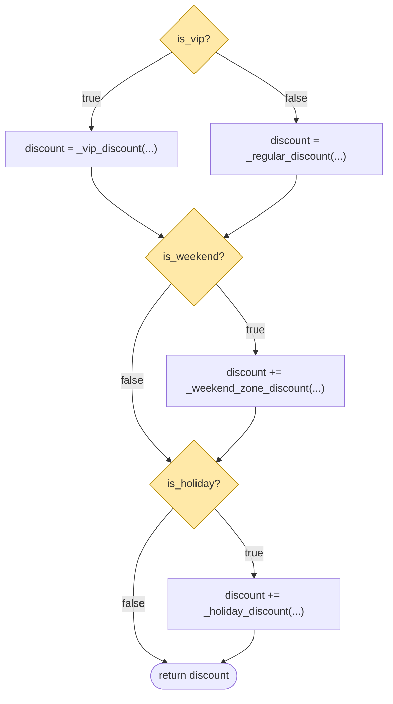

# Звіт: Лабораторна робота №6 — Топологічний та аналітичний аудит складності (Холстед, Мак-Кейб)

**Застосунок:** Fleet Management (каршерінг): FastAPI + PostgreSQL + Redis + RabbitMQ, Python 3.13
**Гілка:** `feat/lab6-complexity-audit`
**План і команди для ручної демонстрації:** [PLAN.md](PLAN.md)
**Сирі виводи команд:** [`outputs/`](outputs/) — кожен файл містить рядок часу, команду й код виходу; нічого не дописано вручну.

> Скріншоти для здачі студент робить сам під час повтору демонстрації за [PLAN.md](PLAN.md). У репозиторії лежать дослівні текстові виводи тих самих команд.

## 0. Декларація інструментального стеку

| Інструмент | Версія | Призначення | Встановлення |
|---|---|---|---|
| Radon CLI | 6.0.1 | цикломатична складність (`cc`), міри Холстеда (`hal`) | `pip install radon==6.0.1` |
| Lizard CLI | 1.24.3 | незалежна перевірка CCN | `pip install lizard==1.24.3` |
| Xenon | 0.9.3 | поріг CC для CI (`--max-absolute B`) | `pip install xenon==0.9.3` |
| Complexipy | 8.0.1 | когнітивна складність | `pip install complexipy==8.0.1` |
| `scripts/halstead_tokens.py` | власний | Холстед за визначенням з лаби (токени) | входить у репозиторій |
| `scripts/cfg_cc.py` | власний | `E − V + 2` з Mermaid-графів у цьому звіті | входить у репозиторій |
| `scripts/complexity_gate.py` | власний | воротар для pre-commit | входить у репозиторій |
| pre-commit framework | 4.6.2 | оркестратор Git-хуків | `pip install -r requirements-dev.txt && pre-commit install` |

Усі версії закріплені в [`requirements-dev.txt`](../../requirements-dev.txt) (Lizard додано в цій роботі). Окремих файлів конфігурації лінтерів немає: поріг передається аргументами (`-n`, `--max-absolute`) та константою `LIMIT = 10` у `scripts/complexity_gate.py`. Хук описано в [`.pre-commit-config.yaml`](../../.pre-commit-config.yaml).

Версії: [`outputs/01-tool-versions.txt`](outputs/01-tool-versions.txt).

### Чому дві колонки Холстеда

`radon hal` рахує оператором лише AST-операції (арифметика, булеві, порівняння, унарні), тому його η₁ ≤ 14, а ключові слова (`def`, `if`, `return`), дужки та коми в оператори не потрапляють. Лаба ж визначає оператори як «ключові слова, знаки операцій, роздільники». Тому в звіті подано **обидва виміри з явними підписями**:

* **radon** — офіційний CLI, AST-визначення;
* **token** — власний скрипт `scripts/halstead_tokens.py` на `tokenize` зі стандартної бібліотеки, визначення з лаби: оператори = ключові слова + символи операцій + роздільники; операнди = імена + числа + рядки; коментарі й docstring пропущено. Код оригінальний, чужих реалізацій не використано.

Ранжування проводиться за **token-виміром** (він відповідає визначенню з лаби); для radon показано, чи збігається порядок.

## 1. Завдання 1 — Холстед

### 1.1 Глобальна базова лінія (весь `src/`, 50 файлів, стан до експерименту)

| Вимір | η₁ | η₂ | N₁ | N₂ | η | N | V (біт) | D | E |
|---|---:|---:|---:|---:|---:|---:|---:|---:|---:|
| radon (усі модулі в один файл, щоб словник був глобальним) | 21 | 362 | 249 | 475 | 383 | 724 | 6 212,8 | 13,78 | 85 597 |
| token (глобальний словник усіх файлів) | 60 | 1 513 | 10 639 | 7 750 | 1 573 | 18 389 | 195 278 | 153,67 | 30 008 076 |

Виводи: [`02a`](outputs/02a-radon-hal-global-concatenated.txt), [`02b`](outputs/02b-token-halstead-global.txt). Радон не вміє давати глобальний словник напряму (η не адитивна по файлах), тому модулі були конкатеновані у тимчасовий файл; η для проєкту обчислюється саме так, а не сумою η файлів.

### 1.2 Вибір файлів (правило задано до вимірювань: за архітектурною роллю, а не за результатом)

| Роль | Файл | Чому |
|---|---|---|
| Core Domain | `services/rental_service.py` | розрахунок вартості й знижок, правила допуску до оренди |
| Infrastructure / Integration | `resilience.py` | retry/backoff/timeout навколо викликів Redis (`cache.py` використовує його політику) |
| Utility / Helper | `privacy/sanitizer.py` | маскування e-mail/телефону/імен у логах — чисті функції-утиліти |
| Контрольна група DTO (додатково) | `schemas.py` | Pydantic-схеми; функцій немає, тому як «Utility» не підходить за вимогою про токени на функцію |

У кожній функції вибраних файлів унікальних токенів (η) від 12 (`station_closed`) до 60 (`call_with_retry`); для 12 з 14 функцій `rental_service.py` η ≥ 14 — вимога «10–15 унікальних токенів» виконана ([`03c`](outputs/03c-token-halstead-per-function.txt)).

### 1.3 Матриця архітектурного поштучного аналізу

Token-вимір (визначення з лаби), [`03b`](outputs/03b-token-halstead-three-files.txt):

| Файл (роль) | LOC | η₁ | η₂ | N₁ | N₂ | η | N | V | D | E |
|---|---:|---:|---:|---:|---:|---:|---:|---:|---:|---:|
| `rental_service.py` (Core) | 188 | 39 | 133 | 503 | 393 | 172 | 896 | 6 653,9 | 57,62 | 383 402 |
| `sanitizer.py` (Utility) | 101 | 24 | 93 | 367 | 274 | 117 | 641 | 4 403,9 | 35,35 | 155 699 |
| `resilience.py` (Infrastructure) | 78 | 38 | 66 | 245 | 175 | 104 | 420 | 2 814,2 | 50,38 | 141 775 |
| `schemas.py` (DTO, контроль) | 130 | 15 | 80 | 221 | 217 | 95 | 438 | 2 877,6 | 20,34 | 58 541 |

radon-вимір (AST-оператори), [`03e`](outputs/03e-radon-hal-file-totals-baseline.txt):

| Файл | η₁ | η₂ | N₁ | N₂ | V | D | E |
|---|---:|---:|---:|---:|---:|---:|---:|
| `rental_service.py` | 12 | 39 | 23 | 43 | 374,4 | 6,62 | 2 477 |
| `resilience.py` | 8 | 28 | 16 | 32 | 248,2 | 4,57 | 1 134 |
| `sanitizer.py` | 5 | 16 | 9 | 16 | 109,8 | 2,50 | 275 |
| `schemas.py` | 1 | 5 | 5 | 10 | 38,8 | 1,00 | 39 |

**Ручна перевірка формул** для `rental_service.py` (token): η = 39 + 133 = 172; N = 503 + 393 = 896; V = 896·log₂172 = 896·7,4263 = **6 653,9**; D = (η₁/2)·(N₂/η₂) = 19,5·(393/133) = 19,5·2,9549 = **57,62**; E = V·D = 6 653,9·57,62 ≈ **383 402** — збігається зі скриптом.

### 1.4 Ранжування за E (топ-за-E по всьому `src/`, [`03d`](outputs/03d-token-halstead-ranking-all-files.txt))

| # | Модуль | LOC | E |
|---:|---|---:|---:|
| 1 | `telemetry/simulator.py` | 247 | 768 548 |
| 2 | `services/consent_service.py` | 185 | 515 151 |
| 3 | `services/vehicle_state_service.py` | 178 | 427 758 |
| 4 | `api/privacy.py` | 201 | 407 943 |
| 5 | **`services/rental_service.py`** (Core) | 188 | 383 402 |
| 6 | `privacy/logging_setup.py` | 124 | 215 436 |
| 7 | `models/privacy.py` | 127 | 190 631 |
| 8 | **`privacy/sanitizer.py`** (Utility) | 101 | 155 699 |
| 9 | **`resilience.py`** (Infrastructure) | 78 | 141 775 |
| … | `schemas.py` (DTO) | 130 | 58 541 |
| … | `cache.py` | 47 | 26 781 |

Серед трьох обраних: Core > Utility > Infrastructure за token-виміром. radon дає Core > Infrastructure > Utility (2 477 > 1 134 > 275): Core лідирує в обох вимірах, а порядок двох нижчих файлів залежить від визначення оператора: radon бачить лише арифметику/порівняння/булеві операції (там `resilience.py` багатший), а токенний вимір рахує ще ключові слова, виклики й роздільники (там `sanitizer.py` обганяє `resilience.py`).

### 1.5 Чому менше LOC може означати більше зусиль

Пара з власних даних: `resilience.py` (78 рядків) проти `schemas.py` (130 рядків).

* V майже однакові: 2 814 проти 2 878 (довжина N = 420 проти 438).
* D = (η₁/2)·(N₂/η₂): 50,38 проти 20,34. Різниця від різноманітності операторів: η₁ = 38 (арифметика, `async`/`await`, `try`/`except`, `raise … from`, `**` тощо) проти 15 (переважно `class`, `:`, `=`, `(`, `)`, `import`, `from`).
* E = V·D: **141 775 проти 58 541** — на 66 % менше рядків дає у 2,4 раза більше ментальних зусиль.

Тобто E залежить від щільності унікальних токенів і від складності їх взаємодії, а не від кількості рядків: 130 рядків однотипних `name: type` читаються за «шаблоном», 78 рядків з експоненційним backoff, jitter-ом, таймаутами й ланцюжком винятків вимагають тримати в голові багато різних понять одночасно. Ще один приклад: `main.py` (134 LOC, E = 129 387) нижчий за `resilience.py` (78 LOC, E = 141 775).

**Висновок для Code Review.** LOC побачив би `rental_service.py` як «188 рядків — норма», але E показує його 5-м у проєкті (бізнес-правила щільні: 39 різних операторів, 133 різні імені). Інтеграційний `resilience.py` мав би найменший LOC серед обраних, але D = 50 — другий за «важкістю» в читанні після Core. Лише рядки приховали б обидва ризики; саме такі модулі (бізнес-правила, інфраструктурні політики) потребують найбільше тестів і ревʼю.

## 2. Завдання 2 — CFG, FAIL, PASS

Цільовий метод: `services/rental_service.py::calculate_discount` (Core Domain, чисті розрахунки, є parametrized-тести).

### 2.1 Baseline (комміт `bdd6416`)

CLI-сканери: radon — `calculate_discount - A (4)` ([`04`](outputs/04-radon-cc-baseline-calculate_discount.txt)); lizard — CCN 4 ([`05`](outputs/05-lizard-baseline-rental_service.txt)).

Вихідний код: тернарний оператор (`is_vip`), `if is_weekend`, `if is_holiday`, `return`.



Предикатні вузли (жовті): `P1`, `P2`, `P3`. **Ручний розрахунок:** вузлів V = 8, ребер E = 10 → CC = E − V + 2 = 10 − 8 + 2 = **4** — збігається з radon і lizard. Те саме обчислює `python scripts/cfg_cc.py docs/lab6-complexity-audit/REPORT.md` ([`10`](outputs/10-cfg-cc-from-mermaid.txt)).

### 2.2 Теоретичне розширення («папір»)

Чотири нові бізнес-правила (кожне — окремий `if` зі складеною умовою з трьох атомарних):

| Правило | Умова | Знижка |
|---|---|---:|
| A: корпоративний | `is_corporate and rental_count > 5 and vehicle_type != "premium"` | +3 |
| B: нічна поїздка | `is_night and trip_hours >= 3 and not has_coupon` | +4 |
| C: день народження | `is_birthday and (is_vip or rental_count > 3)` | +6 |
| D: заряджений EV | `returned_charged and vehicle_type == "electric" and trip_hours > 1` | +2 |

> Ці правила вигадані для експерименту (за умовою лаби треба «спроєктувати майбутнє розширення»); реальні дані й API проєкту вони не змінюють — нові параметри `calculate_discount` keyword-only з дефолтами.

```mermaid
%% cfg: extended
flowchart TD
    P1{"is_vip?"}
    N1["discount = _vip_discount(...)"]
    N2["discount = _regular_discount(...)"]
    P2{"is_weekend?"}
    N3["discount += _weekend_zone_discount(...)"]
    P3{"is_holiday?"}
    N4["discount += _holiday_discount(...)"]
    RET(["return discount"])
    A1{"is_corporate?"}
    A2{"rental_count > 5?"}
    A3{"vehicle_type != premium?"}
    A4["discount += 3"]
    B1{"is_night?"}
    B2{"trip_hours >= 3?"}
    B3{"not has_coupon?"}
    B4["discount += 4"]
    C1{"is_birthday?"}
    C2{"is_vip?"}
    C3{"rental_count > 3?"}
    C4["discount += 6"]
    D1{"returned_charged?"}
    D2{"vehicle_type == electric?"}
    D3{"trip_hours > 1?"}
    D4["discount += 2"]
    P1 -->|true| N1
    P1 -->|false| N2
    N1 --> P2
    N2 --> P2
    P2 -->|true| N3
    P2 -->|false| P3
    N3 --> P3
    P3 -->|true| N4
    P3 -.->|false| A1
    N4 -.-> A1
    A1 -.->|true| A2
    A1 -.->|false| B1
    A2 -.->|true| A3
    A2 -.->|false| B1
    A3 -.->|true| A4
    A3 -.->|false| B1
    A4 -.-> B1
    B1 -.->|true| B2
    B1 -.->|false| C1
    B2 -.->|true| B3
    B2 -.->|false| C1
    B3 -.->|true| B4
    B3 -.->|false| C1
    B4 -.-> C1
    C1 -.->|true| C2
    C1 -.->|false| D1
    C2 -.->|true| C4
    C2 -.->|false| C3
    C3 -.->|true| C4
    C3 -.->|false| D1
    C4 -.-> D1
    D1 -.->|true| D2
    D1 -.->|false| RET
    D2 -.->|true| D3
    D2 -.->|false| RET
    D3 -.->|true| D4
    D3 -.->|false| RET
    D4 -.-> RET
    classDef pred fill:#ffe9a8,stroke:#b58900;
    classDef added fill:#ffd6d6,stroke:#c0392b,stroke-dasharray: 5 3;
    class P1,P2,P3 pred;
    class A1,A2,A3,B1,B2,B3,C1,C2,C3,D1,D2,D3 added;
    class A4,B4,C4,D4 added;
```



Короткозамкнені `and`/`or` — це приховані предикати: у CFG кожна атомарна умова — окремий ромб. Кожне правило додає 4 вузли (3 предикати + тіло) і 7 ребер; два існуючі ребра `P3→RET`, `N4→RET` лише перенаправлені на `A1`. Разом ΔV = 16, ΔE = 28, V = 24, E = 38.
**Паперовий CC = 38 − 24 + 2 = 16 = 4 + 4·3.** Перевірка скриптом: [`10`](outputs/10-cfg-cc-from-mermaid.txt).

**Зауваження до умови лаби.** В умові сказано «4 нові предикати і 6 ребер». Для формули Мак-Кейба приріст CC = ΔE − ΔV, тому чотири «ромби» дають максимум CC = 4 + 4 = 8, а потрібно CC > 15. Тому інтерпретовано так: 4 нові *правила*, у кожному 3 атомарні предикати (разом 12 предикатних вузлів). Наївний підрахунок «4 оператори `if`» дав би 8 і розійшовся б зі сканером на 8 — саме через `&&`/`||`.

### 2.3 FAIL-стан (комміт `625de47`, `feat(audit): simulate topological CC failure, FAIL`)

Монолітна функція за кресленням (з `rental_service.py`):

```python
    if is_corporate and rental_count > 5 and vehicle_type != "premium":
        discount += 3
    if is_night and trip_hours >= 3 and not has_coupon:
        discount += 4
    if is_birthday and (is_vip or rental_count > 3):
        discount += 6
    if returned_charged and vehicle_type == "electric" and trip_hours > 1:
        discount += 2
```

Результат сканерів ([`06-fail-*`](outputs/)):

| Інструмент | Результат |
|---|---|
| radon cc | `calculate_discount - C (16)` |
| lizard | CCN **16** |
| xenon `--max-absolute B` | `block ... calculate_discount has a rank of C`, exit code **1** |
| complexipy (когнітивна) | **12** (поріг 15 не перевищено) |

**Прогноз збігся:** 16 = 16 в обох сканерах. Radon рахує +1 за кожен `if` і +1 за кожен операнд `BoolOp` понад перший; lizard — +1 за `if`, `and`, `or`. Тому `a and b and c` дає +3 (if + 2 оператори), `a and (b or c)` — теж +3. `not`, порівняння й `==` складності не додають. Тести (50 у модулі) зелені: [`06-fail-pytest-unit-rental`](outputs/06-fail-pytest-unit-rental.txt).

### 2.4 PASS-стан (комміт `181d393`, `refactor(audit): eliminate conditional branches using lookup table, PASS`)

Фрагмент «До» — FAIL-версія вище (ланцюжки `if`). Фрагмент «Після» (`rental_service.py`):

```python
SURCHARGE_RULES = (
    (lambda c: (c.is_weekend,), {(True,): lambda c: _weekend_zone_discount(c.station_zones)}),
    (lambda c: (c.is_holiday,), {(True,): lambda c: _holiday_discount(c.has_coupon)}),
    (  # corporate account, more than 5 rentals, non-premium vehicle
        lambda c: (c.is_corporate, c.rental_count > 5, c.vehicle_type != "premium"),
        {(True, True, True): _flat(3)},
    ),
    # ... night / birthday / electric rules, same shape
)

def calculate_discount(rental_count, is_vip, ..., returned_charged=False) -> float:
    ctx = DiscountContext(rental_count, is_vip, ..., returned_charged)
    return BASE_DISCOUNT[is_vip](ctx) + sum(
        table.get(key(ctx), _NO_DISCOUNT)(ctx) for key, table in SURCHARGE_RULES
    )
```

Повний diff: [`08-diff-fail-to-pass.diff`](outputs/08-diff-fail-to-pass.diff). Ключі таблиць — це результати порівнянь (кортеж булевих), значення — суми знижок; розгалужень у тілі немає. Допоміжні функції теж перенесено в таблиці: `VIP_DISCOUNT[(count > 10, vehicle_type == "premium")]`, `REGULAR_DISCOUNT[(bisect_left(bounds, count), has_coupon)]`, `HOLIDAY_DISCOUNT[has_coupon]`. Правило C («VIP або > 3 оренд») розгорнуто в таблицю істинності з трьох ключів — без `or`.

Після рефакторингу ([`07-pass-*`](outputs/)):

| Функція | radon | lizard | до (FAIL) |
|---|---:|---:|---:|
| `calculate_discount` | **2** | **2** | 16 |
| `_vip_discount` | 1 | 1 | 4 |
| `_regular_discount` | 1 | 1 | 4 |
| `_holiday_discount` | 1 | 1 | 2 |
| `_weekend_zone_discount` | 2 | 2 | 2 |

CC = 2, а не 1, бо `sum(... for ...)` — це цикл (+1 в обох інструментах); це в межах «1..2». `xenon --max-absolute B` — exit 0. Лямбди на рівні модуля не мають розгалужень (тільки кортежі порівнянь). Усе це підтверджено **1 294 unit-тестами** (на момент рефакторингу), зокрема golden-master `tests/unit/test_discount_equivalence.py`: заморожена монолітна версія порівнюється з новою на повній декартовій сітці з 92 160 комбінацій граничних значень усіх входів.

**Побічний ефект, який варто знати.** Рефакторинг зменшив цикломатичну складність, але збільшив Холстедів ефорт файлу: токенний E `rental_service.py` зріс з 383 402 до ≈ 750 790 (η₂ 133 → 159, N₁ 503 → 880), бо таблиці, `DiscountContext` і лямбди додали словник та токени (і чотири нові правила — теж). Тобто CC і E міряють різне: CC — кількість шляхів виконання (тестів), E — обсяг, який треба прочитати; data-driven стиль міняє логіку на дані й не робить файл «меншим».

### 2.5 Лінійна Git-історія

```
* c6938c6 feat(infra): add complexity pre-commit gate (radon, CC <= 10)
* 181d393 refactor(audit): eliminate conditional branches using lookup table, PASS
* 625de47 feat(audit): simulate topological CC failure, FAIL
* bdd6416 chore(audit): baseline complexity audit, calculate_discount CC=4
```

Стани: Baseline (`bdd6416`) → FAIL (`625de47`) → PASS (`181d393`); далі `c6938c6` — pre-commit воротар (на момент зняття графа; після нього додано ще комміти з виправленням `halstead_tokens.py` і документацією). Вивід: [`11-git-graph.txt`](outputs/11-git-graph.txt).

> **Не пушити FAIL-комміт без squash/rebase:** CI-джоба «Complexity gate» (`xenon --max-absolute B src`) на ньому впаде — це очікувана поведінка експерименту.
> Повідомлення коммітів `feat(audit)`/`refactor(audit)` задані лабою; скоуп `audit` поза списком із `git.md`, тут це свідомий виняток.

## 3. Завдання 3 — pre-commit воротар

Використано framework **pre-commit** (дозволено умовою): `.git/hooks/pre-commit` уже згенерований framework-ом і викликає всі хуки з `.pre-commit-config.yaml`; додано локальний хук `complexity-gate`. Framework передає скрипту **лише staged-файли** (`files: ^(src|scripts)/.*\.py$`), тож сканується тільки те, що йде в коміт. Область `src/` і `scripts/` вибрана тому, що тести й `loadtest/report.py` історично мають CC > 10 (див. [PLAN.md](PLAN.md)).

### 3.1 Конфігурація

```yaml
  # Lab 6: block commits that stage a function with cyclomatic complexity > 10
  # (scripts/complexity_gate.py runs the radon CLI on the staged files only).
  - repo: local
    hooks:
      - id: complexity-gate
        name: complexity gate (radon, CC <= 10)
        entry: python scripts/complexity_gate.py
        language: python
        additional_dependencies: [radon==6.0.1]
        files: ^(src|scripts)/.*\.py$
```

### 3.2 Скрипт `scripts/complexity_gate.py`

```python
"""Pre-commit quality gate: block commits that contain a function with CC > 10.

pre-commit passes only the staged Python files as arguments, so just the changed files are
scanned. The radon CLI is run with JSON output; every function or method whose cyclomatic
complexity exceeds LIMIT is reported in red and the script exits with code 1, which makes Git
abort the commit. A file radon cannot parse also blocks the commit, so a broken file never
slips through silently.

    python scripts/complexity_gate.py src/fleet_management/services/rental_service.py
"""

import json
import subprocess
import sys
from collections.abc import Iterator

LIMIT = 10
RED = "\033[1;31m"
RESET = "\033[0m"


def run_radon(files: list[str]) -> dict:
    result = subprocess.run(
        [sys.executable, "-m", "radon", "cc", "-j", *files],
        capture_output=True,
        text=True,
        encoding="utf-8",
    )
    if result.returncode != 0:
        sys.exit(f"{RED}radon failed:{RESET} {result.stderr.strip()}")
    return json.loads(result.stdout or "{}")


def walk_blocks(blocks: list[dict]) -> Iterator[dict]:
    """Yields functions and methods, including nested closures; classes are only containers."""
    for block in blocks:
        if block["type"] != "class":
            yield block
        yield from walk_blocks(block.get("methods", []) + block.get("closures", []))


def find_problems(report: dict) -> list[str]:
    problems = []
    for file, blocks in report.items():
        if isinstance(blocks, dict):  # radon reports unparsable files as {"error": ...}
            problems.append(f"{file}: cannot analyse ({blocks.get('error')})")
            continue
        for block in walk_blocks(blocks):
            if block["complexity"] > LIMIT:
                problems.append(
                    f"{file}:{block['lineno']} {block['name']}() has CC={block['complexity']} "
                    f"(rank {block['rank']}), limit is {LIMIT}"
                )
    return problems


def main(files: list[str]) -> int:
    if not files:
        return 0
    problems = find_problems(run_radon(files))
    if not problems:
        print(f"complexity gate: OK, every function in {len(files)} file(s) has CC <= {LIMIT}")
        return 0
    print(f"{RED}COMPLEXITY GATE FAILED: commit blocked{RESET}")
    for problem in problems:
        print(f"{RED}  {problem}{RESET}")
    print(f"Refactor (e.g. replace if/else chains with a lookup table) to get CC <= {LIMIT}.")
    return 1


if __name__ == "__main__":
    sys.exit(main(sys.argv[1:]))
```

Скрипт запускає radon CLI, читає JSON, збирає всі функції/методи (включно з вкладеними) з CC > 10, друкує червоне попередження й повертає `exit 1` — Git скасовує коміт. Файл, який radon не може розібрати, теж блокує коміт (інакше зламаний файл проходив би непоміченим). Сам скрипт підпадає під власний поріг (CC ≤ 10) і має 6 unit-тестів (`tests/unit/test_complexity_gate.py`).

### 3.3 Стрес-тест (реальний запуск, [`09-precommit-hook-demo.txt`](outputs/09-precommit-hook-demo.txt))

* **FAIL.** `shipping_label` з вкладеними умовами (CC = 12, [фікстура](demo/messy_cc12.py.txt)); `git add` + `git commit -m "feat: add messy code"` → `complexity gate ... Failed`, червоний рядок `shipping_label() has CC=12 (rank C), limit is 10`, **exit code 1**, `git log` без нового коміту (верхній коміт — як і був `c6938c6`).
* **PASS.** Той самий функціонал через довідник (CC = 1, [фікстура](demo/lookup_cc1.py.txt); еквівалентність двох версій перевірена повним перебором 48 комбінацій), `git commit` → `complexity gate ... Passed`, коміт створено, exit code 0.

Демонстрація виконувалася на одноразовій гілці `demo/hook-throwaway`, яку потім видалено, тому в історії `feat/lab6-complexity-audit` demo-комміту немає. Фікстури лежать у `docs/.../demo/` з розширенням `.txt`, щоб самі не потрапляли під воротаря.

## 4. Глосарій (для захисту)

* **Оператор / операнд (Холстед).** Оператор — те, що *діє*: ключове слово (`if`, `return`), знак операції (`+`, `==`), роздільник (`(`, `,`, `:`). Операнд — те, *над чим* діють: ім'я змінної/функції, число, рядок. η₁/N₁ — оператори (унікальні/усього), η₂/N₂ — операнди.
* **Цикломатична складність (Мак-Кейб)** — кількість незалежних шляхів у CFG: CC = E − V + 2 = предикати + 1; відповідає мінімальній кількості тестів для покриття гілок. Не залежить від вкладеності: п'ять `if` підряд і п'ять вкладених дають однакове CC.
* **Когнітивна складність** — оцінка зусиль *людини* при читанні: штрафує вкладеність і розриви лінійного потоку, а послідовність `and`/`or` одного типу рахує як одну дію. Приклад: monolith `calculate_discount` має CC = 16, а когнітивну — 12 (плоский код без вкладеності дешевший для читання, ніж «глибокий» з тим самим CC).
* **Lookup Table.** Умови переносяться з коду в дані: замість `if/elif` — `dict`, де ключ — обчислена умова, значення — результат; розгалуження зникають з функції, а правила стають перегляданою таблицею, яку легко тестувати й розширювати.

## 5. Обмеження й чесні примітки

* Нові правила знижок вигадані для експерименту; реальна кодова база — решта проєкту.
* radon-вимір Холстеда вузький за визначенням (див. §0); тому подано і токенний вимір.
* Усі цифри у звіті взято з `outputs/*.txt` (запущено командами з [PLAN.md](PLAN.md)). Скрипти `halstead_tokens.py`, `cfg_cc.py`, `complexity_gate.py` написано для цієї роботи.
