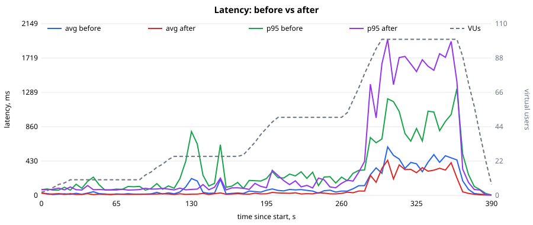
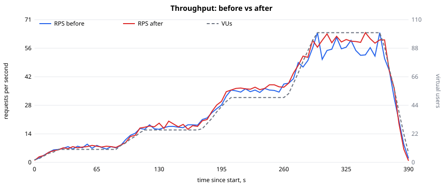

# Звіт: Лабораторна робота №7 — Оптимізація продуктивності

**Застосунок:** Fleet Management (FastAPI + PostgreSQL + Redis + RabbitMQ)
**Гілка:** `feat/lab7-performance-optimization`

Сирі дані: [`loadtest/results/lab7/`](../../loadtest/results/lab7/) (`before/`, `after/`, ablation-прогони, `comparison.md`, SVG-графіки). План виконання запитів: [`explain.md`](explain.md).

## 1. Методика

- Інструмент і профіль — ті самі, що в ЛР4: k6, [`loadtest/user_journey.js`](../../loadtest/user_journey.js), `PROFILE=stepped` (10 → 25 → 50 → 100 VUs, 6 хв 30 с), 100 акаунтів, 50 авто.
- «До» і «Після» зняті **в одному середовищі** одне за одним: docker compose, nginx → **одна** репліка API (`nginx/single.conf`), ліміт `2 CPU / 512 MiB`, одна й та сама БД. «До» — код `main` (worktree), «Після» — ця гілка. Цифри ЛР4 (без лімітів) не використовуються напряму, але «До» їх відтворює (p95 login ≈ 0.9 с, saturation на 100 VUs).
- CPU/RAM — `scripts/docker_stats.py` (як у ЛР4); таблиці й графіки — `loadtest/report.py`, порівняння — `loadtest/compare.py`.

## 2. Вузькі місця (з ЛР4) і обрані стратегії

| # | Вузьке місце | Стратегія | Реалізація |
|---|---|---|---|
| 1 | Argon2 у `login`/`register` виконується синхронно в `async`-обробнику й блокує event loop — деградують **усі** ендпоінти (ЛР4, п. 5.2) | **Оптимізація алгоритму/конкурентності:** хешування в окремому `ThreadPoolExecutor` | `security.hash_password_async` / `verify_password_async`, використані в `user_service`; розмір пулу — `PASSWORD_HASH_WORKERS` (за замовчуванням 1; кожен хеш ≈ 64 MiB, тож пул обмежує й пам'ять) |
| 2 | `GET /stations`, `GET /vehicles` читають усю таблицю з БД на кожен запит | **Кешування (Redis, TTL 30 с)** | `cache.read_through_json` — read-through, збереження готового JSON; інвалідація при `POST /stations`, `POST /vehicles`, `POST /rentals/start`, `POST /rentals/{id}/end`; збій Redis → відповідь із БД |
| 3 | Запити без індексів: підрахунок авто на станції (`station_id`, `status`), `GET /me/rentals` (`renter_id`, `started_at`) | **Індекси** | міграція `e1f4a7c9b2d6`: `ix_vehicles_station_id_status`, `ix_rentals_renter_id_started_at` |

Бізнес-логіка не змінена; додано `ORDER BY id` у списках (детермінований порядок). Додаткові тести: `tests/integration/test_list_cache.py` (TTL, інвалідація, зміна статусу авто, Redis down), `test_async_hashing…`. Весь набір — 1394 тести проходять.

## 3. Результати: «До» і «Після»

| Метрика | До | Після | Зміна |
|---|---|---|---|
| Запитів за тест | 11 082 | 11 556 | +4% |
| **RPS** середній | 28.1 | 29.5 | +5% |
| RPS на плато 100 VUs | 56.5 | 60.4 | +7% |
| **Latency avg**, ms | 206.3 | 143.8 | **−30%** |
| Latency avg на 100 VUs, ms | 435 | 336 | −23% |
| Latency avg на 25 / 50 VUs, ms | 75 / 58 | 18 / 25 | −76% / −57% |
| **Latency p95** (усі запити), ms | 821 | 1 311 | **+60% (гірше)** |
| **Error rate** | 0.00% | 0.00% | — |
| **CPU** api (середнє), % | 88.6 | 90.6 | +2% |
| **RAM** api (середнє), MiB | 89 | 92 | +4% |
| CPU / RAM db | 2.2% / 54 MiB | 1.8% / 62 MiB | — |

По ендпоінтах (avg / p95, ms):

| Ендпоінт | До | Після | avg |
|---|---|---|---|
| GET /stations | 167 / 713 | **9 / 40** | −95% |
| GET /vehicles | 188 / 815 | **9 / 40** | −95% |
| GET /vehicles/{id}/state | 193 / 829 | **8 / 50** | −96% |
| GET /auth/me | 211 / 812 | 75 / 439 | −65% |
| GET /vehicles/{id} | 188 / 817 | 71 / 417 | −62% |
| POST /auth/login | 291 / 892 | **691 / 1 858** | **+138% (гірше)** |

Графіки:  

### Чесний висновок щодо p95

П'ять із шести ендпоінтів стали в 2–20 разів швидшими, середня затримка впала на 30%. Але **загальний p95 погіршився**, і причина зрозуміла: Argon2 тепер не блокує всіх, а стає в чергу пулу з 1 потока, тому вся вартість CPU-важкого логіна лягла на сам `POST /auth/login` (p95 1.9 с). Логін — 1/6 запитів сценарію, тож він визначає загальний 95-й перцентиль. Це перерозподіл, а не усунення роботи: Argon2 навмисно дорогий, а CPU-ліміт 2 ядра незмінний. Поріг k6 `p95 < 500 ms` не виконано ні до, ні після.

## 4. Який захід дав найбільший приріст

Ablation-прогони (один і той самий профіль; окремі прогони мають розкид, тож це орієнтир, а не точні частки):

| Конфігурація | avg, ms | p95, ms | RPS | RPS на 100 VUs |
|---|---|---|---|---|
| До (main) | 206 | 821 | 28.1 | 56.5 |
| Лише кеш (хешування inline) | 359 | 1 725 | 25.5 | 42.6 |
| Лише пул Argon2 (2 потоки, кеш вимкнено) | 239 | 1 559 | 27.4 | 52.7 |
| Кеш + пул 2 потоки | 224 | 1 613 | 27.8 | 54.5 |
| **Кеш + пул 1 потік (фінал)** | **144** | 1 311 | **29.5** | **60.4** |
| Кеш + пул 4 потоки | 277 | 1 748 | 26.9 | 50.4 |

- Найбільший ефект на окремих ендпоінтах дало **кешування** (−95% на `/stations`, `/vehicles`) — воно знімає навантаження з БД і CPU на серіалізацію.
- **Кеш без винесення Argon2** виявився гіршим за базу: прогін був нестабільним (max 6.8 с); це тільки один прогін, і різниця в межах розкиду середовища, тому окремо цей результат не інтерпретую.
- Розмір пулу **1** кращий за 2 і 4: більше паралельних хешів — це більше конкуренції за 2 ядра під CFS-квотою Docker і довші хвости. Тому значення за замовчуванням — 1.
- Індекси на цьому навантаженні не впливають (сценарій не викликає ці запити), їх ефект показано окремо в EXPLAIN.

## 5. EXPLAIN ANALYZE (додаткове завдання 2)

Дані: 100 000 авто, 400 000 оренд ([`explain.md`](explain.md), відтворюється `scripts/explain_lab7.py`).

| Запит | Без індексу | З індексом |
|---|---|---|
| Авто на станції (`station_id`, `status`) | Seq Scan, **5.77 ms** | Bitmap Index Scan, **1.49 ms** (−74%) |
| Оренди орендаря за датою (`GET /me/rentals`) | Parallel Seq Scan, **13.0 ms** | Bitmap Index Scan, **1.22 ms** (−91%) |

## 6. Кешування (додаткове завдання 1)

Redis, ключі `cache:stations:list` і `cache:vehicles:list`, TTL 30 с (`LIST_CACHE_TTL_SECONDS`), перемикач `LIST_CACHE_ENABLED`. Інвалідація при будь-якій зміні станцій/авто/статусу оренди — спільна між репліками, бо ключі в Redis. Якщо Redis недоступний, список читається з БД, запит не падає.

## 7. Обмеження і що далі

- Загальний p95 і p95 логіна не покращені. Реальні шляхи: кілька workers/реплік (ЛР6), менш дорогі параметри Argon2 (це компроміс безпеки, тож без рішення власника не змінював), видача довшоживучих токенів/refresh, щоб не логінитися на кожну сесію.
- Один прогін на конфігурацію; для остаточних висновків варто повторити 3 рази.

## 8. Відтворення

```powershell
$env:NGINX_CONF="./nginx/single.conf"; docker compose up -d --build
python scripts/seed_loadtest.py --vehicles 50
docker compose run --rm --no-deps k6 run --out csv=/scripts/results/lab7/after/k6.csv /scripts/user_journey.js
python loadtest/report.py --k6 loadtest/results/lab7/after/k6.csv --resources loadtest/results/lab7/after/resources.csv --out loadtest/results/lab7/after
python loadtest/compare.py --before loadtest/results/lab7/before --after loadtest/results/lab7/after --out loadtest/results/lab7
python scripts/explain_lab7.py --out docs/lab7-performance/explain.md
```
«До» — те саме на коміті `main`.
