# Звіт: Лабораторна робота №8 - Фінальне тестування стабільності

Проєкт: Fleet Management (FastAPI). Стенд: Docker Compose (`fleet_sandbox`) - nginx (round robin) -> 3 репліки API
(кожна `cpus: 2`, `memory: 512M`), PostgreSQL 16, Redis 7, RabbitMQ 4, worker. Хост: 8 vCPU, 11.7 ГБ RAM (Docker Desktop).
Генератор навантаження - k6 1.3.0 (контейнер, 2 CPU / 512 МБ). Моніторинг - Prometheus 3.5 + Grafana 12.1.
Дата прогонів: 2026-11-08 (UTC).

Відтворення:

```bash
docker compose -p fleet_sandbox --env-file .env.sandbox -f docker-compose.yml -f docker-compose.monitoring.yml up -d --build
python scripts/docker_exporter.py &              # CPU/RAM контейнерів для Prometheus (:9101)
python scripts/seed_loadtest.py --vehicles 50
docker compose ... run --rm --no-deps -e PROFILE=soak -e RATE=14 -e DURATION=60m -e RUN_TAG=soak \
    k6 run -o experimental-prometheus-rw /scripts/soak.js
python loadtest/report_lab8.py --run soak --start <UTC> --end <UTC> --out loadtest/results/lab8/soak
```

## 1. Профіль стабільності

Сценарій - сесія орендаря з ЛР-4/6 (логін, профіль, станції, авто, стан авто = 6 HTTP-запитів на ітерацію).
Модель відкрита (`constant-arrival-rate`): кількість нових сесій за секунду стала, тому деградація проявляється у
затримках/помилках, а не в падінні RPS (`loadtest/soak.js`).

**Максимальний RPS** визначено ступінчастим тестом `breakpoint` (+2 сесії/с кожну хвилину; 12 хв):

| Хв | Сесій/с (ціль) | RPS | avg, мс | p95, мс | p99, мс | CPU API, % квоти |
|---|---|---|---|---|---|---|
| 1 | 4 | 21 | 13 | 70 | 90 | 12 |
| 2 | 6 | 33 | 11 | 68 | 74 | 17 |
| 3 | 8 | 45 | 11 | 67 | 74 | 25 |
| 4 | 10 | 57 | 11 | 67 | 74 | 28 |
| 5 | 12 | 69 | 12 | 69 | 86 | 35 |
| 6 | 14 | 81 | 13 | 71 | 98 | 41 |
| 7 | 16 | 93 | 19 | 127 | 232 | 60 |
| 8 | 18 | 105 | 24 | 181 | 247 | 65 |
| 9 | 20 | 117 | 41 | 277 | 482 | 73 |
| 10 | 22 | 128 | 82 | 591 | 1475 | 92 |
| 11 | 24 | 135 | 340 | 2097 | 3317 | 98 |
| 12 | 26 | 135 | 1060 | 5026 | 7185 | 101 |

(серверні значення, вікно 30 с; джерело - `http_request_duration_seconds`.)
Остання «комфортна» ступінь - **117 RPS** (p95 < 300 мс, CPU 73 %); насичення - **~135 RPS** (CPU API = 100 % квоти,
p95 > 2 с). Помилок на цьому тесті не було, система деградує лише латентністю.

**Профіль soak: 14 сесій/с = 84 RPS ≈ 72 % від 117 RPS** (≈ 62 % від точки насичення), тривалість **60 хв**.

**Критерії успіху:** CPU ≤ 80 %, RAM ≤ 80 %, Error Rate ≤ 0.1 %; додатково p95 < 1 с і відсутність тренду
зростання RAM/FD/латентності. CPU і RAM репліки API рахуємо від її квоти (2 CPU, 512 МБ).

## 2. Тривале тестування (soak, 60 хв)

k6 штовхав метрики в Prometheus (remote write), контейнери збирав `scripts/docker_exporter.py`
(`docker stats`, крок 1 с, скрейп 5 с), API віддає `/metrics`.

### Підсумковий протокол

| Метрика | Значення |
|---|---|
| Тривалість | 60 хв (07:49-08:49 UTC) |
| Всього запитів | 302 507 (50 401 сесія) |
| **RPS (середній)** | **83.9** |
| Latency avg | 15.1 мс |
| Latency min | 0.12 мс |
| Latency max | 648.9 мс |
| Latency median | 2.6 мс |
| **p95** | **75.7 мс** |
| **p99** | **142.7 мс** |
| Невдалих запитів (фаза навантаження) | 0 |
| **Error Rate** | **0.0000 %** (поріг 0.1 %) |
| Перевірки k6 (`check`) | 302 406 / 302 406 пройдено |
| Рестарти / OOM контейнерів API | 0 / ні |

Порогові умови k6 (`http_req_failed <= 0.1 %`, `p(95) < 1000 мс`) - виконані.
Найповільніша операція - `POST /auth/login` (хешування пароля): p95 ≈ 150 мс, решта ендпоінтів - p95 < 10 мс.

### Ресурси (Prometheus, кроки 15 с; повна таблиця - `loadtest/results/lab8/soak_report.md`)

| Ресурс | Середнє | Максимум | Тренд (МНК, за год) |
|---|---|---|---|
| RAM api1 / api2 / api3, МіБ | 95 / 96 / 88 | 150 / 154 / 156 (≤ 31 % від 512) | -9.4 / +8.9 / +2.9 |
| RSS процесу api1 / api2 / api3, МіБ | 112 / 106 / 100 | 157 / 161 / 161 | +5.6 / -3.2 / +2.0 |
| Відкриті FD api1 / api2 / api3 | 24 / 24 / 24 | 26 / 26 / 26 | ≈ 0 |
| CPU api1 / api2 / api3, % квоти 2 CPU | 63 / 50 / 24 | 94 / 103 / 76 (піки) | +0.9 / -1.7 / -2.8 |
| PostgreSQL RAM, МіБ | 139 | 142 | +6 |
| Redis RAM, МіБ | 9 | 13 | +1.2 |
| RabbitMQ RAM, МіБ | 136 | 208 | +6 |
| nginx RAM, МіБ | 12 | 16 | 0 |
| CPU db / nginx / redis, % хоста (8 ядер) | 0.4 / 0.4 / 0.2 | 1.4 / 0.8 / 0.5 | ≈ 0 |

Графіки за весь період (SVG у `docs/lab8/charts/`): `soak_rps`, `soak_latency`, `soak_errors`, `soak_cpu`,
`soak_ram_api`, `soak_ram_other`, `soak_cpu_other`.

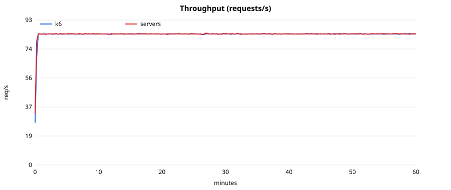
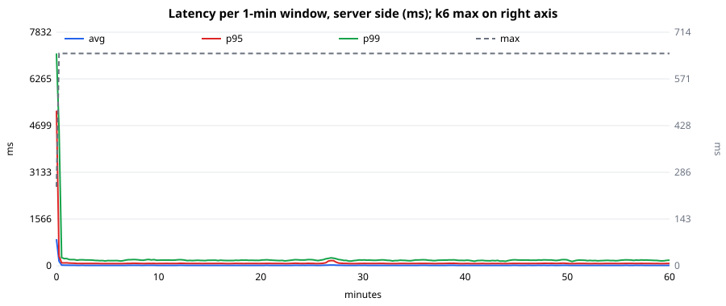
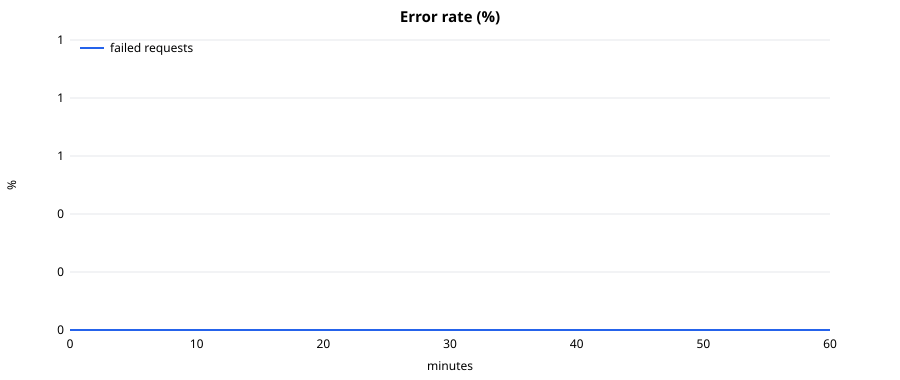
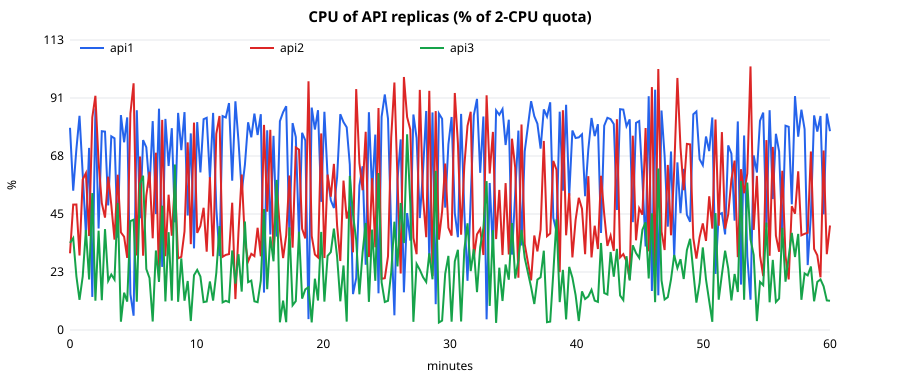
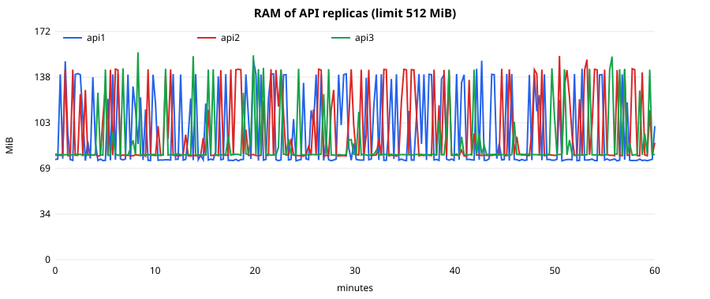
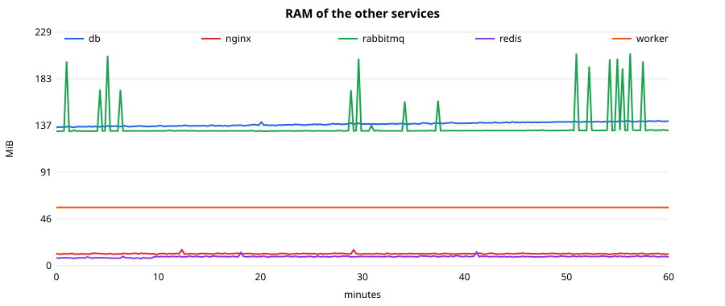

## 3. Аналіз довгострокової поведінки

**Витоки пам'яті відсутні.** RAM кожної репліки API коливається в межах ~90-155 МіБ (піки - короткі сплески під час
login) і повертається до базового рівня ~90 МіБ; лінійний тренд ≤ 9 МіБ/год при середньому 95 МіБ, знак тренду різний у
різних реплік - це шум, а не накопичення. RSS процесів і кількість відкритих файлових дескрипторів (24-26) за годину не
змінилися - витоків з'єднань/сокетів немає. Пам'ять БД, Redis і nginx плоска (Redis +1.2 МіБ/год - кеш).
Піки RabbitMQ (до 208 МіБ) короткочасні.

**Латентність стабільна.** Серверні значення за вікно 1 хв (усі ендпоінти разом): перші 10 хв після прогріву -
avg 15 мс, p95 75 мс, p99 187 мс; останні 10 хв - avg 14 мс, p95 75 мс, p99 178 мс. Деградації немає, p99 навіть дещо
краще після прогріву (прогрів кешу та з'єднань). Короткий підйом p95/p99 у перші хвилини графіка - прогрів кешу та пулу з'єднань; після ~5 хв значення плоскі.

**Рівномірність балансування:** кожна репліка обслуговувала ~28 req/с (round robin) - нерівномірність CPU між
репліками (24-63 % у середньому) пояснюється нерівномірним розподілом дорогих `login` запитів і кроком вибірки
`docker stats`, а не розподілом запитів.

**Перевірка критеріїв:**

| Критерій | Ціль | Результат | Висновок |
|---|---|---|---|
| CPU | ≤ 80 % | середнє по API 46 % квоти (найбільш завантажена репліка - 63 %); короткі піки 94-103 % у 1-секундних вибірках | виконано за середнім; піки під час login-сплесків |
| RAM | ≤ 80 % | макс. 31 % ліміту 512 МіБ | виконано |
| Error Rate | ≤ 0.1 % | 0.0000 % | виконано |
| p95 | < 1 с | 75.7 мс | виконано |
| Витоки/деградація | немає | не виявлено | виконано |

Зауваження щодо методики: CPU контейнерів береться з `docker stats`, який дає миттєві 1-секундні вибірки, тому
пікові значення (94-103 %) завищують реальне навантаження, а k6 працює на тому ж хості (2 CPU), тобто тест
консервативний. Перцентилі k6 в Prometheus накопичувальні з початку тесту, тому для аналізу дрейфу використано
віконні серверні гістограми.

## 4. Додаткове завдання 1: стрес-тест, точка зламу, відновлення

**Break point** - з тесту `breakpoint` (розділ 1): система тримає до **~117-128 RPS**, насичується на **~135 RPS**
(CPU реплік = 100 % квоти, p95 росте з 0.3 до 5 с), помилок до насичення немає, тест не досяг відмов (лише чергу).

**Spike-тест** (`PROFILE=spike`, 8.5 хв): базові 14 сесій/с (84 RPS) -> раптовий стрибок до **70 сесій/с (x5, ~420 RPS
пропонованого навантаження)** на 2 хв -> повернення до 84 RPS на 4 хв.

| Показник | Значення |
|---|---|
| Пікова кількість VU | 1500 (ліміт `maxVUs`) |
| Під час піку | RPS обмежено ~250 (стеля), до 79 % запитів - таймаут 60 с / 5xx |
| 5xx на серверах (пік) | ~23 req/с |
| Падіння контейнерів | немає (0 рестартів, 0 OOM) |
| **Час відновлення** | **≈ 1 хв** після повернення до 84 RPS: RPS = 84, помилки = 0, FD 800 -> 24, RAM -> норма |
| Підсумок прогону | 49 757 запитів, помилок 23.1 % (усі - у вікні піку), p95 за прогін 25.5 с |

Система **не падає і самовідновлюється без втручання**: після спаду черга розвантажується, лічильники FD та RAM
повертаються до базового рівня (`docs/lab8/screenshots/03-spike-dashboard.png`, `charts/spike_*.svg`).
Порогові умови k6 для spike-тесту очікувано порушені (це і є точка зламу).

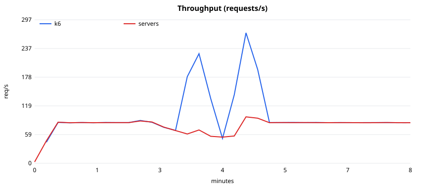
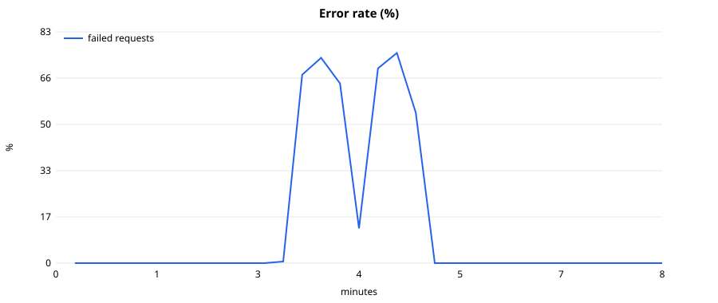

## 5. Додаткове завдання 2: дашборд моніторингу (Prometheus + Grafana)

`docker-compose.monitoring.yml` додає Prometheus (скрейп 3 реплік API + експортер контейнерів + remote write від k6) і
Grafana з автоматично підключеним дашбордом `monitoring/grafana/dashboards/lab8-soak.json` (RPS, латентність по
ендпоінтах і по вікнах, Error Rate, VU, CPU/RAM від квот, RSS, FD, розподіл по репліках, 5xx). Скріншоти робилися
headless Chrome (`monitoring/screenshot.sh`).

- Soak, 60 хв: `screenshots/01-soak-dashboard.png`
- Break point: `screenshots/02-breakpoint-dashboard.png`
- Spike: `screenshots/03-spike-dashboard.png`

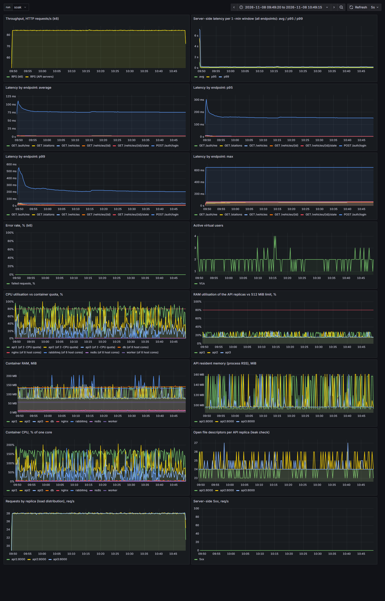
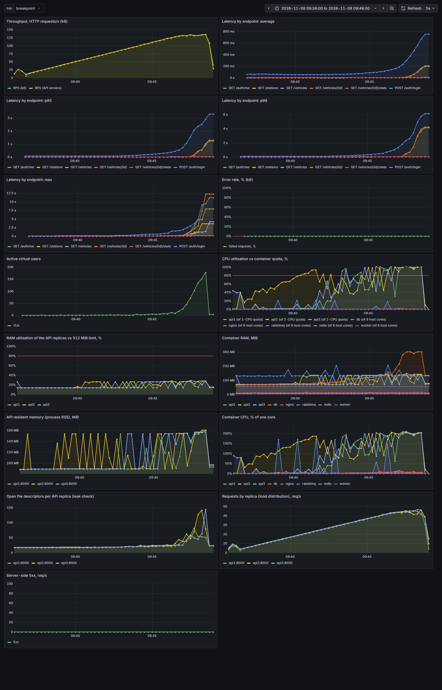
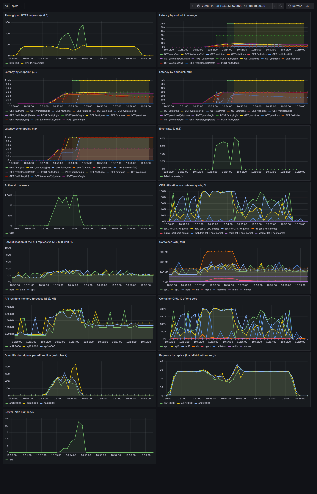

Примітка: cAdvisor на Docker Desktop (containerd image store) не бачить контейнери, тому CPU/RAM віддає власний
експортер `scripts/docker_exporter.py` (читає `docker stats`).

## 6. Висновок

За годину стабільного навантаження 84 RPS (≈ 72 % від максимального комфортного 117 RPS) система відпрацювала
**302 507 запитів без жодної помилки** (Error Rate 0 % при порозі 0.1 %), з **p95 = 76 мс, p99 = 143 мс**,
середнім CPU API 46 % і RAM не більше 31 % від ліміту. Витоків пам'яті, дескрипторів чи з'єднань та деградації
латентності не виявлено: перші та останні 10 хв за avg/p95/p99 збігаються. Вимоги стабільності виконано, продукт
готовий до експлуатації при навантаженні до ~100 RPS на поточній конфігурації (3 x 2 CPU).

Межі та ризики: стеля пропускної здатності ~135 RPS визначається CPU реплік API (передусім хешування пароля в
`/auth/login`); при 5-кратному стрибку трафіку система втрачає запити (таймаути), але відновлюється приблизно за
хвилину. Рекомендації: rate limiting/черга перед `/auth/login`, автомасштабування реплік за CPU, алерти на p95 > 1 с та
Error Rate > 0.1 %; для більшої впевненості - повторити soak 4 год із продакшн-подібним обсягом даних у БД.
