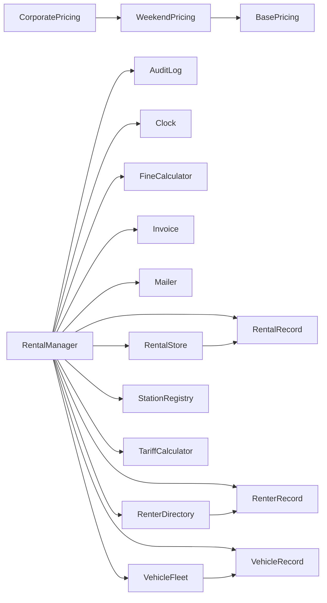

| row uses col | c0 | c1 | c2 | c3 | c4 | c5 | c6 | c7 | c8 | c9 | c10 | c11 | c12 | c13 | c14 | c15 | c16 | out |
|---|---|---|---|---|---|---|---|---|---|---|---|---|---|---|---|---|---|---|
| c0 AuditLog |  |  |  |  |  |  |  |  |  |  |  |  |  |  |  |  |  | 0 |
| c1 BasePricing |  |  |  |  |  |  |  |  |  |  |  |  |  |  |  |  |  | 0 |
| c2 Clock |  |  |  |  |  |  |  |  |  |  |  |  |  |  |  |  |  | 0 |
| c3 CorporatePricing |  |  |  |  |  |  |  |  |  |  |  |  |  |  |  |  | X | 1 |
| c4 FineCalculator |  |  |  |  |  |  |  |  |  |  |  |  |  |  |  |  |  | 0 |
| c5 Invoice |  |  |  |  |  |  |  |  |  |  |  |  |  |  |  |  |  | 0 |
| c6 Mailer |  |  |  |  |  |  |  |  |  |  |  |  |  |  |  |  |  | 0 |
| c7 RentalManager | X |  | X |  | X | X | X |  | X | X | X | X | X | X | X | X |  | 13 |
| c8 RentalRecord |  |  |  |  |  |  |  |  |  |  |  |  |  |  |  |  |  | 0 |
| c9 RentalStore |  |  |  |  |  |  |  |  | X |  |  |  |  |  |  |  |  | 1 |
| c10 RenterDirectory |  |  |  |  |  |  |  |  |  |  |  | X |  |  |  |  |  | 1 |
| c11 RenterRecord |  |  |  |  |  |  |  |  |  |  |  |  |  |  |  |  |  | 0 |
| c12 StationRegistry |  |  |  |  |  |  |  |  |  |  |  |  |  |  |  |  |  | 0 |
| c13 TariffCalculator |  |  |  |  |  |  |  |  |  |  |  |  |  |  |  |  |  | 0 |
| c14 VehicleFleet |  |  |  |  |  |  |  |  |  |  |  |  |  |  |  | X |  | 1 |
| c15 VehicleRecord |  |  |  |  |  |  |  |  |  |  |  |  |  |  |  |  |  | 0 |
| c16 WeekendPricing |  | X |  |  |  |  |  |  |  |  |  |  |  |  |  |  |  | 1 |
| in | 1 | 1 | 1 | 0 | 1 | 1 | 1 | 0 | 2 | 1 | 1 | 2 | 1 | 1 | 1 | 2 | 1 | |

