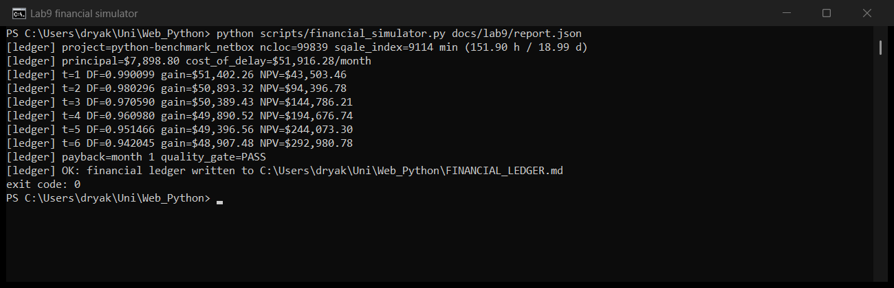
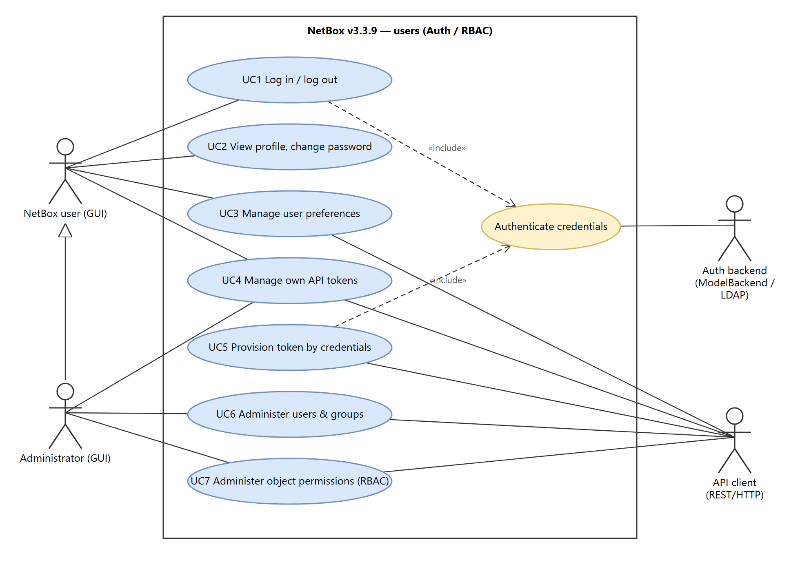
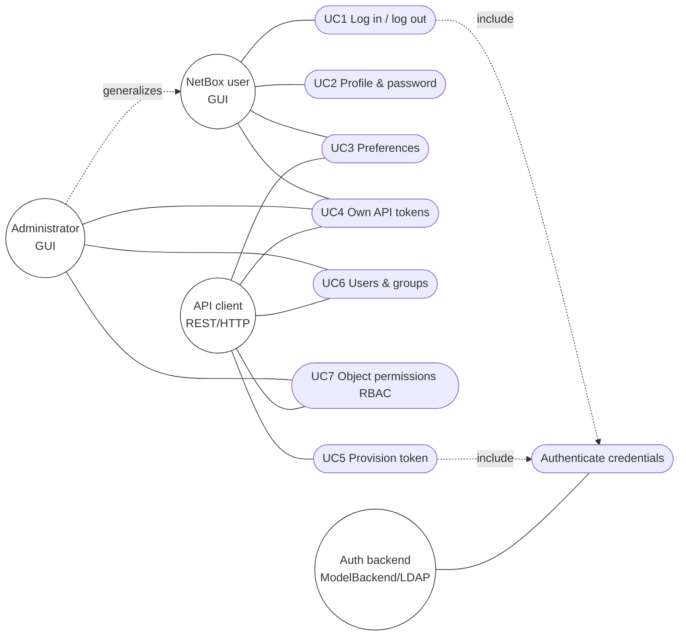

# Лабораторна робота №9 — SQALE, Software Economics (CoD / NPV), FPA & UCP

Гілка: `feat/lab9-lab10-quality`. Інструменти: `curl` → SonarCloud Web API, `scripts/financial_simulator.py`
(фінансовий симулятор), `scripts/git_effort.py` (ретроспективні трудовитрати з Git), `scripts/size_metrics.py`
(калькулятор FPA/UCP за матрицями IFPUG/Карнера). Сирі дані — `docs/lab9/evidence/`.

---

## Завдання 1. Forensic-аудит SQALE-моделі

### 1.1 Картка об'єкта аудиту

| Поле | Значення |
|---|---|
| Проєкт | **NetBox** — open-source «source of truth» для мережевої інфраструктури (DCIM + IPAM): облік стійок, пристроїв, кабелів, IP-адрес, VLAN, VRF; REST/GraphQL API для автоматизації мереж |
| Стек | Python 3 / Django / Django REST Framework / PostgreSQL |
| Upstream-репозиторій | https://github.com/netbox-community/netbox |
| Проаналізований репозиторій (SonarCloud ALM) | https://github.com/python-benchmark/netbox, ревізія `8232bb0c393486850547315a6db8a1355b90b10d` (знімок NetBox **v3.3.9**, `VERSION = '3.3.9-dev'`) |
| organization key | `python-benchmark` |
| project key | `python-benchmark_netbox` |
| Дашборд | https://sonarcloud.io/project/overview?id=python-benchmark_netbox |
| Остання аналізована ревізія | 2023-04-17 (Autoscan, профіль «Sonar way comprehensive») |
| Масштаб | **ncloc = 99 839 ≥ 50 000** ✅ |

Як обрано: `api/components/search_projects?filter=languages=py and ncloc>=50000` + пошук за назвою. Офіційні
організації NetBox/Django/Saleor на SonarCloud відсутні (`Component key ... not found`), тому взято публічний
знімок `python-benchmark` — його модуль `netbox/users` побайтно збігається з upstream-тегом `v3.3.9`
(однаковий git tree-hash `fbb124bb…`), що дало змогу для Завдання 3 використати повну upstream-історію Git.

### 1.2 Протокол хмарного API-виклику

```bash
curl -s -D docs/lab9/evidence/sonarcloud_response_headers.txt -o docs/lab9/report.json \
  "https://sonarcloud.io/api/measures/component?component=python-benchmark_netbox&metricKeys=sqale_index,ncloc,sqale_rating"
```

HTTP-запит (без автентифікації — публічний проєкт):

```http
GET /api/measures/component?component=python-benchmark_netbox&metricKeys=sqale_index,ncloc,sqale_rating HTTP/1.1
Host: sonarcloud.io
Accept: */*
```

Відповідь: `HTTP/1.1 200`, `Content-Type: application/json`, `Date: Sat, 14 Nov 2026 08:21:02 GMT`
(`evidence/sonarcloud_response_headers.txt`). Сирий JSON — `docs/lab9/report.json`:

```json
{"component":{"id":"AYWHT6hSIixz7TnZa_1o","key":"python-benchmark_netbox","name":"netbox","qualifier":"TRK",
 "measures":[
   {"metric":"ncloc","value":"99839"},                              ← ncloc
   {"metric":"sqale_index","value":"9114","bestValue":false},       ← sqale_index (хв)
   {"metric":"sqale_rating","value":"1.0","bestValue":true}         ← sqale_rating (1.0 = A)
 ]}}
```

> Стрілки `←` додано лише у звіті для підсвічення ключів; у `report.json` — оригінальна відповідь сервера.

### 1.3 Математична паспортизація боргу (SQALE)

- Борг у годинах: 9 114 хв / 60 = **151.90 люд.-год**
- Борг у людино-днях: 151.90 / 8 = **18.99 люд.-днів** (≈ 4 робочі тижні одного інженера)
- Повний час написання системи з нуля: ncloc × 30 хв / 60 = 99 839 × 0.5 = **49 919.5 люд.-год**
- **TDD** = 151.90 / 49 919.5 × 100 % = **0.304 %**

### 1.4 Верифікація хмарних розрахунків

| Шкала SQALE | Межа | NetBox |
|---|---|---|
| A | ≤ 5 % | **0.304 % → A** ✅ |
| B | 6–10 % | — |
| C | 11–20 % | — |

`sqale_rating = 1.0` у SonarCloud відповідає літері **A** → розрахунок **збігається**. Додатковий контроль:
метрика `sqale_debt_ratio` того ж проєкту = `0.3` (запит із `metricKeys=…,sqale_debt_ratio`) — тобто сервер
рахує TDD тією ж формулою (5 хв/рядок × 30 хв за SQALE-нормою `development cost`), похибка — лише округлення.

### 1.5 SQALE Audit Ledger

| Масштаб (ncloc) | Обсяг боргу (люд.-год / робочих днів) | Розрахунковий TDD | Хмарний рейтинг (sqale_rating) |
|---|---|---|---|
| 99 839 | 151.90 год / 18.99 днів | **0.304 %** | 1.0 = **A** (збіг ✅) |

**Висновок аудитора.** NetBox має дуже низьку щільність боргу: 0.3 % — у 16 разів нижче межі рейтингу A.
Абсолютний борг (≈ 19 люд.-днів) малий відносно масштабу ~100 KLOC; це наслідок жорсткої code review-культури
одного core-мейнтейнера (див. Завд. 3: 90 % комітів модуля `users` — один автор). Ризик аудиту: знімок
2023 року (v3.3.9), сучасні гілки upstream цим проєктом не скануються.

---

## Завдання 2. Software Economics та Financial Quality Ledger

### 2.1 Модель (реалізована в `scripts/financial_simulator.py`)

| Величина | Формула |
|---|---|
| Тіло боргу (Principal) | `(sqale_index / 60) × HOURLY_RATE × OVERLOAD_COEFF` |
| Cost of Delay (міс.) | `(ncloc / 100) × 1 год × HOURLY_RATE × OVERLOAD_COEFF` |
| Коефіцієнт дисконтування | `DF_t = 1 / (1 + DISCOUNT_RATE)^t` |
| Кумулятивний NPV | `NPV_t = −Principal + Σ_{k=1..t} CoD × DF_k` |
| Payback | перше `t`, для якого `NPV_t > 0` (`if NPV_t > 0`) |
| Quality Gate | PASS, якщо payback ≤ 6 міс.; інакше FAIL з архітектурним попередженням |

Вхід: `report.json` (метрики парсяться **динамічно** з `component.measures`) + змінні оточення
`HOURLY_RATE=40` (діапазон 35–50 перевіряється), `OVERLOAD_COEFF=1.3`, `DISCOUNT_RATE=0.01`.
Помилки вводу (немає змінної, ставка поза діапазоном, бракує метрики в JSON) → код виходу 2 без генерації
леджера; FAIL-гейт → код 1 (придатно для CI). Тести: `tests/unit/test_financial_simulator.py` (11 тестів:
формули, дисконтування, payback на 5-му місяці, FAIL-сценарій, валідація env/JSON).

### 2.2 Декларація вихідного коду

Повний текст — `scripts/financial_simulator.py` (у репозиторії). Ядро розрахунку:

```python
def simulate(baseline: Baseline, economics: Economics, horizon: int = HORIZON_MONTHS) -> Simulation:
    principal = baseline.debt_hours * economics.loaded_rate
    cost_of_delay = baseline.ncloc / LOC_PER_LOST_HOUR * economics.loaded_rate
    npv = -principal
    flows: list[CashFlow] = []
    payback: int | None = None
    for t in range(1, horizon + 1):
        factor = 1 / (1 + economics.discount_rate) ** t
        gain = cost_of_delay * factor
        npv += gain
        flows.append(CashFlow(t, factor, gain, npv))
        if npv > 0 and payback is None:
            payback = t
    return Simulation(baseline, economics, principal, cost_of_delay, flows, payback)
```

### 2.3 Консольний запуск

```powershell
$env:HOURLY_RATE='40'; $env:OVERLOAD_COEFF='1.3'; $env:DISCOUNT_RATE='0.01'
python scripts/financial_simulator.py docs/lab9/report.json
```

```text
[ledger] project=python-benchmark_netbox ncloc=99839 sqale_index=9114 min (151.90 h / 18.99 d)
[ledger] principal=$7,898.80 cost_of_delay=$51,916.28/month
[ledger] t=1 DF=0.990099 gain=$51,402.26 NPV=$43,503.46
[ledger] t=2 DF=0.980296 gain=$50,893.32 NPV=$94,396.78
[ledger] t=3 DF=0.970590 gain=$50,389.43 NPV=$144,786.21
[ledger] t=4 DF=0.960980 gain=$49,890.52 NPV=$194,676.74
[ledger] t=5 DF=0.951466 gain=$49,396.56 NPV=$244,073.30
[ledger] t=6 DF=0.942045 gain=$48,907.48 NPV=$292,980.78
[ledger] payback=month 1 quality_gate=PASS
[ledger] OK: financial ledger written to C:\Users\dryak\Uni\Web_Python\FINANCIAL_LEDGER.md
```

Скріншот терміналу (окреме вікно PowerShell, той самий запуск; текстовий лог — `evidence/simulator_console.txt`):



### 2.4 Згенерований артефакт `FINANCIAL_LEDGER.md` (корінь репозиторію)

| t | DF | Щомісячний прибуток | Кумулятивний NPV |
|---|---|---|---|
| 0 | — | — | −$7,898.80 |
| 1 | 0.990099 | $51,402.26 | **$43,503.46** ← payback |
| 2 | 0.980296 | $50,893.32 | $94,396.78 |
| 3 | 0.970590 | $50,389.43 | $144,786.21 |
| 4 | 0.960980 | $49,890.52 | $194,676.74 |
| 5 | 0.951466 | $49,396.56 | $244,073.30 |
| 6 | 0.942045 | $48,907.48 | $292,980.78 |

Окупність — **1-й місяць**, **Quality Gate: PASS** (повний лістинг — `FINANCIAL_LEDGER.md`).

### 2.5 Аналітичний висновок (Software Economics)

Обидва грошові потоки лінійні, але залежать від різних метрик: Principal ∝ `sqale_index`, а CoD ∝ `ncloc`.
Їхнє відношення зводиться до самого TDD:

```
Principal / CoD = (TDD · 0.5 · ncloc) / (ncloc / 100) = 50 · TDD  (місяців, TDD як частка) = TDD% / 2
```

- **Payback без дисконту ≈ TDD% / 2 місяців.** Для NetBox: 0.304 / 2 = 0.15 міс. ≈ 5 днів → окупність у 1-му
  місяці. Масштаб (`ncloc`) сам по собі не змінює швидкості окупності — він множить **абсолютні** суми
  (99.8 KLOC → $51.9 тис./міс. збитків бездіяльності), а швидкість визначає щільність боргу.
- **Межа PASS на 6 місяцях:** `TDD%/2 < Σ DF_1..6 = 5.795` ⇒ **TDD < 11.6 %**. Проєкти з рейтингом A/B
  окуповують рефакторинг за ≤ 6 міс.; рейтинг C (11–20 %) — це точка, де гейт падає в FAIL і борг треба
  гасити інкрементально (по модулях-гарячих точках, а не «big bang»).
- Дисконт 1 %/міс. майже не впливає на короткий горизонт (−5.8 % вартості за 6 міс.), але для систем із
  TDD 10–12 % саме він перемикає вердикт PASS/FAIL.
- Обмеження моделі: правило «1 год / 100 LOC / міс.» для 100 KLOC дає ≈ 998 люд.-год/міс. (~6 FTE) —
  це верхня оцінка; для зрілого проєкту з TDD 0.3 % реальні регресійні втрати менші, тож результат варто
  трактувати як порівняльний, а не бюджетний.

---

## Завдання 3. FPA (IFPUG) та Use Case Points

### 3.1 Об'єкт: підмодуль `netbox/users` (Автентифікація / RBAC / API-токени)

Ізольований Django-застосунок (1 371 рядок Python без тестів і міграцій: `models.py`, `views.py`, `api/*`, `forms.py`, `filtersets.py` …),
що відповідає за вхід, профіль, налаштування користувача, API-токени та об'єктні дозволи (RBAC).

#### Специфікація реверс-інжинірингу (джерела даних)

**ORM-сутності (`users/models.py`)**

| Клас | Поля (DET) | Роль |
|---|---|---|
| `Token(models.Model)` | id, user FK→User, created, expires, last_used, key (40, unique), write_enabled, description, allowed_ips `ArrayField[IPNetwork]`; методи `save()`, `generate_key()`, `is_expired`, `validate_client_ip(client_ip)` | ILF |
| `ObjectPermission(models.Model)` | id, name, description, enabled, object_types M2M→ContentType, groups M2M→Group, users M2M→User, actions `ArrayField`, constraints `JSONField`; `list_constraints()` | ILF |
| `UserConfig(models.Model)` | user 1:1→User, data `JSONField`; `get(path, default)`, `all()`, `set(path, value, commit)`, `clear(path, commit)` | ILF |
| `AdminUser(User)`, `AdminGroup(Group)` (proxy) | id, username, password, first/last_name, email, is_staff, is_active, date_joined, last_login, groups / id, name | ILF (User, Group пишуться лише цим модулем) |
| `ContentType`, `extras.ConfigRevision` (через `get_config()`) | читаються для довідки | EIF |

**API-ендпоінти (`users/api/urls.py`, DRF-router → `/api/users/`)**

| Маршрут | Методи | View |
|---|---|---|
| `users/`, `users/{id}/` | GET, POST, PUT, PATCH, DELETE | `UserViewSet` (+`UserSerializer.create()` хешує пароль) |
| `groups/`, `groups/{id}/` | GET, POST, PUT, PATCH, DELETE | `GroupViewSet` (`annotate(user_count=Count('user'))`) |
| `tokens/`, `tokens/{id}/` | GET, POST, PUT, PATCH, DELETE | `TokenViewSet.get_queryset()` — не-суперюзер бачить лише свої |
| `tokens/provision/` | POST | `TokenProvisionView.post(request)` — без автентифікації, `authenticate(username, password)` |
| `permissions/`, `permissions/{id}/` | GET, POST, PUT, PATCH, DELETE | `ObjectPermissionViewSet` |
| `config/` | GET, PATCH | `UserConfigViewSet.list(request)`, `.patch(request)` (`deepmerge`) |

**UI-маршрути (`users/urls.py`, `netbox/urls.py`)**: `GET|POST /login/` (`LoginView.get/post`,
`get_auth_backends`, `redirect_to_next`), `GET /logout/`, `GET /user/profile/`, `GET|POST /user/preferences/`,
`GET|POST /user/password/`, `GET /user/api-tokens/`, `GET|POST /user/api-tokens/add/`,
`…/{pk}/edit/`, `…/{pk}/delete/`.

**Актори та прецеденти** — див. 3.3. UML Use Case діаграма: джерело `docs/lab9/users_use_cases.drawio`
(відкривається в draw.io), експорт — `screenshots/users_use_cases.png` / `.svg`:



Те саме у вигляді Mermaid:



### 3.2 FPA-калькулятор (IFPUG Ledger)

Джерело — `docs/lab9/fpa_ifpug.csv` (імпортується в Google Sheets); складність і ваги обчислює
`scripts/size_metrics.py` за матрицями IFPUG CPM 4.3 (тести `tests/unit/test_size_metrics.py`).

| ID | Кат. | Функція | RET/FTR | DET | Складність | FP |
|---|---|---|---|---|---|---|
| D1 | ILF | User | 1 | 11 | Low | 7 |
| D2 | ILF | Group | 1 | 3 | Low | 7 |
| D3 | ILF | Token | 1 | 11 | Low | 7 |
| D4 | ILF | ObjectPermission | 1 | 10 | Low | 7 |
| D5 | ILF | UserConfig | 1 | 7 | Low | 7 |
| D6 | EIF | ContentType | 1 | 3 | Low | 5 |
| D7 | EIF | ConfigRevision (`get_config`) | 1 | 3 | Low | 5 |
| T1 | EI | Create user | 2 | 10 | Average | 4 |
| T2 | EI | Update user | 2 | 10 | Average | 4 |
| T3 | EI | Delete user | 1 | 2 | Low | 3 |
| T4 | EI | Create group | 1 | 3 | Low | 3 |
| T5 | EI | Update group | 1 | 3 | Low | 3 |
| T6 | EI | Delete group | 1 | 2 | Low | 3 |
| T7 | EI | Create API token (API + UI) | 2 | 7 | Average | 4 |
| T8 | EI | Update API token (API + UI) | 2 | 7 | Average | 4 |
| T9 | EI | Delete API token (API + UI) | 1 | 2 | Low | 3 |
| T10 | EI | Provision token by credentials | 2 | 13 | Average | 4 |
| T11 | EI | Create object permission | 4 | 8 | High | 6 |
| T12 | EI | Update object permission | 4 | 8 | High | 6 |
| T13 | EI | Delete object permission | 1 | 2 | Low | 3 |
| T14 | EI | Save user preferences (UI + API PATCH) | 2 | 8 | Average | 4 |
| T15 | EI | Change password | 1 | 4 | Low | 3 |
| T16 | EI | Log in (пише `last_login`, створює UserConfig) | 3 | 4 | Average | 4 |
| T17 | EO | Group list з обчисленим `user_count` | 2 | 5 | Low | 4 |
| T18 | EO | Форма налаштувань з резолвом дефолтів | 2 | 8 | Average | 5 |
| T19 | EO | Список токенів (маскований key, статус expired) | 2 | 9 | Average | 5 |
| T20 | EQ | View / filter users | 2 | 12 | Average | 4 |
| T21 | EQ | View / filter object permissions | 4 | 11 | High | 6 |
| T22 | EQ | View own API tokens (API) | 2 | 11 | Average | 4 |
| T23 | EQ | Read user config (API) | 1 | 6 | Low | 3 |
| T24 | EQ | View profile | 2 | 7 | Average | 4 |
| T25 | EQ | Login page зі списком SSO-бекендів | 1 | 3 | Low | 3 |

| Категорія | К-сть | FP |
|---|---|---|
| ILF | 5 | 35 |
| EIF | 2 | 10 |
| EI | 16 | 61 |
| EO | 3 | 14 |
| EQ | 6 | 24 |
| **UFP** | **32** | **144** |

Правила підрахунку: proxy-моделі `AdminUser/AdminGroup` не є окремими логічними файлами; M2M-таблиці без
атрибутів не дають RET; UI- та API-варіант одного елементарного процесу (напр. створення токена) — одна
транзакція; list + detail з однаковими DET/FTR — один EQ; `logout` не рахується (не змінює ILF модуля,
сесія — інфраструктура Django). VAF прийнято 1.00 (як TCF/ECF у UCP) → **AFP = 144 FP**.

### 3.3 UCP-матриця Карнера

| ID | Актор | Тип | Вага |
|---|---|---|---|
| A1 | NetBox user (людина через GUI) | Складний | 3 |
| A2 | Administrator (людина через GUI / admin) | Складний | 3 |
| A3 | API client / скрипт автоматизації (REST по HTTP) | Середній | 2 |
| A4 | Authentication backend (`authenticate()` — ModelBackend/LDAP/RemoteUser) | Простий (API) | 1 |
| | **UAW** | | **9** |

| ID | Use Case | Транзакції (кроки в сигнатурах) | Клас | Вага |
|---|---|---|---|---|
| UC1 | Log in / log out | 6: показ форми + SSO, валідація, `authenticate`, `last_login`/UserConfig, `redirect_to_next`, logout | Середній | 10 |
| UC2 | View profile, change password | 5: profile, LDAP-перевірка, форма, `form.save`, `update_session_auth_hash` | Середній | 10 |
| UC3 | Manage user preferences (UI + API) | 7: форма з дефолтами, POST, `set`, `clear`, save, API GET, API PATCH `deepmerge` | Середній | 10 |
| UC4 | Manage own API tokens | 9: list, add-форма, `generate_key`, save, edit, delete-confirm, delete, API-queryset owner-filter, `validate_client_ip`/`is_expired` | Складний | 15 |
| UC5 | Provision token by credentials | 5: валідація серіалізатора, перевірка наявності, `authenticate`, створення токена, серіалізація 201 | Середній | 10 |
| UC6 | Administer users & groups | 8: CRUD users (4), хешування пароля, CRUD groups, `user_count`, фільтри | Складний | 15 |
| UC7 | Administer object permissions (RBAC) | 8: CRUD (4), object_types, призначення users/groups, actions, constraints/фільтри | Складний | 15 |
| | **UUCW** | | | **85** |

- **UUCP** = UAW + UUCW = 9 + 85 = **94**
- TCF = 1.0, ECF = 1.0 (базові промислові)
- **UCP** = 94 × 1.0 × 1.0 = **94**

### 3.4 Зворотне калібрування продуктивності (Productivity Factor)

Трудовитрати з Git (`scripts/git_effort.py`, алгоритм git-hours: коміти одного автора з інтервалом < 2 год —
одна сесія, інтервал зараховується; кожна нова сесія + 2 год «до першого коміту»; merge-коміти виключено;
ідентичності `Jeremy Stretch`/`jeremystretch` злито):

```bash
git clone --filter=blob:none https://github.com/netbox-community/netbox.git upstream
python scripts/git_effort.py --repo upstream --rev v3.3.9 --path netbox/users \
    --json docs/lab9/evidence/git_effort_users.json
# path=netbox/users rev=v3.3.9 commits=227 authors=17 effort=370.10 h (max_gap=2.0 h, first_commit=2.0 h)
```

| Автор | Коміти | Сесії | Год |
|---|---|---|---|
| jeremystretch (core maintainer) | 204 | 143 | 326.1 |
| Arthur Hanson | 3 | 3 | 6.0 |
| інші 15 контриб'юторів | 20 | 19 | 38.0 |
| **Разом** (2016-03-01 … 2022-11-18) | **227** | **165** | **370.1** |

**PF = 370.1 люд.-год / 94 UCP = 3.94 люд.-год / UCP** (через FPA: 370.1 / 144 = **2.57 люд.-год / FP**).

Чутливість: з `--first-commit 4` (більш консервативна оцінка невидимої роботи — дизайн, рев'ю, issues)
effort = 700.1 год → PF = 7.45 год/UCP. Отже реалістичний коридор **PF ≈ 4–7.5 год/UCP**, що у 3–5 разів
нижче класичного Карнера (20 год/UCP). Причини: (1) модуль стоїть на готових Django auth + DRF (CRUD-viewset
дає 5 операцій «безкоштовно»); (2) git-hours бачить лише час біля комітів; (3) ~90 % коду написала одна
людина, яка знає фреймворк досконало — це висока продуктивність і водночас Bus Factor = 1.

### 3.5 Висновок Lead Engineer: оцінювання Change Requests до написання коду

1. Новий CR описується як прецеденти/актори (UCP) або як ILF/EI/EO/EQ (FPA) **ще на етапі вимог**, без коду.
2. Бюджет = розмір × PF × ставка. Приклад CR «Сповіщення e-mail про токени, що спливають»: +1 середній UC
   (≈ 5 транзакцій, 10 UUCW), +1 простий актор SMTP (1 UAW) → 11 UCP; FPA: +1 EO Average (5 FP) + 1 EI Low
   (налаштування, 3 FP) = 8 FP.
   - UCP: 11 × 3.94 = **43 год** (песимістично 11 × 7.45 = 82 год);
   - FPA-перевірка: 8 × 2.57 = **21 год** (розбіжність показує, що UCP враховує взаємодію з новим актором, а
     FPA — лише бізнес-дані: обидва числа дають коридор);
   - Вартість (ставка з Завд. 2: $40 × 1.3 = $52/год): **$2 254 – $4 261**.
3. PF відкалібрований на історії **цієї ж** команди й кодової бази, тому оцінка не залежить від мови/стилю
   кодування і помилка — це лише похибка рахунку розміру CR, а не чужа галузева норма. Коридор
   (2 год-сесія ↔ 4 год-сесія) замовник отримує як P50/P90 до старту робіт; після кожного релізу PF
   перераховується `git_effort.py` + `size_metrics.py`, тобто модель самокалібрується.
4. Ризик: PF виміряно на роботі одного експерта — при його відсутності реальний PF зросте (новачку бракує
   контексту), тому для CR, які виконуватиме нова людина, слід застосовувати верхню межу коридору.

### Відтворення

```bash
pytest tests/unit/test_financial_simulator.py tests/unit/test_size_metrics.py -q   # 29 passed
python scripts/size_metrics.py --fpa docs/lab9/fpa_ifpug.csv --ucp docs/lab9/ucp_karner.csv \
    --effort docs/lab9/evidence/git_effort_users.json --json docs/lab9/evidence/size_metrics.json
```
