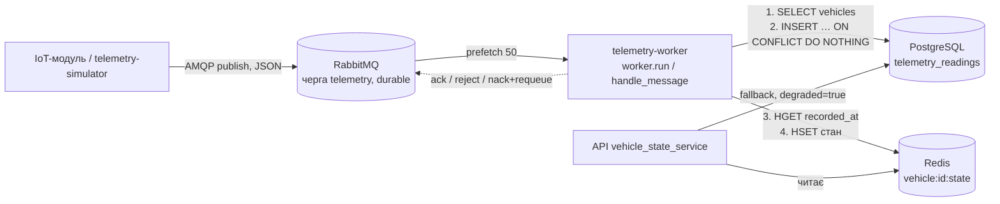

# Legacy-компонент `telemetry-worker` — відновлена документація

**Чому саме він.** Компонент написано у вересні 2026 (коміт `b18d110`, ЛР№1 DevOps) і відтоді змінено двічі (опечатка
і логування); за аудитом ЛР№10 і handover-пакетом — найгірше задокументований: у SDD йому відведено п'ять рядків,
немає runbook-а, алерта, метрик і ADR про обробку збоїв; Bus Factor = 1, «темна зона» — правила ідемпотентності й
повторів ([[handover]]). Нижче знання відновлено з коду і запусків.

**Рівні довіри:** **[V] verified** — перевірено інструментально (рядок коду, тест, запуск); **[A] assumed** —
гіпотеза, яку ще треба перевірити (і як саме).

## 1. Граф залежностей



| Хто → кого | Що | Довіра |
|---|---|---|
| RabbitMQ → worker | `queue.iterator()` над `TELEMETRY_QUEUE` (`telemetry`), `durable=True`, `prefetch_count=50` (`worker.py`, `run`) | **[V]** код |
| worker → PostgreSQL | `db.get(Vehicle)` + `INSERT … ON CONFLICT DO NOTHING` за `uq_telemetry_vehicle_recorded_at`, окремий commit на кожне повідомлення (`processor.save_reading`) | **[V]** код + тест `test_duplicate_message_is_stored_once` |
| worker → Redis | `HGET recorded_at`, потім `HSET` лише якщо дані новіші (`processor.update_vehicle_state`) | **[V]** код + тест `test_older_message_does_not_overwrite_cached_state` |
| API → Redis / PostgreSQL | API читає те, що пише worker; при недоступності Redis — останній рядок PostgreSQL з `degraded=true` | **[V]** код `vehicle_state_service` + проба інциденту |
| Хто викликає worker | ніхто напряму: процес `telemetry-worker` (console script) у контейнері `worker`; compose стартує його після `migrate`, не чекаючи API | **[V]** `docker-compose.yml` |
| Хто ще публікує в чергу | лише симулятор у sandbox; реальні трекери — зовнішня система | **[A]** перевірити у власника IoT-інтеграції |

## 2. Схема даних і формат конфігурації

**Вхідне повідомлення** — `TelemetryMessage` (`telemetry/schemas.py`, `extra="forbid"`):

```json
{"vehicle_id": 7, "recorded_at": "2026-11-20T08:00:00+00:00",
 "latitude": 50.45, "longitude": 30.52, "fuel_level": 63.5, "is_locked": true}
```

Обмеження: `vehicle_id > 0`, широта `[-90, 90]`, довгота `[-180, 180]`, `fuel_level ∈ [0, 100]`, `recorded_at` з
часовою зоною — **[V]** `tests/unit/test_telemetry_schema.py`.

**Таблиця** `telemetry_readings(id bigint PK, vehicle_id FK, recorded_at, latitude, longitude, fuel_level, is_locked)`,
унікальний ключ `(vehicle_id, recorded_at)` — **[V]** `models/telemetry.py`, міграції Alembic.
**Redis** — hash `vehicle:{id}:state` з полями `recorded_at`, `latitude`, `longitude`, `fuel_level`, `is_locked` (0/1),
без TTL — **[V]** `processor.py`; **[A]** ключі ніколи не видаляються (у тому числі для списаних авто).

**Конфігурація** (змінні оточення, `config.py` + `docker-compose.yml`):

| Змінна / константа | Значення | Довіра |
|---|---|---|
| `RABBITMQ_URL`, `TELEMETRY_QUEUE` | `amqp://…@rabbitmq:5672/`, `telemetry` | **[V]** |
| `DATABASE_URL`, `APP_ENV` | як у API (сервіс `migrate` готує схему) | **[V]** |
| `REDIS_URL` | у compose **жорстко** `redis://redis:6379/0` — worker іде в обхід toxiproxy, тому fault-injection ЛР№2 його не зачіпав | **[V]** `docker-compose.yml` |
| `CONNECT_ATTEMPTS=10`, `CONNECT_RETRY_SECONDS=3` | старт: до 30 с очікування брокера, далі `RuntimeError` → контейнер перезапускає `restart: unless-stopped` | **[V]** код; **[A]** `connect_robust` відновлює з'єднання після рестарту RabbitMQ без втрати consumer'а — не перевірено |
| `PREFETCH_COUNT=50`, `NACK_DELAY_SECONDS=1` | до 50 повідомлень у роботі; пауза 1 с перед `nack` | **[V]** код |

## 3. Призначення ключових методів

| Метод | Що робить | Результат для повідомлення | Довіра |
|---|---|---|---|
| `handle_message` | валідує JSON → `save_reading` → `update_vehicle_state` | невалідне → `reject(requeue=False)`; невідоме авто → `reject(requeue=False)`; **будь-який інший виняток** → `sleep(1)` + `nack(requeue=True)`; успіх → `ack` | **[V]** код + 5 integration-тестів |
| `save_reading` | ідемпотентний INSERT, `commit` одразу | рядок у БД **до** спроби оновити Redis | **[V]** код |
| `update_vehicle_state` | оновлює hash, якщо новіший | виняток Redis летить нагору в `handle_message` | **[V]** код |
| `run` | підключення, `set_qos`, `declare_queue`, нескінченний цикл | повідомлення обробляються **послідовно** — `sleep(1)` в одному блокує всі | **[V]** код |
| `main` / `_stop` | SIGTERM → `KeyboardInterrupt` | «м'яка» зупинка з `ack` поточного повідомлення не гарантована | **[A]** перевірити `docker stop` під навантаженням |

**Ключова гіпотеза до інциденту [A]:** «Втрата Redis не втрачає даних» (ADR-0001) справедлива і для worker'а. Код
говорить інше: при недоступному Redis кожне повідомлення вже записане в БД, але отримує `nack(requeue=True)` і повертається
в чергу, а тест `test_infrastructure_failure_requeues_message` **закріплює** таку поведінку як правильну. Гіпотезу
перевірено симуляцією збою — [[INC-001]].

## 4. Реєстр технічного боргу і ризиків

| ID | Тип боргу | Опис | Наслідки | Імовірність / вплив | Пріоритет |
|---|---|---|---|---|---|
| TD-1 | architecture | оновлення похідного кешу (Redis) зв'язане з підтвердженням повідомлення: збій кешу = повтор повідомлення | збій некритичної залежності зупиняє інжест телеметрії в джерело істини (SLI-3) | висока / високий | **P1** |
| TD-2 | architecture | немає dead-letter-черги і ліміту повторів: «отруйне» повідомлення (напр. порушення обмеження БД) повторюється нескінченно | блокування черги одним повідомленням, ріст backlog | середня / високий | **P1** |
| TD-3 | code | `except Exception` + `asyncio.sleep(1)` усередині обробника, послідовна обробка | пропускна здатність при збої падає до ~1 повідомлення/с | висока / середній | P2 |
| TD-4 | test | тести перевіряють лише «щасливий» шлях і загальний requeue; немає тесту «Redis недоступний — дані інжестяться» і тесту відновлення після рестарту брокера | дефект TD-1 закріплено тестом як правильну поведінку | — / високий | **P1** |
| TD-5 | documentation / ops | немає метрик (`/metrics`), алерта на глибину черги, runbook-а | збій виявляє лише людина (скарга / випадковий погляд) | висока / середній | **P1** |
| TD-6 | code | `REDIS_URL` worker'а захардкоджено в compose в обхід toxiproxy | fault-injection ЛР№2 ніколи не перевіряв worker | — / середній | P3 |
| TD-7 | code | ключі `vehicle:{id}:state` без TTL | «сирітські» стани списаних авто в Redis | низька / низький | P3 |

Пріоритети вдосконалення — у [[maintenance-plan]].

Пов'язано: [[INC-001]] · [[PM-001]] · [[sdd#c-worker|SDD §3.4]] · [[adr-0001-postgresql-redis-rabbitmq-storage|ADR-0001]] · #architecture #ops
