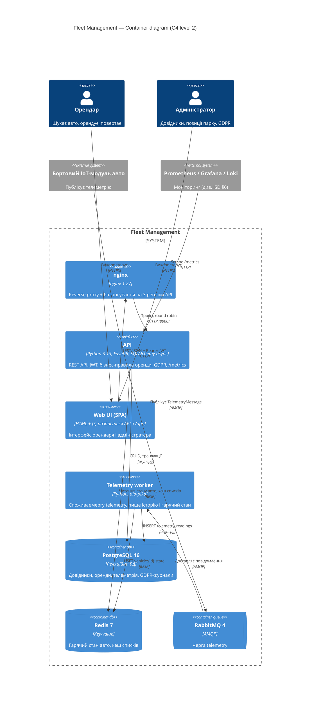
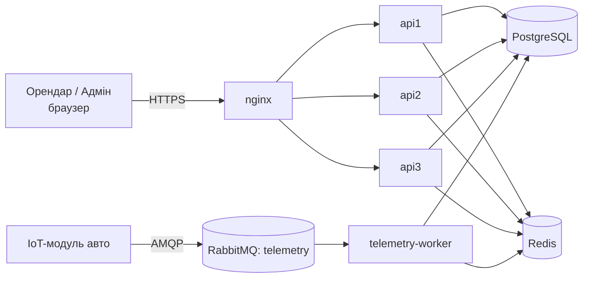
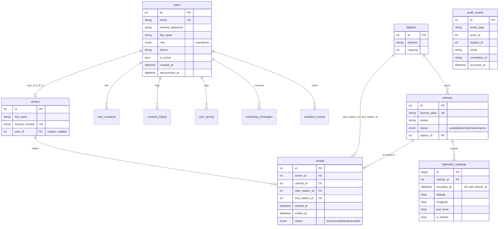

# System Design Document — Fleet Management (станційний каршерінг)

**Що це за документ:** як система влаштована *всередині* — контейнери, компоненти, дані та контракти.
Де і на чому вона працює — у [ISD](isd.md); чому прийнято саме такі рішення — в [ADR](architecture/adr/).
Документ відповідає коду гілки `main`; правило супроводу — [docs/maintenance.md](maintenance.md)
(«зміна коду = зміна документації»).

## 1. Призначення та межі системи

Компанія володіє парком авто, які клієнти орендують на короткий термін на фіксованих **станціях**. Система:

- веде довідники станцій, авто, орендарів і користувачів (ролі `user` / `admin`, JWT);
- проводить оренду: старт (авто → `rented`), завершення на станції з вільним місцем, підсумки;
- приймає безперервну **IoT-телеметрію** авто (координати, пальне/заряд, замок) через RabbitMQ і тримає
  «гарячий» стан кожного авто в Redis;
- реалізує вимоги GDPR (експорт персональних даних, анонімізація, згоди, аудит);
- віддає власний вебінтерфейс (SPA `/app`) і метрики Prometheus (`/metrics`).

## 2. C4 — контекст і контейнери



Те саме у вигляді схеми потоків (читається і там, де C4-розширення Mermaid не підтримується):



## 3. Компоненти

Кожен компонент посилається на ті, з якими взаємодіє, і на свій опис розгортання в ISD.

<a id="c-nginx"></a>
### 3.1 nginx (балансувальник)

- **Відповідальність:** єдина точка входу, розподіл запитів між `api1..api3`; алгоритм задається файлом
  `nginx/*.conf` (`round_robin` за замовчуванням, також `least_conn`, `ip_hash`, `weighted`, `single`);
  власна проба `/lb-health`.
- **Взаємодіє з:** [API](#c-api). **Розгортання:** [ISD §2.1](isd.md#isd-compose).

<a id="c-api"></a>
### 3.2 API (`src/fleet_management`)

FastAPI-застосунок, `create_app()` у `main.py`. Шари: `api/` (HTTP-роутери) → `services/` (бізнес-правила)
→ `models/` (ORM) ; `schemas.py` — Pydantic-контракти. Наскрізні механізми:

| Модуль | Відповідальність |
|---|---|
| `auth.py`, `security.py`, `api/auth.py` | Реєстрація, логін, JWT (HS256, `ACCESS_TOKEN_EXPIRE_MINUTES`), Argon2id-хеш паролів у пулі потоків; залежності `get_current_user`, `require_admin` |
| `services/rental_service.py` | Старт/завершення оренди, `calculate_cost`, знижки, `validate_rental_eligibility` |
| `services/station_service.py` | Пошук станції, підрахунок авто на станції, `has_free_slot` |
| `services/vehicle_state_service.py` | Стан авто: Redis → fallback на останній запис PostgreSQL (`degraded=true`), позиції всього парку |
| `cache.py`, `resilience.py` | Клієнт Redis, власний retry (3 спроби, таймаут 200 мс, експоненційна затримка + jitter), read-through кеш списків (TTL 30 с) |
| `services/{consent,export,erasure,marketing,audit}_service.py`, `privacy/` | GDPR: згоди з історією, експорт персональних даних, анонімізація, журнал аудиту, санітайзер логів і correlation id |
| `observability.py` | `MetricsMiddleware` (`http_requests_total{method,route,status}`, `http_request_duration_seconds`), `/metrics`, `FAIL_RATE`-інжектор для демонстрації поганого релізу |
| `web/` | Роздає SPA з `/app`, `GET /` → редірект на `/app/` |

- **Помилки:** доменні винятки мапляться в HTTP: `NotFoundError`→404, `VehicleNotAvailableError`/
  `StationFullError`/`EmailAlreadyRegisteredError`→409, `ConsentDeniedError`→403,
  `DependencyUnavailableError`→503 + `Retry-After: 5`, усе інше → 500 з `request_id` (traceback лише в лог).
- **Взаємодіє з:** [PostgreSQL](#c-db), [Redis](#c-redis); вхід — через [nginx](#c-nginx).
- **Розгортання:** [ISD §2.1](isd.md#isd-compose), [ISD §2.2](isd.md#isd-k8s).

<a id="c-ui"></a>
### 3.3 Web UI (`src/fleet_management/web/static`)

Статичний SPA (`index.html`, `js/api.js`, `js/app.js`, `js/ui.js`, `views/`), що роздається тим самим API
(один origin — CORS не потрібен). Зберігає JWT у пам'яті сторінки й викликає [REST API](#5-api-контракти).
**Розгортання:** входить в образ API ([ISD §3](isd.md#isd-images)).

<a id="c-worker"></a>
### 3.4 Telemetry worker (`src/fleet_management/telemetry`)

- `worker.py` — консольна команда `telemetry-worker`: читає чергу `TELEMETRY_QUEUE` (`telemetry`).
- `schemas.py` — контракт `TelemetryMessage` (§5.3); некоректні повідомлення відкидаються.
- `processor.py` — `save_reading()` (ідемпотентний `INSERT … ON CONFLICT DO NOTHING` за
  `uq_telemetry_vehicle_recorded_at`) і `update_vehicle_state()` (HSET лише якщо дані новіші за кеш).
- `simulator.py` — `telemetry-simulator`, генератор повідомлень для демо й навантаження.
- **Взаємодіє з:** [RabbitMQ](#c-mq), [PostgreSQL](#c-db), [Redis](#c-redis).
  **Розгортання:** [ISD §2](isd.md#isd-compose).

<a id="c-db"></a>
### 3.5 PostgreSQL 16

Основне джерело істини (модель — §4). Схема ведеться міграціями Alembic (`alembic/versions`), які виконує
одноразовий сервіс `migrate` до старту API. **Взаємодіє з:** [API](#c-api), [worker](#c-worker).
**Розгортання і бекап:** [ISD §4](isd.md#isd-storage), [ISD §7](isd.md#isd-backup).

<a id="c-redis"></a>
### 3.6 Redis 7

Похідні, відновлювані дані: `vehicle:{id}:state` (hash: `recorded_at`, `latitude`, `longitude`,
`fuel_level`, `is_locked`) і кеш списків `/stations`, `/vehicles`. Втрата Redis не втрачає даних — API
переходить у fallback на PostgreSQL. **Розгортання:** [ISD §4](isd.md#isd-storage).

<a id="c-mq"></a>
### 3.7 RabbitMQ 4

Черга `telemetry` розв'язує сенсори і запис у БД у часі (згладжує піки). Management UI — порт 15672.
**Розгортання:** [ISD §4](isd.md#isd-storage). Обґрунтування — [ADR-0001](architecture/adr/0001-postgresql-redis-rabbitmq-storage.md).

## 4. Модель даних



GDPR-таблиці `user_consents` (purpose, status, policy_version, granted_at, withdrawn_at, source),
`consent_history`, `user_activity`, `marketing_messages`, `analytics_events` — `models/privacy.py`.
Індекси для гарячих запитів: `ix_vehicles_station_id_status (station_id, status)`,
`ix_rentals_renter_id_started_at (renter_id, started_at)`. Кожен виклик GDPR-ендпоінта пише `audit_events`
(дозвіл: власник даних або admin, інакше 403).

**Інваріанти:** авто в статусі `rented` має рівно одну оренду `active`; кількість не-орендованих авто на
станції ≤ `capacity` (перевіряє `has_free_slot` при завершенні оренди).

> **Відоме обмеження (зафіксовано аудитом ЛР№10):** `start_rental` перевіряє статус авто без
> блокування рядка (`SELECT … FOR UPDATE` не використовується), тому два одночасні запити на останнє
> вільне авто теоретично можуть пройти перевірку обидва. Попередній README стверджував протилежне.

## 5. API-контракти

### 5.1 REST API (JSON; автентифікація — `Authorization: Bearer <JWT>`)

OpenAPI-схема генерується автоматично: `/docs`, `/redoc`, `/openapi.json` (лише не в production).

| Метод і шлях | Доступ | Призначення |
|---|---|---|
| `POST /auth/register` | публічний | Реєстрація (роль `user`) |
| `POST /auth/login` | публічний | OAuth2 password form → `{access_token, token_type}` |
| `GET /auth/me` | user | Поточний користувач |
| `GET /home/user`, `GET /home/admin` | user / admin | HTML-сторінки-заглушки ролей |
| `GET /admin/users` | admin | Список користувачів |
| `POST /admin/admins` | admin | Створити адміністратора |
| `GET /me/renter` | user | Профіль орендаря поточного користувача |
| `GET /me/rentals` | user | Оренди поточного користувача |
| `POST /stations` | публічний* | Створити станцію (інвалідує кеш списку) |
| `GET /stations` | публічний | Список станцій (Redis read-through, TTL 30 с) |
| `GET /stations/{station_id}` | публічний | Станція |
| `POST /vehicles` | публічний* | Додати авто на станцію (404, якщо станції нема; інвалідує кеш списку) |
| `GET /vehicles` | публічний | Список авто (кеш) |
| `GET /vehicles/positions` | admin | Позиції всього парку (Redis pipeline + fallback) |
| `GET /vehicles/{vehicle_id}` | публічний | Авто |
| `GET /vehicles/{vehicle_id}/state` | публічний | Останній стан (`source: cache\|database`, `degraded`) |
| `POST /renters` | публічний* | Створити орендаря |
| `GET /renters`, `GET /renters/{renter_id}` | публічний* | Орендарі |
| `POST /rentals/start` | публічний* | Старт оренди `{renter_id, vehicle_id}` → 201 / 409 |
| `POST /rentals/{rental_id}/end` | публічний* | Завершення `{end_station_id}` → 200 / 409 (станція повна) |
| `GET /rentals` | публічний* | Оренди (новіші першими) з розрахованою вартістю |
| `GET /rentals/summary` | публічний* | Кількість оренд за статусами |
| `GET /rentals/{rental_id}` | публічний* | Оренда |
| `GET /api/users/{user_id}/personal-data` | власник / admin | GDPR-експорт (ст. 15/20) |
| `POST /api/users/{user_id}/anonymize` | власник / admin | Анонімізація (ст. 17) |
| `POST /api/users/{user_id}/renter-profile` | власник / admin | Створити профіль орендаря |
| `GET /api/users/{user_id}/consents` | власник / admin | Поточні згоди + історія |
| `POST /api/users/{user_id}/consents/{purpose}/grant` | власник / admin | Надати згоду |
| `POST /api/users/{user_id}/consents/{purpose}/revoke` | власник / admin | Відкликати згоду |
| `POST /api/users/{user_id}/marketing-email` | власник / admin | Поставити лист у чергу (лише за згодою) → 202 |
| `POST /api/users/{user_id}/analytics-events` | власник / admin | Подія аналітики (лише за згодою) → 201 |
| `POST /api/marketing/dispatch` | admin | Обробити чергу маркетингових листів |

\* *Доменні ендпоінти поки публічні, бо від них залежать k6-сценарії (ЛР№4 Web) — відома прогалина безпеки.*

### 5.2 Службові ендпоінти

| Шлях | Призначення |
|---|---|
| `GET /livez` | liveness: процес живий (без залежностей) |
| `GET /health` | readiness: `SELECT 1` у PostgreSQL |
| `GET /info` | `{app, version, pod}` — версія образу і ім'я репліки |
| `GET /version` | версія образу (`APP_VERSION`) |
| `GET /metrics` | Prometheus exposition format |
| `GET /`, `/app/` | вебінтерфейс |

### 5.3 Контракт телеметрії (RabbitMQ, черга `telemetry`, JSON)

```json
{"vehicle_id": 7, "recorded_at": "2026-11-14T08:00:00+00:00",
 "latitude": 49.84, "longitude": 24.03, "fuel_level": 63.5, "is_locked": true}
```

`extra="forbid"`; обмеження: `vehicle_id > 0`, `latitude ∈ [-90, 90]`, `longitude ∈ [-180, 180]`,
`fuel_level ∈ [0, 100]`, `recorded_at` — з часовим поясом. Доставка «at-least-once»: повтор безпечний
завдяки унікальному ключу `(vehicle_id, recorded_at)`.

### 5.4 Внутрішні контракти між компонентами

| Від → до | Контракт |
|---|---|
| API → Redis | `HGETALL vehicle:{id}:state`; кеш списків `GET/SET` JSON з TTL; через retry-політику `resilience.py` |
| worker → Redis | `HSET vehicle:{id}:state …` лише якщо `recorded_at` новіший |
| API/worker → PostgreSQL | SQLAlchemy 2.0 async, `DATABASE_URL=postgresql+asyncpg://…` |
| Prometheus → API | `GET /metrics`, ServiceMonitor кожні 15 с ([ISD §6](isd.md#isd-monitoring)) |

## 6. Якість і перевірки

Unit- та integration-тести (`tests/`), лінтер ruff, гейти складності (CC ≤ 10, Cognitive ≤ 15),
coverage ≥ 90 % AND mutation score ≥ 75 %, SCA, gitleaks, Trivy — див. [ISD §5](isd.md#isd-cicd).
Контракти поведінки для QA: цей розділ §5 + автогенерований OpenAPI + integration-тести
`tests/integration/test_api.py`.
